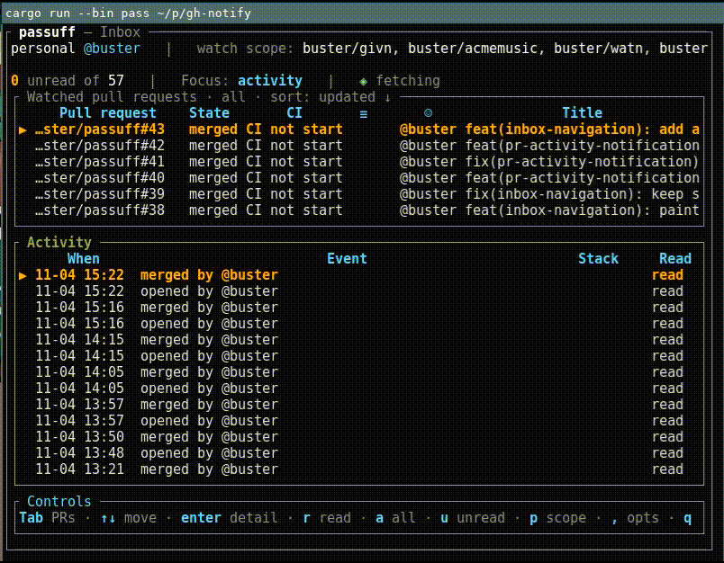

# passuff

<!-- givn:begin:coverage-badge -->
[](coverage/cobertura-coverage.xml)
[](coverage/cobertura-coverage.xml)
<!-- givn:end:coverage-badge -->

[](https://crates.io/crates/passuff)

```text
╭────────────╮
│ Pass uff!    │
╰────┬───────╯
  (☞ﾟヮﾟ)☞
```


Multi-account GitHub PR inbox and desktop notifier for your terminal.


`passuff` watches the GitHub pull requests you authored, are assigned to, or
are asked to review across several accounts and notifies you only when
something needs attention: comments and reviews by other people, failing or
recovered CI, and merged or closed pull requests. Pushes and activity on pull
requests you are not involved in stay silent; your own comments and reviews are
recorded as read without a notification. It runs on Linux and macOS, prints a
terminal transcript, raises a desktop notification, and plays a sound. One
notification is delivered per check pass: several pull requests become one
digest naming the activity count, and the default sound is three short beeps
within one second.



## Installation

```sh
cargo install passuff
```

This installs both `passuff` (the watcher) and `passuff-tui` (the terminal
inbox). Releases are source-only: `passuff-config`, `passuff-core`, and `passuff` are published to crates.io in dependency order, and a GitHub
release is created with the changelog. No prebuilt executables are attached.

## Quick start

```sh
git clone <repository-url> passuff
cd passuff
cargo build --release
```

Create `~/.config/passuff/config.toml`:

```toml
poll_interval_secs = 60
reconciliation_interval_secs = 3600 # live inbox reconciliation; default one hour

[notifications]
desktop = true
sound = true
sound_file = "default"
urgency = "normal"

[focus]
relations = ["authored", "assigned", "review-requested", "team-review-requested"]

[events]
comments = true
reviews = true
ci_failure = true
ci_recovery = true
state_changes = true
bot_comments = false

[watch]
mode = "all"               # all | selected
repositories = []          # retained selected set; empty selected = watch nothing
ignored_pull_requests = [] # owner/repo#number entries produce no activity or notifications

[accounts.personal]
auth = "gh_oauth"
github_user = "octo-personal"

[accounts.work]
auth = "github_pat"
github_user = "octo-work"
token_file = "~/.config/passuff/work.token"
```

Then run `passuff` (watch continuously) or `passuff check` (one pass). On a
fresh machine, `passuff setup` prompts for the account and watch scope and
writes the configuration; `passuff-tui` runs the same prompts when the file is
missing.

`gh_oauth` uses the token from `gh auth token --user <github_user>` and, in an
interactive watch, starts `gh auth login --web` once when no session exists.
`check` and non-interactive runs never open a browser.

`passuff notify-test` sends one notification and plays the configured sound,
reporting each enabled surface. It exits 1 if a surface fails and 2 when both
surfaces are disabled. The `[notifications]` `desktop` and `sound` booleans
mute persistently; `--no-desktop` and `--no-sound` mute one run without
changing the configuration, including the `passuff-tui` live inbox. On macOS the desktop notification goes through
Notification Center via `osascript`; allow notifications for the app that runs
the script (usually Script Editor or the terminal) in System Settings.

`github_pat` accepts exactly one of `token_env`, `token_command`, or
`token_file`. A token file must be absolute or start with `~`, and must not be
readable or writable by group or other users (`0600` or `0400`). A literal
`token` in the configuration is rejected. Configurations with only
`token_env` or `token_command` and no `auth` field remain valid personal access
token accounts.

When `github_user` is present, the resolved token must belong to that login
(case-insensitive); a mismatch is an account failure naming both logins.

<!-- givn:begin:run -->
## Run

Run the tool:

```sh
cargo run --release -p passuff -- --help
```

<!-- givn:end:run -->

## Prerequisites

- Rust stable (see `rust-toolchain.toml`; `cargo`, `rustfmt`, `clippy`).
- A GitHub token with `read:user` and repository read access for every
  configured account.
- The `gh` CLI (2.40 or newer) for `gh_oauth` accounts; `gh auth token --user`
  and `gh auth login --web` must be available.
- Linux: a session D-Bus and `paplay`, `pw-play`, `aplay`, or
  `canberra-gtk-play` for sound.
- macOS: Notification Center; sound is played with `afplay`.
- `cargo-llvm-cov` and the `llvm-tools` component for coverage reports.

## Usage

```
passuff setup               create the configuration interactively
passuff                     watch until interrupted
passuff check               run one observation pass
passuff status              show accounts, watch scope, watched PRs, unread count
passuff inbox               list unread activity
passuff inbox --all         list unread and read activity
passuff read <id>           mark one activity record read
passuff read --all          mark every activity record read
passuff notify-test         send a test notification and play the configured sound
passuff-tui                 open the inbox in a full-screen terminal UI
passuff-tui --snapshot      print one TUI frame and exit
passuff-tui --snapshot --observe  observe once, then print one frame
```

The terminal inbox groups pull requests that GitHub reports as one stack,
showing the stack base and size and each member's position; repositories where
the stacked-PRs preview is unavailable show standalone rows.

The open inbox observes the configured accounts itself: it asks GitHub for a
cheap change signal, observes only the open pull requests that changed, and
shows the result without a keypress or a second process. It also reconciles
every watched open pull request and every open assigned or review-requested pull
request at `reconciliation_interval_secs` (default one hour). The delay follows
the account's remaining API allowance, so a busy account updates more slowly
than an idle one. Running `passuff` (the watch command) at the same time is
redundant: both observe and write the same state.

`Tab` switches focus between the watched pull requests and the activity list;
the arrow keys, `j`/`k`, and `PgUp`/`PgDn` move in the focused pane, `Home`/`End`
jump to the first and last row, and the watched table scrolls. In the pull request pane, `x` ignores the selected pull
request; ignored rows stay visible with a `⊘` marker and the `x` control switches to `unignore`. `←`/`→` switch the activity between the filtered and all views, `s`/`S` cycle the
sort (updated, name, state, age) and reverse it, and `f`/`F` filter the activity
list to the selected pull request or its stack, while `u` limits it to unread
records. `c` clears the filters and `C` resets the whole view. With the activity
list focused, `r` marks the selected record read and `a` marks the visible
records read (with no filter, all of them); `enter` opens a detail overlay
listing every recorded change for that pull request together with the selected
comment or review in full; `j`/`k`, the arrow keys, `PgUp`/`PgDn`, and
`Home`/`End` scroll the overlay and the watched pull request dialog; `esc`
or `q` closes it, and `enter` in the overlay opens the pull request in your browser. `h`/`F1` shows the keys for the focused pane; `,` opens the settings dialog,
where `j`/`k` select desktop notifications or sound, `space` toggles, and `esc`
or `q` closes. Sort, filter, and notification settings are saved to `ui.json` next to
the state file when you confirm the save prompt on exit. Press `p` to open the
watch-scope picker: `j`/`k` move through
the focus relations and the repositories, `space` toggles the focused row, `m`
switches all/selected, and `esc` closes. The focus decides which watched pull
requests the inbox shows, counts, and notifies; it never changes what passuff
fetches. Scripted snapshots accept `--picker`, `--scope-select`,
`--scope-deselect`, `--scope-mode`, and `--focus-set`.

```
passuff --config PATH       use a specific configuration file
passuff --state PATH        use a specific state file
passuff --verbose           enable diagnostic logs on stderr
passuff --no-desktop        suppress desktop notifications for this run
passuff --no-sound          suppress the notification sound for this run
passuff --help              show usage
passuff --version           show the version
```

Exit codes: `0` success, `1` one or more accounts failed, `2` configuration or usage
error, `3` state failure.

The first observation of each pull request records a baseline and does not
replay historical activity. Short-lived pull requests created and merged
between two checks still notify their terminal state. Once a pull request is
merged or closed, later comments and reviews produce no notification; the
transition itself and a reopen are still reported.

## Development

Run the project-owned scripts configured in `givn/commands.yaml`:

```sh
./scripts/verify.sh          # regular Gherkin suite (non-@e2e)
./scripts/verify.sh --e2e    # @e2e smoke suite against a fake GitHub and D-Bus
./measure-coverage.sh        # writes the non-E2E and E2E Cobertura reports
./merge-coverages.sh         # combines them into the merged report
```

The Gherkin runner is `crates/passuff-cli/tests/features_runner.rs`; feature
files live under `givn/specs/` and per-change delta specs. Step definitions are
split per capability under `crates/passuff-cli/tests/steps/`.

## Contributing

- Work through the givn lifecycle: `givn status` shows the next step.
- Keep the `.feature` file as the executable source of behaviour; do not
  weaken scenarios to fit the implementation.
- Run `./scripts/verify.sh` and `./scripts/verify.sh --e2e` before a change is
  reviewed.
- One commit per coherent behaviour batch, created with `givn commit`.

## License

GPL-3.0-or-later. See `LICENSE`.

<!-- givn:begin:coverage -->
## Coverage

Merged report: [coverage/cobertura-coverage.xml](coverage/cobertura-coverage.xml)

Line coverage: 88% (6584/7443)
Branch coverage: 47% (1118/2362)

Reproduce the result:

```sh
./measure-coverage.sh
./merge-coverages.sh
```
<!-- givn:end:coverage -->
