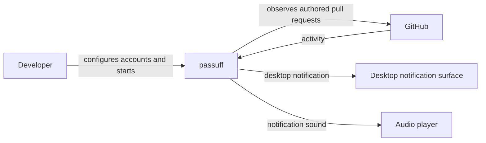
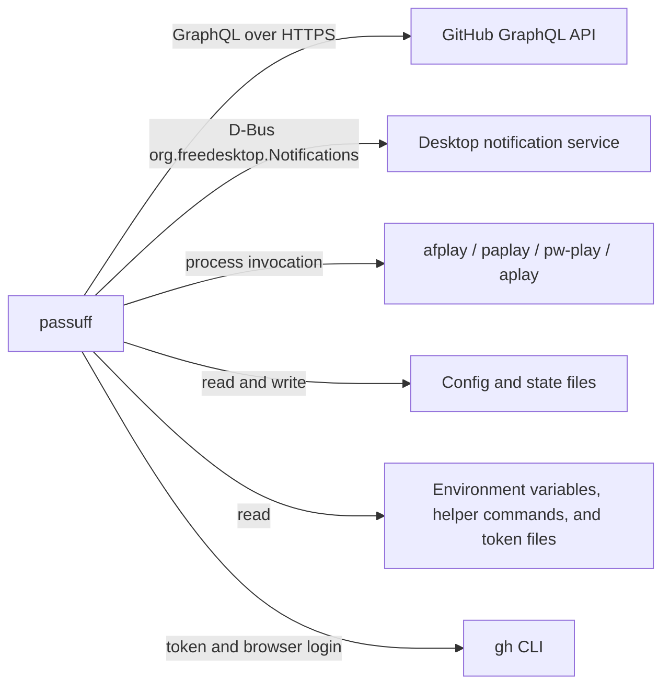

# 3. Context and Scope

## Business context

passuff sits between the developer's GitHub accounts and the local desktop. It
reads pull request activity from GitHub and turns eligible changes into
notifications. It never writes to GitHub.

| Partner / User | Input to system | Output from system |
|---|---|---|
| Developer | Account configuration, start/check command, interrupt | Grouped notification transcript, desktop notification, sound |
| GitHub | Authored pull requests, comments, reviews, CI results, pull request state | Read-only GraphQL queries; no mutations |
| Desktop notification surface | Accepted notification requests | Visible notification or a delivery error |
| Audio player | Sound file path | Audible sound or a playback error |

## Technical context

| Interface | Technology / Protocol | Direction |
|---|---|---|
| GitHub observation | GraphQL over HTTPS | Outbound |
| Desktop notification on Linux | D-Bus `org.freedesktop.Notifications` | Outbound |
| Desktop notification on macOS | macOS notification surface through `notify-rust` | Outbound |
| Sound playback | Child process: `afplay`, `paplay`, `pw-play`, or `aplay` | Outbound |
| Configuration | TOML file | Read and write |
| Persisted observation | Versioned JSON file plus atomic replacement | Read and write |
| Credentials | Environment variable, `/bin/sh -c` command output, permission-checked token file, or gh OAuth session | Read |
| Interactive authentication | gh CLI browser login (`gh auth login --web`) | Outbound, interactive |
| Terminal transcript | Standard output and standard error | Write |
| GitHub stack metadata | GraphQL `stack` and `stackEntry` fields on authored pull requests | Read-only, preview-gated |
| Status, inbox, and read | Terminal output over the local configuration and state; no GitHub call | Read and write state |
| Terminal inbox (open) | GitHub GraphQL change probe and, on a change, a check cycle; terminal rendering | Read-only GitHub, read and write state |

## Scope boundaries

Inside: authored pull request observation, activity classification, grouping,
stack membership recording, stacked inbox grouping, watch-scope editing,
first-run setup, desktop delivery, sound, configuration, state, and the CLI.

Outside: GitHub mutations, stack creation or modification, per-account watch
scope, a full repository catalog, webhooks, a hosted service, review of code
diffs, non-authored pull requests, remote push channels, Windows, and a
graphical interface.
