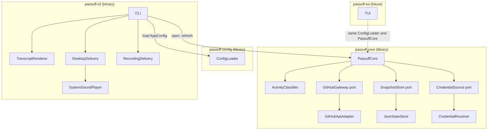

# 5. Building Block View

## Level 1 — System overview

| Building block | Responsibility |
|---|---|
| `passuff-config` | Shared TOML schema, validation, `AppConfig`, `CoreConfig`, and `NotificationsConfig`. No UI or terminal dependency. |
| `passuff-core` | UI-agnostic observation, classification, credential resolution, state, and the `RefreshReport` contract. |
| `PassuffCore` | Expose `open`, `with_gateway`, `with_ports`, and `refresh`; run one cycle over all accounts; return notifications, account failures, and baselines. |
| `ActivityClassifier` | Pure classification of comments, reviews, review comments, CI transitions, state transitions, short-lived PRs, and reopen resets. |
| `GitHubGateway` / `GitHubApiAdapter` | Port and GraphQL adapter for one account observation. |
| `SnapshotStore` / `JsonStateStore` | Port and versioned JSON persistence with atomic replacement and corruption recovery. |
| `CredentialSource` / `CredentialResolver` | Port and environment/command credential resolution; tokens never persisted. |
| `passuff-cli` | First adapter: parse arguments, load config, loop, render the transcript, deliver desktop notifications and sound, handle signals and exit codes. Its `CliRuntime` is also the regular Gherkin harness's entry point. |
| `TranscriptRenderer` | Render notifications, account failures, fresh baselines, and empty cycles as terminal text. |
| `DesktopDelivery` | Real `notify-rust` delivery; production path on Linux E2E and macOS. |
| `RecordingDelivery` | Diagnostic and macOS E2E test double. Not a production component. |
| `passuff-tui` | Future adapter: consume `passuff-config` and `passuff-core`; not present in this change. |

## Level 2 — Key building blocks

### PassuffCore

**Responsibility:** Run one check cycle and return a `RefreshReport` without
depending on any UI or delivery adapter.

**Contained elements:**

| Element | Responsibility |
|---|---|
| Account cycle | Resolve the login and credential, observe pull requests, classify, and update the account's observations. |
| Account isolation | Convert an account failure into a reported failure while other accounts continue. |
| Baseline rule | Record a baseline on the first observation of every pull request. |
| Grouping | Create at most one notification per pull request per cycle. |
| Persistence ordering | Write state before returning the report. |

### GitHubApiAdapter

**Responsibility:** Fetch authored pull request observations for one account.

**Contained elements:**

| Element | Responsibility |
|---|---|
| Main query | Viewer login plus the 100 most recently updated authored pull requests across all states. |
| Known-PR query | Fetch known open, closed, and merged pull requests that fell outside the recent window by node ID within the 30-day tracking window. |
| Pagination | Follow `pageInfo` until exhausted or the safety bound is reached. |
| Error mapping | Distinguish authentication, rate limit, timeout, transport, and malformed-response failures. |

### JsonStateStore

**Responsibility:** Load and persist the watcher state without losing the
no-replay guarantee.

**Contained elements:**

| Element | Responsibility |
|---|---|
| Load | Missing file is empty state; corrupt or wrong-version file is quarantined. |
| Save | Write a temporary file in the same directory, flush, and rename. |
| Permissions | Create the state directory and file with private Unix permissions. |
| Versioning | Reject unknown versions rather than guessing a migration. |

### ConfigLoader

**Responsibility:** Parse and validate the shared TOML document into
`AppConfig`, without resolving credentials or using a UI.

**Contained elements:**

| Element | Responsibility |
|---|---|
| Core settings | Accounts, event toggles, poll interval, GraphQL URL. |
| UI settings | Desktop, sound, sound file, urgency. |
| Validation | Unknown keys, mutual credential sources, loopback-only HTTP, sound-file existence. |

### CLI delivery

**Responsibility:** Turn one `Notification` from the core into a transcript
block, a desktop message, and at most one sound.

**Contained elements:**

| Element | Responsibility |
|---|---|
| TranscriptRenderer | Stable summary, event lines, account failures, baselines, and empty-cycle text. |
| DesktopDelivery | Platform notification delivery through `notify-rust`. |
| SystemSoundPlayer | Choose the platform player, play the bundled WAV, fall back to the XDG hint. |
| RecordingDelivery | Record the same title and body for macOS E2E and diagnostics. |
