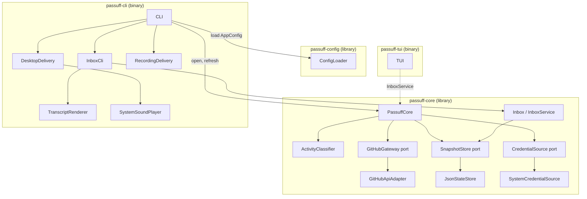

# 5. Building Block View

## Level 1 — System overview

| Building block | Responsibility |
|---|---|
| `passuff-config` | Shared TOML schema, validation, `AppConfig`, `CoreConfig`, and `NotificationsConfig`. No UI or terminal dependency. |
| `passuff-core` | UI-agnostic observation, classification, credential resolution, state, `InboxService`, and the `RefreshReport` contract. |
| `PassuffCore` | Expose `with_ports` and `refresh`; run one cycle over all accounts; validate expected logins; return notifications, account failures, and baselines. |
| `ActivityClassifier` | Pure classification of comments, reviews, review comments, CI transitions, state transitions, short-lived PRs, and reopen resets. |
| `GitHubGateway` / `GitHubApiAdapter` | Port and GraphQL adapter for one account observation. |
| `SnapshotStore` / `JsonStateStore` | Port and versioned JSON persistence with atomic replacement and corruption recovery. |
| `CredentialSource` / `SystemCredentialSource` | Port and environment/command/file/gh credential resolution; tokens never persisted. |
| `passuff-cli` | First adapter: parse arguments, load config, loop, render the transcript, deliver desktop notifications and sound, handle signals and exit codes. Its `CliRuntime` is also the regular Gherkin harness's entry point. |
| `InboxService` / `Inbox` | Build the status and activity read model over the state store and mark activity read. |
| `InboxCli` | Render `status`, `inbox`, and `read` from `InboxService`; no GitHub calls. |
| `TuiApp` / `passuff-tui` | Render the inbox with ratatui, handle keys, and mark records read through `InboxService`; `--snapshot` prints one frame. |
| `TranscriptRenderer` | Render notifications, status, inbox, account failures, fresh baselines, and empty cycles as terminal text. |
| `DesktopDelivery` | Real `notify-rust` delivery; production path on Linux E2E and macOS. |
| `RecordingDelivery` | Diagnostic and macOS E2E test double. Not a production component. |

## Level 2 — Key building blocks

### PassuffCore

**Responsibility:** Run one check cycle and return a `RefreshReport` without
depending on any UI or delivery adapter.

**Contained elements:**

| Element | Responsibility |
|---|---|
| Account cycle | Resolve the login and credential, observe pull requests, classify, and update the account's observations. |
| Account isolation | Convert an account failure into a reported failure while other accounts continue. |
| Baseline rule | Record a baseline on the first observation of every pull request. |
| Grouping | Create at most one notification per pull request per cycle. |
| Persistence ordering | Write state before returning the report. |

### GitHubApiAdapter

**Responsibility:** Fetch authored pull request observations for one account.

**Contained elements:**

| Element | Responsibility |
|---|---|
| Main query | Viewer login plus the 100 most recently updated authored pull requests across all states. |
| Known-PR query | Fetch known open, closed, and merged pull requests that fell outside the recent window by node ID within the 30-day tracking window. |
| Pagination | Follow `pageInfo` until exhausted or the safety bound is reached. |
| Error mapping | Distinguish authentication, rate limit, timeout, transport, and malformed-response failures. |

### JsonStateStore

**Responsibility:** Load and persist the watcher state without losing the
no-replay guarantee.

**Contained elements:**

| Element | Responsibility |
|---|---|
| Load | Missing file is empty state; version 1 migrates to version 2; corrupt or unknown-version files are quarantined. |
| Save | Write a temporary file in the same directory, flush, and rename. |
| Permissions | Create the state directory and file with private Unix permissions. |
| Versioning | Migrate version 1 additively; reject unknown versions rather than guessing. |

### ConfigLoader

**Responsibility:** Parse and validate the shared TOML document into
`AppConfig`, without resolving credentials or using a UI.

**Contained elements:**

| Element | Responsibility |
|---|---|
| Core settings | Accounts, event toggles, poll interval, GraphQL URL. |
| UI settings | Desktop, sound, sound file, urgency. |
| Validation | Unknown keys, one credential mode per account, mutual credential sources, gh login requirements, token-file path and permissions, loopback-only HTTP, sound-file existence. |

### Credential acquisition

**Responsibility:** Resolve one configured account to a GitHub token through its
declared credential mode, performing an interactive gh login only when the CLI
allows it.

**Contained elements:**

| Element | Responsibility |
|---|---|
| Environment source | Read a non-empty environment variable. |
| Command source | Run a helper through `/bin/sh -c` with a 10-second timeout and trim the output. |
| Token-file source | Expand `~`, require a regular file with no group/other access, read and trim the token. |
| gh OAuth source | Run `gh auth token --user <login>`, optionally retry after an interactive `gh auth login --web`, once per gh login per process. |
| Identity check | Compare the resolved token's `viewer.login` with the account's expected login before processing its pull requests. |

### Inbox

**Responsibility:** Build the watch-status and activity read model from the
persisted state and mark activity read.

**Contained elements:**

| Element | Responsibility |
|---|---|
| `InboxService` | View configured accounts, watched pull requests, and activity; mark one or all records read. |
| State version 2 | Bounded activity history (`ActivityRecord`) and a monotonic record id counter. |
| Watch scope | Global repository allowlist applied before observation; excluded pull requests are pruned. |

### CLI delivery

**Responsibility:** Turn one `Notification` from the core into a transcript
block, a desktop message, and at most one sound.

**Contained elements:**

| Element | Responsibility |
|---|---|
| TranscriptRenderer | Stable summary, event lines, account failures, baselines, and empty-cycle text. |
| DesktopDelivery | Platform notification delivery through `notify-rust`. |
| SystemSoundPlayer | Choose the platform player, play the bundled WAV, fall back to the XDG hint. |
| RecordingDelivery | Record the same title and body for macOS E2E and diagnostics. |
