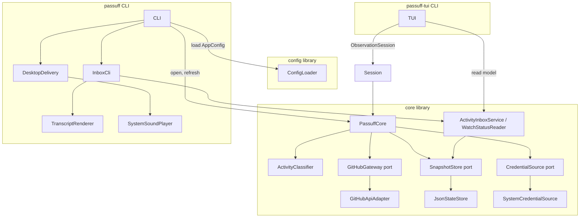

# 5. Building Block View

## Level 1 — System overview

| Building block | Responsibility |
|---|---|
| Config library | Shared TOML schema, validation, `AppConfig`, `CoreConfig`, and `NotificationsConfig`. No UI or terminal dependency. |
| Core library | UI-agnostic observation, classification, credential resolution, state, the read models, and the `RefreshReport` contract. |
| `PassuffCore` | Expose the construction, change-probe, targeted-refresh, and reconciliation-refresh entry points; compare a cheap change probe with the last successful cycle, select changed, new, transitioned, and short-lived targets, run the selected pass over all accounts, validate expected logins, and return notifications, account failures, and baselines. |
| `ActivityClassifier` | Pure classification of comments, reviews, review comments, CI transitions, state transitions, short-lived PRs, and reopen resets. |
| `GitHubGateway` / `GitHubApiAdapter` | Port and GraphQL adapter for the cheap change probe, the observation of selected node ids, and the assigned/review-requested discovery search, including GitHub-reported stack membership and the GraphQL allowance. |
| `PullRequestStack` | Value object carrying the stack number, size, position, and ultimate base on a watched pull request; absent means standalone. |
| `WatchMode` / `WatchConfig` | Explicit all/selected scope; an empty selected set observes none. |
| `ScopeEditor` | Edit the watch scope atomically and preserve unrelated configuration; the watcher derives catch-up from the previous scope and retained records. |
| `ScopePicker` | Terminal screen for the scope mode, known repositories, manual entry, and errors. |
| `SetupSession` | Line-based first-run prompts, validation, and atomic configuration creation; never stores a token. |
| `SnapshotStore` / `JsonStateStore` | Port and versioned JSON persistence with atomic replacement and corruption recovery. |
| `CredentialSource` / `SystemCredentialSource` | Port and environment/command/file/gh credential resolution; tokens never persisted. |
| `passuff` | First adapter: parse arguments, load config, loop, render the transcript, deliver desktop notifications and sound, handle signals and exit codes. The regular Gherkin harness drives this adapter as a subprocess. |
| `ActivityInboxService` / `WatchStatusReader` | Build the activity and watch-status read models over the state store; mark activity read; group stacks through `StackGrouper`. |
| `InboxCli` | Render `status`, `inbox`, and `read` from the read models; no GitHub calls. |
| `TuiApp` / `passuff-tui` | Render the inbox with the pure frame renderer and curses, group stack members by repository and stack number and order them by position, cycle focus between watched PRs and activity, scroll the watched table, apply observation updates pushed by `ObservationSession`, open the scope picker, show an activity detail overlay, return an open intent for the pull request URL, handle keys, and mark records read; the main thread owns input and redraw, and `--snapshot` prints one frame. |
| `SystemBrowserOpener` | Launch the platform browser with a pull request URL; report a missing or failing opener as a status line. |
| `ObservationSession` | Decide when to probe, when to run a targeted pass, and when the reconciliation interval has elapsed; deliver the cycle's notifications, keep the last view on failure, and hand updates to the terminal loop. |
| `TranscriptRenderer` | Render notifications, the per-pass digest, status, inbox, account failures, fresh baselines, and empty cycles as terminal text. |
| `DesktopDelivery` | Real platform notification delivery of one digest per check pass; production path on Linux E2E and macOS. |
| `RecordingDelivery` | Test double under `tests/support/recording_delivery.py` for macOS adapter tests. Not a production component and not E2E evidence. |

## Level 2 — Key building blocks

### PassuffCore

**Responsibility:** Run one check cycle and return a `RefreshReport` without
depending on any UI or delivery adapter.

**Contained elements:**

| Element | Responsibility |
|---|---|
| Target selection | Diff the accepted and pending probes; select changed open, new open, transitions, short-lived, and discovery targets. |
| Account cycle | Resolve the login and credential, observe the selected targets, classify, and merge the observations into the account's records. |
| Account isolation | Convert an account failure into a reported failure while other accounts continue. |
| Baseline rule | Record a baseline on the first observation of every pull request. |
| Grouping | Create at most one notification per pull request per cycle. |
| Persistence ordering | Write state before returning the report. |

### GitHubApiAdapter

**Responsibility:** Fetch authored pull request observations for one account.

**Contained elements:**

| Element | Responsibility |
|---|---|
| Main query | Viewer login plus the 100 most recently updated authored pull requests across all states. |
| Known-PR query | Fetch known open, closed, and merged pull requests that fell outside the recent window by node ID within the 30-day tracking window. |
| Pagination | Follow `pageInfo` until exhausted or the safety bound is reached. |
| Error mapping | Distinguish authentication, rate limit, timeout, transport, and malformed-response failures. |

### JsonStateStore

**Responsibility:** Load and persist the watcher state without losing the
no-replay guarantee.

**Contained elements:**

| Element | Responsibility |
|---|---|
| Load | Missing file is empty state; version 1 migrates to version 2; corrupt or unknown-version files are quarantined. |
| Save | Write a temporary file in the same directory, flush, and rename. |
| Permissions | Create the state directory and file with private Unix permissions. |
| Versioning | Migrate version 1 additively; reject unknown versions rather than guessing. |

### ConfigLoader

**Responsibility:** Parse and validate the shared TOML document into
`AppConfig`, without resolving credentials or using a UI.

**Contained elements:**

| Element | Responsibility |
|---|---|
| Core settings | Accounts, event toggles, poll interval, GraphQL URL. |
| UI settings | Desktop, sound, sound file, urgency. |
| Validation | Unknown keys, one credential mode per account, mutual credential sources, gh login requirements, token-file path and permissions, loopback-only HTTP, sound-file existence. |

### Credential acquisition

**Responsibility:** Resolve one configured account to a GitHub token through its
declared credential mode, performing an interactive gh login only when the CLI
allows it.

**Contained elements:**

| Element | Responsibility |
|---|---|
| Environment source | Read a non-empty environment variable. |
| Command source | Run a helper through `/bin/sh -c` with a 10-second timeout and trim the output. |
| Token-file source | Expand `~`, require a regular file with no group/other access, read and trim the token. |
| gh OAuth source | Run `gh auth token --user <login>`, optionally retry after an interactive `gh auth login --web`, once per gh login per process. |
| Identity check | Compare the resolved token's `viewer.login` with the account's expected login before processing its pull requests. |

### Inbox

**Responsibility:** Build the watch-status and activity read model from the
persisted state and mark activity read.

**Contained elements:**

| Element | Responsibility |
|---|---|
| `ActivityInboxService` | View activity and its detail; mark one or all records read. |
| `WatchStatusReader` | View configured accounts, watch scope, watched pull requests, and unread counts. |
| `StackGrouper` | Group watched pull requests by stack and order members by position. |
| State version 2 | Bounded activity history (`ActivityRecord`) with a fetch time, an optional occurrence time, the event summary, the selected comment or review body bounded at 4 KiB, each watched pull request's involvement relations, and a monotonic record id counter. |
| Watch scope | Global all/selected scope applied before observation and to the inbox/status read model; excluded records are hidden and retained in state. |

### CLI delivery

**Responsibility:** Turn one `Notification` from the core into a transcript
block, a desktop message, and at most one sound.

**Contained elements:**

| Element | Responsibility |
|---|---|
| TranscriptRenderer | Stable summary, per-pass digest with count, event lines, account failures, baselines, and empty-cycle text. |
| DesktopDelivery | Platform notification delivery of one digest per check pass. |
| SystemSoundPlayer | Choose the platform player, play the bundled WAV, fall back to the XDG hint. |
| RecordingDelivery | Record the same title and body for macOS adapter tests and diagnostics. Not E2E evidence. |
