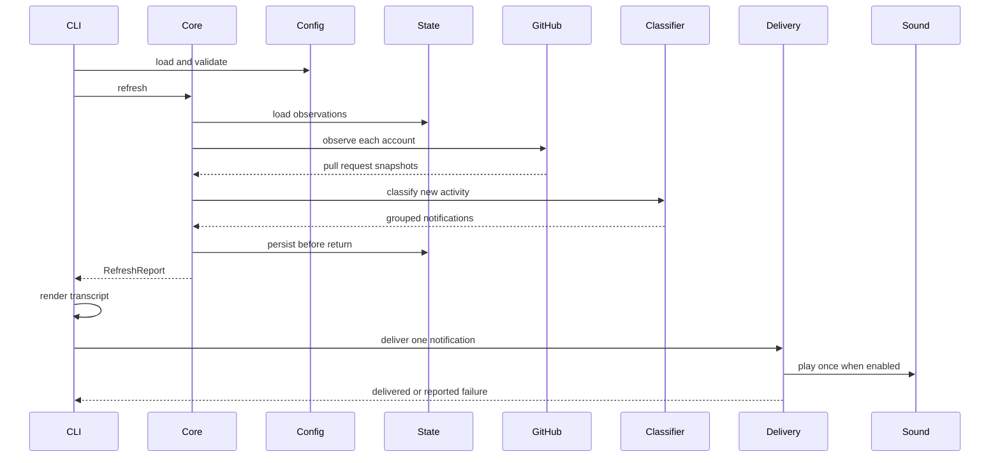
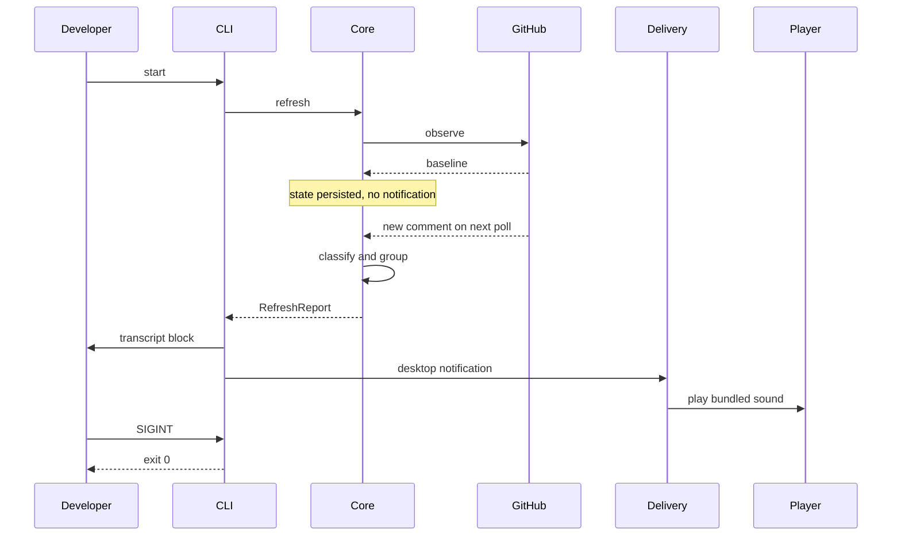
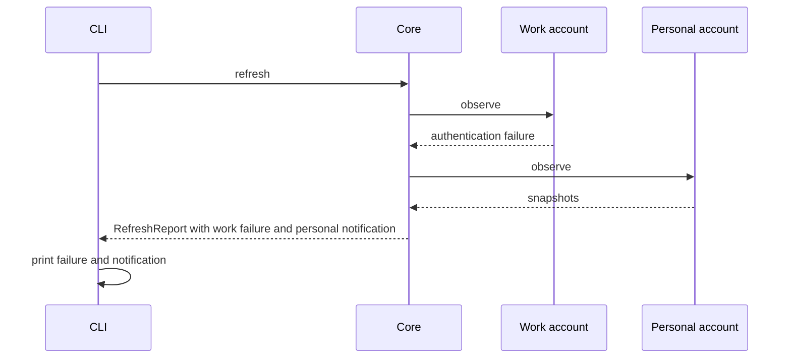

# 6. Runtime View

## Scenario: One check cycle

**Trigger:** The developer runs `passuff check` or the continuous watcher's
interval elapses.

**Steps:**

1. The CLI loads and validates configuration.
2. The CLI calls `PassuffCore::refresh`.
3. The core loads the persisted state.
4. Each account is observed independently.
5. The classifier compares snapshots with the recorded observation.
6. Events are grouped by pull request; empty groups are discarded.
7. The core persists state before returning the report.
8. The CLI prints the transcript block and invokes the delivery adapter once per
   group.
9. The sound plays once per notification when enabled.

**Notes:** The core has no delivery dependency. A state write failure returns an
error before a report exists. A delivery failure is reported but not retried;
this preserves the no-replay guarantee. An account failure is returned in the
report and does not stop the remaining accounts.

## Scenario: A new comment during continuous watching

**Trigger:** A configured account is being watched and another person comments
on an authored pull request.

**Steps:**

1. The first observation records a baseline and emits nothing.
2. The next observation sees a comment ID outside the seen set.
3. The author is outside the configured login set, so it is eligible.
4. One notification is created for the pull request.
5. The core returns the report; the CLI produces the transcript, desktop
   notification, and one sound.
6. SIGINT stops the watcher cleanly after the cycle.

**Notes:** A comment by a configured account, a push, a bot comment with bot
comments disabled, or activity on a non-authored pull request produces no
notification. A future TUI calls the same `refresh` and renders the report in
its own event loop.

## Scenario: One account fails

**Trigger:** A configured credential is invalid or the GitHub endpoint fails
for one account.

**Steps:**

1. The failing account is marked failed with an actionable message.
2. The remaining accounts are observed normally.
3. The core returns both the account failure and the healthy account's
   notifications.
4. The CLI prints the notification and the failure; `check` exits 1 because at
   least one account failed. Continuous mode logs the failure and retries on the
   next cycle.

**Notes:** A corrupt state file is quarantined and replaced with a fresh
baseline; the cycle continues. A rate-limit response reports the reset time and
skips only that account for the cycle.
