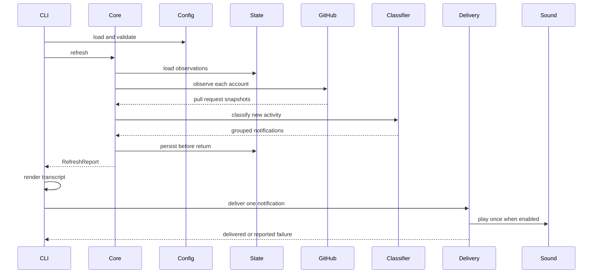
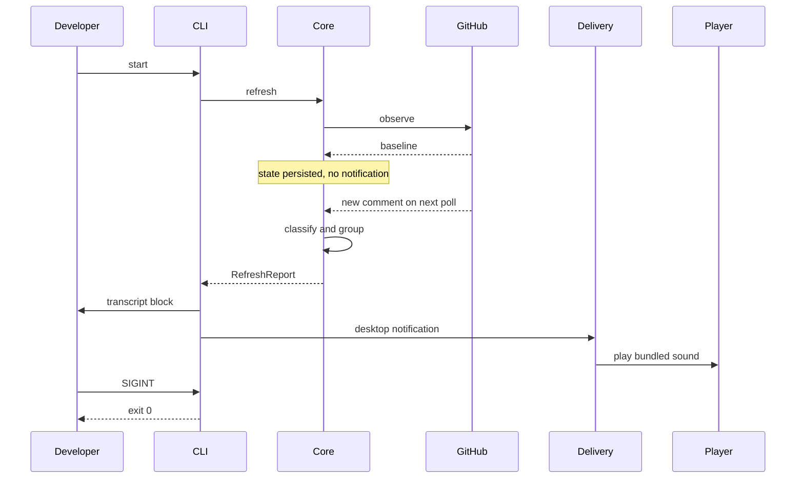
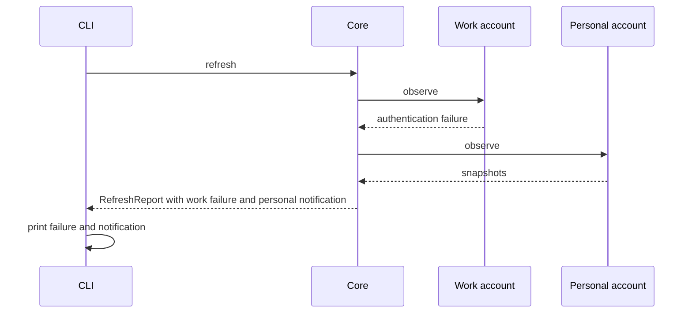
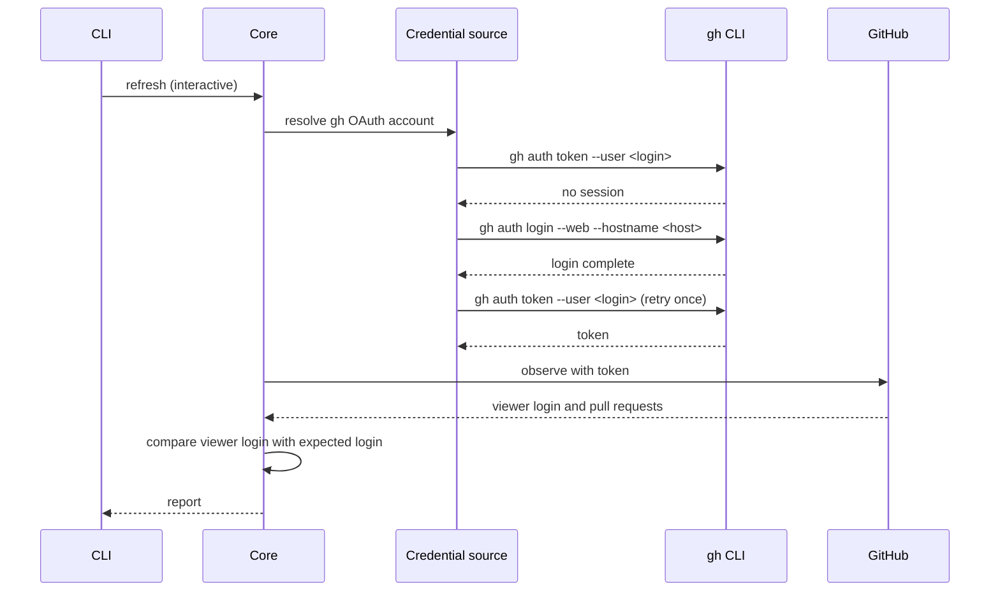
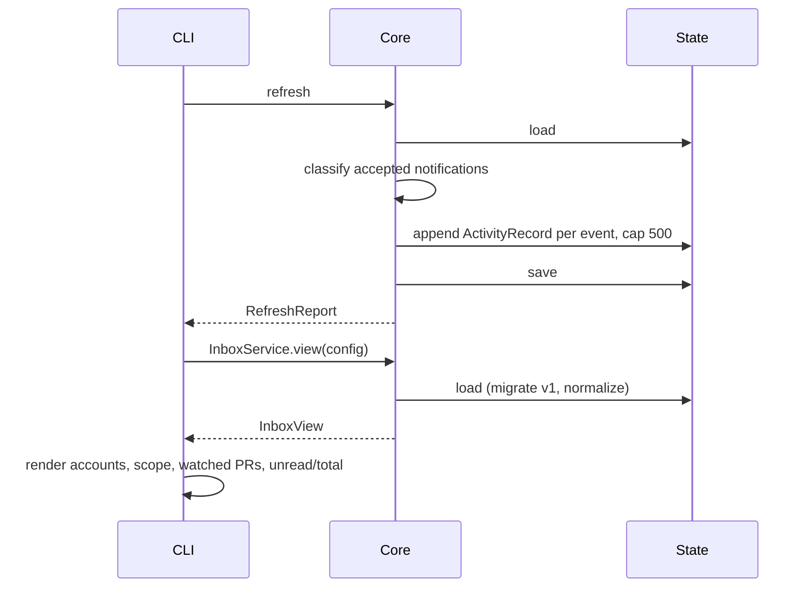

# 6. Runtime View

## Scenario: One check cycle

**Trigger:** The developer runs `passuff check` or the continuous watcher's
interval elapses.

**Steps:**

1. The CLI loads and validates configuration.
2. The CLI calls `PassuffCore::refresh`.
3. The core loads the persisted state.
4. Each account is observed independently.
5. The classifier compares snapshots with the recorded observation.
6. Events are grouped by pull request; empty groups are discarded.
7. The core persists state before returning the report.
8. The CLI prints the transcript block and invokes the delivery adapter once per
   group.
9. The sound plays once per notification when enabled.

**Notes:** The core has no delivery dependency. A state write failure returns an
error before a report exists. A delivery failure is reported but not retried;
this preserves the no-replay guarantee. An account failure is returned in the
report and does not stop the remaining accounts.

## Scenario: A new comment during continuous watching

**Trigger:** A configured account is being watched and another person comments
on an authored pull request.

**Steps:**

1. The first observation records a baseline and emits nothing.
2. The next observation sees a comment ID outside the seen set.
3. The author is outside the configured login set, so it is eligible.
4. One notification is created for the pull request.
5. The core returns the report; the CLI produces the transcript, desktop
   notification, and one sound.
6. SIGINT stops the watcher cleanly after the cycle.

**Notes:** A comment by a configured account, a push, a bot comment with bot
comments disabled, or activity on a non-authored pull request produces no
notification. The TUI renders the `InboxService` read model in its own event
loop; it never calls `refresh` and never contacts GitHub.

## Scenario: One account fails

**Trigger:** A configured credential is invalid or the GitHub endpoint fails
for one account.

**Steps:**

1. The failing account is marked failed with an actionable message.
2. The remaining accounts are observed normally.
3. The core returns both the account failure and the healthy account's
   notifications.
4. The CLI prints the notification and the failure; `check` exits 1 because at
   least one account failed. Continuous mode logs the failure and retries on the
   next cycle.

**Notes:** A corrupt state file is quarantined and replaced with a fresh
baseline; the cycle continues. A rate-limit response reports the reset time and
skips only that account for the cycle.

## Scenario: Interactive credential recovery

**Trigger:** An interactive continuous watch resolves a gh OAuth account whose
gh session is missing.

**Steps:**

1. The credential source records that a login was attempted for the gh login.
2. It runs gh's browser login with inherited stdio; gh owns the prompts and the
   browser.
3. It retries the token read once. A failure after login is an account failure.
4. The core validates the resolved login. A mismatch becomes an identity
   account failure and the account's pull requests are skipped.
5. The remaining accounts are observed normally. A one-shot check never enters
   this flow.

## Scenario: Record activity and show status

**Trigger:** A check cycle notifies, then the developer asks for status.

## Scenario: Stacked inbox

**Trigger:** The developer opens the terminal inbox with watched pull requests
that belong to a stack.

1. The observation records the stack number, size, base, and the pull request's
   position on each watched pull request.
2. `InboxService::view` returns the membership with the pull request view.
3. `TuiApp` groups members by repository and stack number, sorts by position,
   and renders one summary line per stack with base, size, and unread count.
4. Activity records stay newest first and carry the stack label; the group
   unread count sums its members.
5. A pull request without metadata, or an account whose GraphQL stack field is
   rejected, renders standalone; the observation retries once without the stack
   fields.

## Scenario: Mark activity read

**Trigger:** The developer marks one record or all records read.

1. `InboxService::mark_read` loads state, finds the id, sets `read`, and saves.
2. An unknown id returns `found = false`; the CLI prints `no activity with id`
   and exits 2.
3. `mark_all_read` sets every record read, saves, and returns the changed count.
4. A save failure is a state error (exit 3).

## Scenario: Terminal inbox

**Trigger:** The developer starts `passuff-tui`.

1. The binary loads configuration and the `InboxService` view; a configuration
   error exits 2, a state error exits 3.
2. `--snapshot` renders one frame with `TestBackend` and exits 0.
3. Interactive mode enters the alternate screen, draws the accounts, scope,
   watched pull requests, and activity list.
4. `j`/`k` adjust the selection; `r` marks the selected record, `a` everything;
   the view reloads and the selection clamps.
5. `q`/Escape restores the terminal and exits 0.
