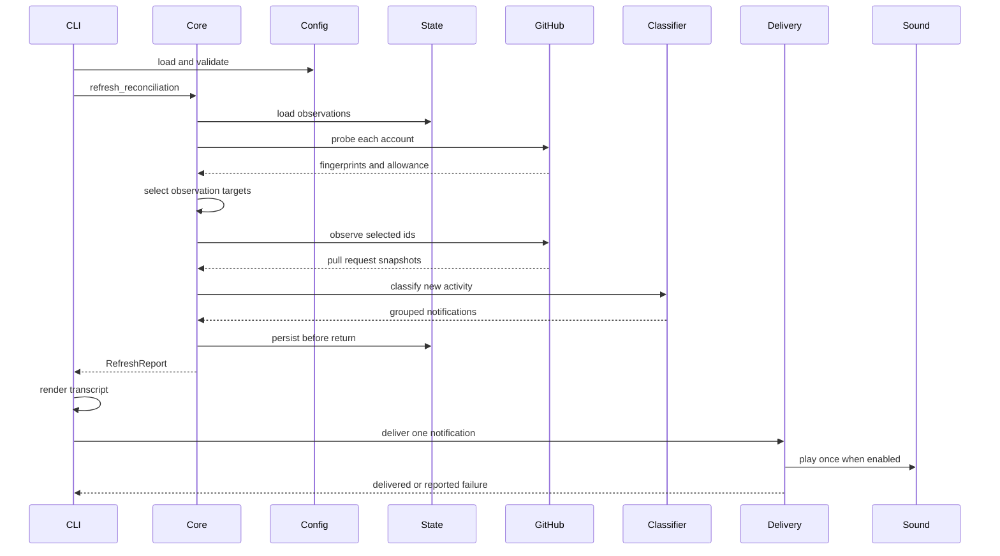
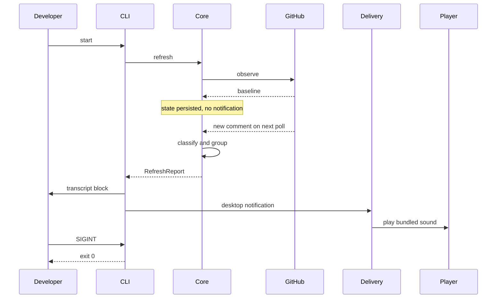
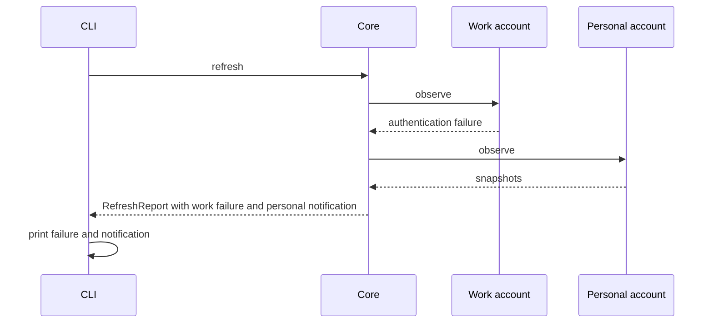
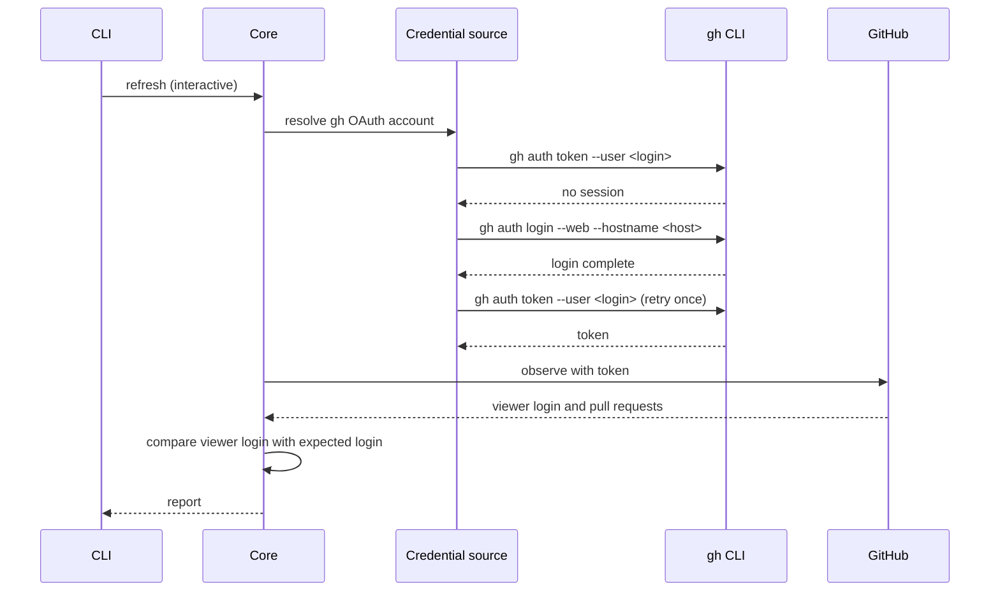
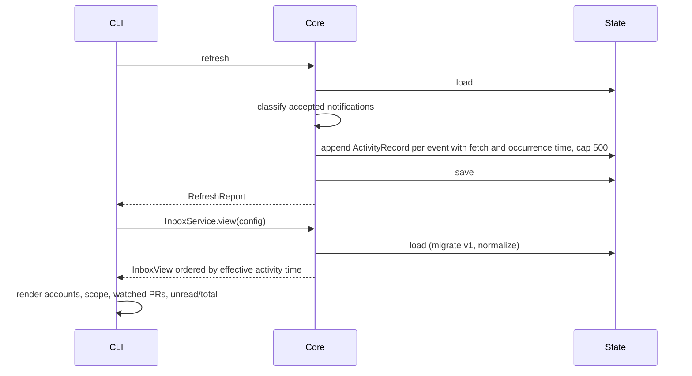

# 6. Runtime View

## Scenario: One check cycle

**Trigger:** The developer runs `passuff check` or the continuous watcher's
interval elapses.

**Steps:**

1. The CLI loads and validates configuration.
2. The CLI calls `PassuffCore::refresh_reconciliation`.
3. The core loads the persisted state.
4. The core probes each account, compares the fingerprint with the accepted one,
   and selects changed open, new open, transitioned, short-lived, and
   discovery targets; the reconciliation pass adds every watched open id and
   every open assigned/review-requested id.
5. Each account's selected ids are observed independently.
6. The classifier compares snapshots with the recorded observation.
7. Events are grouped by pull request; empty groups are discarded. A target that
   was not observed keeps its previous probe baseline and is retried.
8. The core persists state before returning the report.
9. The CLI renders one notification for a single pull request; several pull
   requests become one digest naming the total activity count. The delivery
   adapter is called once for the pass, so the sound plays once.
9. The CLI prints the transcript block and invokes the delivery adapter once per
   group.
10. The sound plays once per notification when enabled.

**Notes:** The core has no delivery dependency. A state write failure returns an
error before a report exists. A delivery failure is reported but not retried;
this preserves the no-replay guarantee. An account failure is returned in the
report and does not stop the remaining accounts.

## Scenario: A new comment during continuous watching

**Trigger:** A configured account is being watched and another person comments
on an authored pull request.

**Steps:**

1. The first observation records a baseline and emits nothing.
2. The next observation sees a comment ID outside the seen set.
3. The author is outside the configured login set, so it is eligible.
4. One notification is created for the pull request.
5. The core returns the report; the CLI produces the transcript, desktop
   notification, and one sound.
6. SIGINT stops the watcher cleanly after the cycle.

**Notes:** A comment by a configured account, a push, a bot comment with bot
comments disabled, or activity on a non-authored pull request produces no
notification. The standalone watch command and the open terminal inbox both run
check cycles; the inbox adds a cheap change probe and paces itself against the
allowance. The CLI inbox and status commands never call `refresh` and never
contact GitHub.

## Scenario: One account fails

**Trigger:** A configured credential is invalid or the GitHub endpoint fails
for one account.

**Steps:**

1. The failing account is marked failed with an actionable message.
2. The remaining accounts are observed normally.
3. The core returns both the account failure and the healthy account's
   notifications.
4. The CLI prints the notification and the failure; `check` exits 1 because at
   least one account failed. Continuous mode logs the failure and retries on the
   next cycle.

**Notes:** A corrupt state file is quarantined and replaced with a fresh
baseline; the cycle continues. A rate-limit response reports the reset time and
skips only that account for the cycle.

## Scenario: Interactive credential recovery

**Trigger:** An interactive continuous watch resolves a gh OAuth account whose
gh session is missing.

**Steps:**

1. The credential source records that a login was attempted for the gh login.
2. It runs gh's browser login with inherited stdio; gh owns the prompts and the
   browser.
3. It retries the token read once. A failure after login is an account failure.
4. The core validates the resolved login. A mismatch becomes an identity
   account failure and the account's pull requests are skipped.
5. The remaining accounts are observed normally. A one-shot check never enters
   this flow.

## Scenario: Record activity and show status

**Trigger:** A check cycle notifies, then the developer asks for status.

## Scenario: Stacked inbox

**Trigger:** The developer opens the terminal inbox with watched pull requests
that belong to a stack.

1. The observation records the stack number, size, base, and the pull request's
   position on each watched pull request.
2. `InboxService::view` returns the membership with the pull request view.
3. `TuiApp` groups members by repository and stack number, sorts by position,
   and renders one summary line per stack with base, size, and unread count.
4. Activity records stay newest first and carry the stack label; the group
   unread count sums its members.
5. A pull request without metadata, or an account whose GraphQL stack field is
   rejected, renders standalone; the observation retries once without the stack
   fields.

## Scenario: Edit the watch scope

**Trigger:** The developer opens the repository picker and toggles a
repository or switches the mode.

1. `ScopePicker` shows the mode, known repositories, selected state, and manual
   entry.
2. `ScopeEditor` updates `[watch].mode` and `[watch].repositories` with
   `toml_edit`, writes a temporary file in the same directory, and renames it.
3. The watcher compares the new scope with `WatcherState.last_scope`; a newly
   selected repository with retained watched pull requests becomes a catch-up
   repository for the next cycle.
4. `InboxService::view` filters out records outside the selected scope; the
   status view uses the same filter.
5. A running watcher reloads the configuration before its next cycle. On a
   catch-up cycle, activity is recorded as unread without a notification;
   `last_scope` advances only after a cycle without account failures.

## Scenario: First-run setup

**Trigger:** `passuff setup` runs, or `passuff-tui` starts without a configuration.

1. `SetupSession` asks for an account label, credential mode, expected login,
   and the token source for token modes.
2. It asks whether to add another account, then the watch scope.
3. It validates the answers, builds the TOML, and writes a temporary file plus
   rename; a negative replacement answer leaves an existing file unchanged.
4. `passuff setup` exits 0; the terminal UI continues to the inbox. A
   non-interactive start prints the `passuff setup` hint and exits 2.

## Scenario: Navigate the inbox

**Trigger:** The developer presses `Tab` or a movement key.

1. `Tab`/`Shift-Tab` switches focus between the watched-PR pane and activity.
2. `j`/`k` or the arrows move the selected row in the focused pane; the watched
   table scrolls and the activity selection clamps.
3. The footer names the focused pane and its keys; `▶ ` marks the selected row.
4. A key does not reload the view; observation updates arrive independently and
   restore the selected PR by key (or clamp) without changing focus.

## Scenario: Live inbox observation

**Trigger:** The terminal inbox is open; the observation task's delay expires.

1. `PassuffCore::probe` queries every authored pull request of each account,
   compares identity, update time, creation time, state, head commit, and CI
   state with the accepted probe, and reports the GraphQL allowance.
2. A known terminal pull request whose only change is its update time is not a
   target; no cycle runs for activity after the terminal state.
3. A relevant change starts a deferred targeted pass when the allowance can
   afford it; `PassuffCore::refresh_targeted` observes only the selected ids,
   records activity, `CliRuntime` delivers the notifications, and the account's
   probe baseline advances only after its observation succeeded.
4. When the configured reconciliation interval elapses, a reconciliation pass
   observes every watched open id and every open assigned/review-requested id,
   even without a probe signal.
5. The terminal loop reloads `InboxService::view`, redraws, and preserves focus
   and the selected pull request.
6. A failed probe or pass backs off and keeps the current view; the program
   continues.

## Scenario: Open an activity detail and its pull request

**Trigger:** The developer presses Enter on the focused activity, then Escape or
Enter.

1. `TuiApp::handle_key` finds the selected activity and the matching
   `PullRequestView`, and stores an `ActivityDetail` with the record, the pull
   request, and its URL.
2. The renderer draws a centered `Clear` + bordered overlay with the activity id,
   event summary, observation time, pull request key and title, state, CI result,
   stack position, read state, and the key hints. No comment or review body is
   shown.
3. Escape clears the overlay and the inbox is unchanged.
4. Enter returns `TuiAction::OpenUrl`; the binary adapter calls the platform
   opener. Success closes the overlay; a failure keeps it and sets the footer
   status line.

## Scenario: Mark activity read

**Trigger:** The developer marks one record or all records read.

1. `InboxService::mark_read` loads state, finds the id, sets `read`, and saves.
2. An unknown id returns `found = false`; the CLI prints `no activity with id`
   and exits 2.
3. `mark_all_read` sets every record read, saves, and returns the changed count.
4. A save failure is a state error (exit 3).

## Scenario: Terminal inbox

**Trigger:** The developer starts `passuff-tui`.

1. The binary loads configuration and the `InboxService` view; a configuration
   error exits 2, a state error exits 3.
2. `--snapshot` renders one frame with `TestBackend` and exits 0.
3. Interactive mode enters the alternate screen, draws the accounts, scope,
   watched pull requests, and activity list.
4. `j`/`k` adjust the selection; `r` marks the selected record, `a` everything;
   the view reloads and the selection clamps.
5. `q`/Escape restores the terminal and exits 0.
