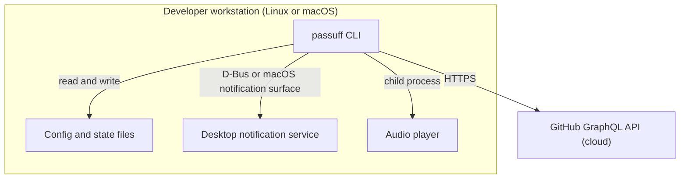

# 7. Deployment View

passuff has no server and no hosted infrastructure. It runs as a foreground
CLI on the developer's workstation.

## Infrastructure level 1

| Node / Environment | Description |
|---|---|
| Developer workstation | Runs the binary in the foreground or from a user service. Holds config, state, and the bundled sound cache. |
| GitHub cloud | Read-only GraphQL source of pull request activity. |
| Desktop notification service | XDG notification daemon on Linux; macOS notification surface on macOS. |
| Audio player | `afplay` on macOS; `paplay`, `pw-play`, `aplay`, or `canberra-gtk-play` on Linux. |

## Infrastructure level 2

### Developer workstation

| Property | Value |
|---|---|
| Hardware / VM | Any macOS or Linux machine that runs the developer's desktop session. |
| OS | macOS or a Linux desktop with a notification daemon and a sound player. |
| Middleware / Runtime | Python 3 runtime; no database, queue, or container. |
| Key software deployed | The `passuff` CLI package, importing the core and config libraries; on macOS, the `Passuff.app` bundle for a stable notification identity. |
| Configuration | `~/.config/passuff/config.toml` on Linux; `~/Library/Application Support/passuff/config.toml` on macOS. |
| State | `~/.local/state/passuff/state.json` on Linux; `~/Library/Application Support/passuff/state.json` on macOS. |
| Sound cache | Platform cache directory, written from the embedded WAV. |

## Packaging and operation

- Linux: a single installed command. The developer can run it from a terminal or a
  user-level service manager. This change does not install a system service.
- macOS: the command plus a generated `Passuff.app` bundle with
  `CFBundleIdentifier = dev.passuff.app`, `CFBundleName = passuff`, and
  `LSUIElement = true`. The bundle is the supported path for stable
  notification attribution. The command remains directly runnable for diagnostics.
- Upgrades replace the package; config and state are versioned and preserved.
- No inbound port, TLS certificate, container, or cloud resource is deployed.

The `passuff-tui` binary ships alongside `passuff` in the same package and
requires no additional service or file.
