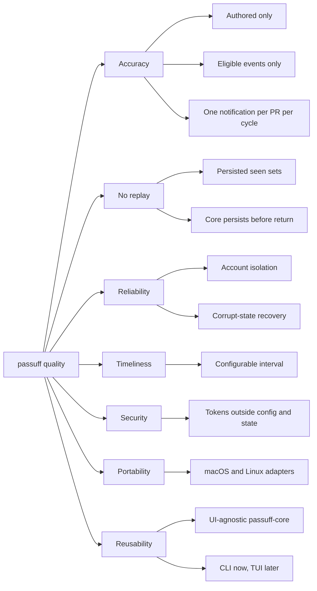

# 10. Quality Requirements

## Quality tree

## Quality scenarios

| ID | Quality attribute | Scenario | Metric / Acceptance criterion |
|---|---|---|---|
| QS-001 | Accuracy | Another person comments on an authored pull request. | Exactly one notification for that pull request; the Gherkin start and check scenarios pass. |
| QS-002 | Accuracy | A configured account comments on an authored pull request. | Zero notifications; the cross-account scenario passes. |
| QS-003 | Accuracy | A commit is pushed without a CI transition. | Zero notifications; the commit-push scenario passes. |
| QS-004 | No replay | The watcher restarts after delivering a notification. | Zero duplicate notifications; the restart scenario passes. |
| QS-005 | Reliability | One account has an invalid credential while another has eligible activity. | The healthy account still notifies; the failure is reported; the failed-account scenario passes. |
| QS-006 | Reliability | The state file is corrupt. | The file is quarantined, a fresh baseline is recorded, and the process does not crash; the corrupt-state scenario passes. |
| QS-007 | Timeliness | A comment arrives while the watcher runs with a 1-second test interval. | The notification appears within 5 seconds; the start scenario asserts it. |
| QS-008 | Security | A token from the environment is used for an account. | The token value appears in no config, state, transcript, or log; the security test greps the artifacts. |
| QS-009 | Portability | The suite runs on Linux; the macOS bundle smoke test runs on macOS. | The Linux E2E suite is green; the macOS smoke test records a delivered notification. |
| QS-010 | Correctness | CI fails and later recovers on the same commit. | One failure notification then one recovery notification; the CI scenarios pass. |
| QS-011 | Reusability | A second UI adapter is added in a follow-up. | `cargo tree -p passuff-core` contains no CLI, terminal, notification, or sound crates; the follow-up TUI consumes `PassuffCore::refresh` without core changes. |
| QS-012 | Testability | Linux E2E exercises the real desktop notification adapter. | The E2E harness starts a private D-Bus session and a mock `org.freedesktop.Notifications` service; the test asserts the `Notify` summary and body. macOS uses `RecordingDelivery` plus the manual smoke. |
| QS-013 | Recoverability | An interactive watch starts with a gh OAuth account whose session is missing. | One gh browser login is started for that account, a retry resolves the token, and the watch reaches `passuff: watching`; a check or non-interactive run starts no login and reports the account failure. |
| QS-014 | Security | A token file is readable by another local user. | The configuration is rejected with exit 2 and no observation occurs; an owner-only file is accepted, and the token value appears in no artifact. |
| QS-015 | Correctness | A token belongs to a login other than the account's expected login. | The account fails with both logins named, no pull request from that account is processed, and other accounts still notify. |
