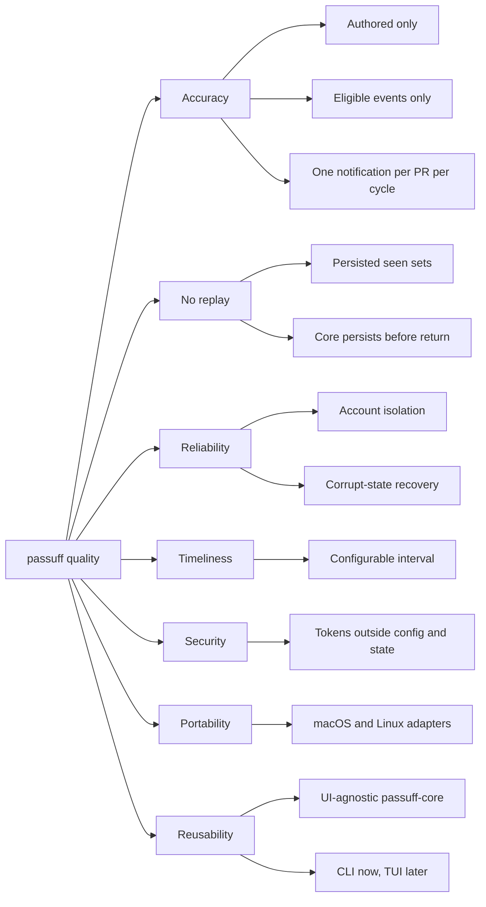

# 10. Quality Requirements

## Quality tree

## Quality scenarios

| ID | Quality attribute | Scenario | Metric / Acceptance criterion |
|---|---|---|---|
| QS-001 | Accuracy | Another person comments on an authored pull request. | Exactly one notification for that pull request; the Gherkin start and check scenarios pass. |
| QS-002 | Accuracy | A configured account comments on an authored pull request. | Zero notifications; the cross-account scenario passes. |
| QS-003 | Accuracy | A commit is pushed without a CI transition. | Zero notifications; the commit-push scenario passes. |
| QS-004 | No replay | The watcher restarts after delivering a notification. | Zero duplicate notifications; the restart scenario passes. |
| QS-005 | Reliability | One account has an invalid credential while another has eligible activity. | The healthy account still notifies; the failure is reported; the failed-account scenario passes. |
| QS-006 | Reliability | The state file is corrupt. | The file is quarantined, a fresh baseline is recorded, and the process does not crash; the corrupt-state scenario passes. |
| QS-007 | Timeliness | A comment arrives while the watcher runs with a 1-second test interval. | The notification appears within 5 seconds; the start scenario asserts it. |
| QS-008 | Security | A token from the environment is used for an account. | The token value appears in no config, state, transcript, or log; the security test greps the artifacts. |
| QS-009 | Portability | The suite runs on Linux; the macOS bundle smoke test runs on macOS. | The Linux E2E suite is green; the macOS smoke test records a delivered notification. |
| QS-010 | Correctness | CI fails and later recovers on the same commit. | One failure notification then one recovery notification; the CI scenarios pass. |
| QS-011 | Reusability | A second UI adapter is added in a follow-up. | `cargo tree -p passuff-core` contains no CLI, terminal, notification, or sound crates; the follow-up TUI consumes `InboxService` without core changes. |
| QS-012 | Testability | Linux E2E exercises the real desktop notification adapter. | The E2E harness starts a private D-Bus session and a mock `org.freedesktop.Notifications` service; the test asserts the `Notify` summary and body. macOS uses `RecordingDelivery` plus the manual smoke. |
| QS-013 | Recoverability | An interactive watch starts with a gh OAuth account whose session is missing. | One gh browser login is started for that account, a retry resolves the token, and the watch reaches `passuff: watching`; a check or non-interactive run starts no login and reports the account failure. |
| QS-014 | Security | A token file is readable by another local user. | The configuration is rejected with exit 2 and no observation occurs; an owner-only file is accepted, and the token value appears in no artifact. |
| QS-015 | Correctness | A token belongs to a login other than the account's expected login. | The account fails with both logins named, no pull request from that account is processed, and other accounts still notify. |
| QS-016 | Inspectability | The developer asks for status before and after the first check. | Before: `not resolved`, `never`, no watched pull requests, 0 unread of 0. After: login, last check, watched PRs with state/CI. Exit 0. |
| QS-017 | Reviewability | Two events are recorded, then the newest is marked read. | Inbox lists unread newest first; `read <id>` leaves 1 unread of 2; read state survives a restart. |
| QS-018 | Bounded state | The 501st activity record is recorded. | Exactly 500 records remain and the oldest is gone. |
| QS-019 | Scope | A watched PR falls outside a newly configured repository allowlist. | It is not notified, is hidden from the inbox and status, and is retained in state. |
| QS-020 | Usability | The developer opens the inbox TUI with two events. | The snapshot shows counts, accounts, scope, the PR, and both events; `r` marks the selected one, `a` all, `q` quits. |
| QS-021 | Reviewability | The developer opens the inbox for a stack of two pull requests. | The snapshot shows one stack group with base, size, positions, and aggregated unread; a standalone pull request stays flat. |
| QS-022 | Controllability | The developer toggles a repository and reselects it after activity. | The picker persists the mode and set; the deselected records are hidden; reselect records gap activity as unread without a notification. |
| QS-023 | Onboarding | A fresh machine runs passuff without a configuration. | `passuff setup` creates a validated configuration without a token value; the TUI opens; a non-terminal start points to `passuff setup`. |
| QS-024 | Navigability | The developer opens an inbox with a large stack and no activity. | `Tab` focuses the PR table; `j` reaches and scrolls to the last member; the footer names the focus; a refresh preserves the selected PR. |
| QS-025 | Timeliness | The developer leaves the inbox open and a comment arrives. | The inbox shows the comment within one observation delay without a keypress or another command; the selected pull request and focus are unchanged. |
| QS-027 | Reachability | The developer opens the detail of an activity and launches its pull request. | Enter opens a detail overlay with the recorded context; Enter launches the pull request URL through the platform opener; Escape closes the overlay; a failed launch keeps it and names the failure. |
| QS-026 | Thrift | A change is detected on one open pull request. | The check cycle observes only the selected target ids; a sparse change costs about 3-5 points instead of 31-40. The inbox widens the delay proportionally, never schedules past the reset, and defers targeted and reconciliation passes below 100 remaining points. |
| QS-028 | Accuracy | A merged or closed watched pull request receives a comment or review. | Zero notifications and no observation; the terminal transition, a short-lived pull request, and a reopen still notify. |
| QS-029 | Timeliness | An assigned pull request receives a comment with no authored change and no probe signal. | The comment is observed and notifies at the next reconciliation pass, at most one configured interval later. |
