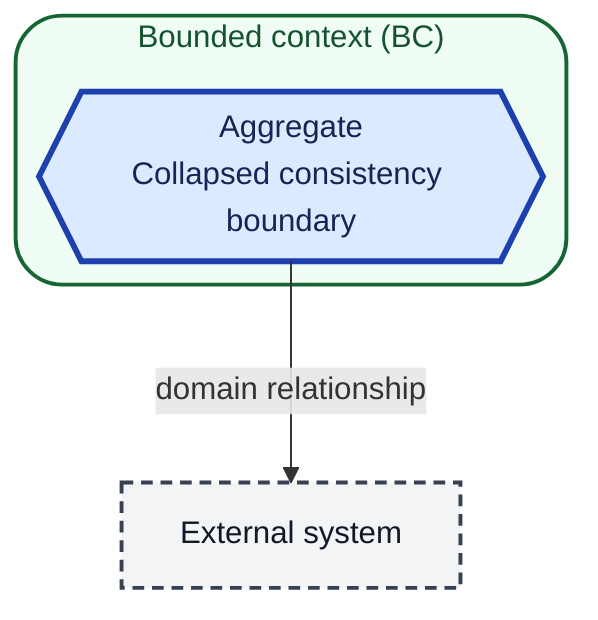
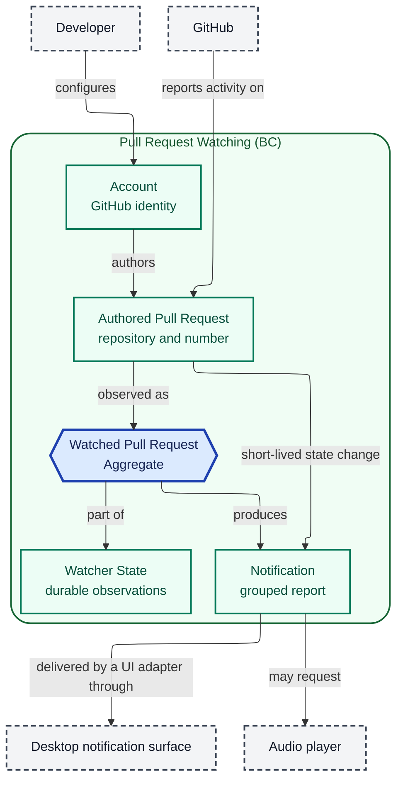

# Domain Model

## Scope and modeling status

The model covers Pull Request Watching, the domain in which a developer
configures GitHub accounts and receives notifications about activity on the pull
requests those accounts authored.

Excluded: code review of diffs, GitHub mutations (commenting, approving,
merging), delivery channels other than the local desktop surface, and
organization-level policy.

This is a proposed model for the `passuff-pr-watch` change. No implementation
exists yet; the model records the intended structure, not implemented behavior.
The core is UI-agnostic: a notification is a grouped report, and a UI adapter
delivers it. Delivery is an external relationship, not part of the Notification
value.

Account failure is a report condition, not a domain entity. Event-family
settings are configuration, not domain structure; both are defined in the
glossary and design.

## Diagram notation and legend

This is notation only, not part of the domain model. Containment shows
bounded-context membership. Read a labeled arrow from source to target; it is
not a runtime call. Shape, border, and labels carry meaning independently of
color.

## Structural overview

## Boundaries and responsibilities

| Bounded context | Responsibility | Explicitly outside its responsibility |
|---|---|---|
| Pull Request Watching | Observe authored pull requests, classify eligible activity, deduplicate it, and produce one grouped notification per pull request per check cycle. | Changing GitHub state, reviewing code, and delivering notifications beyond the local desktop surface. |

| Aggregate | Owning context | Consistency responsibility |
|---|---|---|
| Watched Pull Request | Pull Request Watching | Holds the baseline, the seen activity identities, the last CI result, and the pull request state for one authored pull request. Guarantees that an activity event is reported at most once. A short-lived pull request first seen after the first cycle is recorded as a Watched Pull Request with its state-change report already marked. |

## Relationships

| Relationship | Domain meaning | Governing contract or specification |
|---|---|---|
| Developer → Account | The developer configures one or more GitHub identities. | `watch-pull-requests` use case, R1 |
| Account → Authored Pull Request | An account authors zero or more pull requests; only authored pull requests enter the domain. | `watch-pull-requests` use case, R2 |
| Authored Pull Request → Watched Pull Request | Each observed authored pull request has one observation record with a baseline. A short-lived closed pull request first seen after the first cycle is recorded with its state-change report marked. | `watch-pull-requests` use case, R14, R26, R27 |
| Watched Pull Request → Notification | A watched pull request produces zero or one grouped notification per check cycle. | `watch-pull-requests` use case, R13 |
| Notification → Desktop notification surface | A UI adapter displays the grouped report as a local desktop message. | `watch-pull-requests` use case, Success guarantee |
| Notification → Audio player | A UI adapter may request one sound when sound is enabled. | `watch-pull-requests` use case, R24 |
| GitHub → Authored Pull Request | GitHub is the source of comments, reviews, CI results, and pull request state. | `watch-pull-requests` use case, R3–R8 |

## Open modeling questions

None. The model is complete for the approved capability. Implementation may
refine internal component names without changing these domain relationships.
