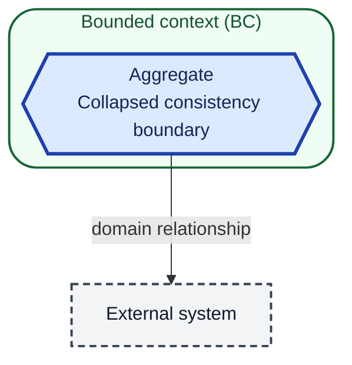
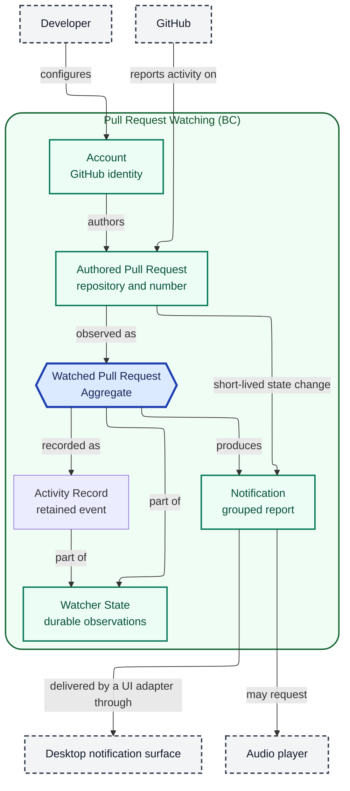

# Domain Model

## Scope and modeling status

The model covers Pull Request Watching, the domain in which a developer
configures GitHub accounts and receives notifications about activity on the pull
requests those accounts authored.

Excluded: code review of diffs, GitHub mutations (commenting, approving,
merging), delivery channels other than the local desktop surface, and
organization-level policy.

This model covers the implemented watch, status, activity-review, stack-review,
and watch-scope capabilities through the `passuff-watch-scope` change. The core is UI-agnostic: a notification is a
grouped report, and a UI adapter delivers it. Delivery is an external
relationship, not part of the Notification value. An account's credential mode
and expected login are configuration and validation attributes, not separate
domain entities; the account remains the identity that owns authored pull
requests. An activity record is a retained fact about a watched pull request;
the inbox is a read model over records and watched pull requests, not a second
aggregate. The watch scope is configuration that filters which pull requests
enter the model.

Account failure is a report condition, not a domain entity. Event-family
settings are configuration, not domain structure; both are defined in the
glossary and design.

## Diagram notation and legend

This is notation only, not part of the domain model. Containment shows
bounded-context membership. Read a labeled arrow from source to target; it is
not a runtime call. Shape, border, and labels carry meaning independently of
color.

## Structural overview

## Boundaries and responsibilities

| Bounded context | Responsibility | Explicitly outside its responsibility |
|---|---|---|
| Pull Request Watching | Observe authored pull requests, classify eligible activity, deduplicate it, and produce one grouped notification per pull request per check cycle. | Changing GitHub state, reviewing code, and delivering notifications beyond the local desktop surface. |
| Activity Review | Retain activity records and expose the watch status and inbox read model with read state. | Changing GitHub state, delivery, and configuration editing. |
| Watch Configuration | Edit the global repository scope atomically and expose the terminal picker. | Per-account scope, a full repository catalog, and changing GitHub state. |

| Aggregate | Owning context | Consistency responsibility |
|---|---|---|
| Watched Pull Request | Pull Request Watching | Holds the baseline, the seen activity identities, the last CI result, the pull request state, and the GitHub-reported stack membership for one authored pull request. Guarantees that an activity event is reported at most once. A short-lived pull request first seen after the first cycle is recorded as a Watched Pull Request with its state-change report already marked. |
| Activity Record | Activity Review | Retains one activity event with a stable id, observation time, pull request key, and read flag. The history is bounded to 500 records. |

## Relationships

| Relationship | Domain meaning | Governing contract or specification |
|---|---|---|
| Developer → Account | The developer configures one or more GitHub identities. | `watch-pull-requests` use case, R1 |
| Account → Authored Pull Request | An account authors zero or more pull requests; only authored pull requests enter the domain. | `watch-pull-requests` use case, R2 |
| Authored Pull Request → Watched Pull Request | Each observed authored pull request has one observation record with a baseline. A short-lived closed pull request first seen after the first cycle is recorded with its state-change report marked. | `watch-pull-requests` use case, R14, R26, R27 |
| Watched Pull Request → Notification | A watched pull request produces zero or one grouped notification per check cycle. | `watch-pull-requests` use case, R13 |
| Notification → Desktop notification surface | A UI adapter displays the grouped report as a local desktop message. | `watch-pull-requests` use case, Success guarantee |
| Notification → Audio player | A UI adapter may request one sound when sound is enabled. | `watch-pull-requests` use case, R24 |
| GitHub → Authored Pull Request | GitHub is the source of comments, reviews, CI results, and pull request state. | `watch-pull-requests` use case, R3–R8 |
| GitHub → Watched Pull Request (stack membership) | GitHub reports the stack number, size, position, and base; the watched pull request records them read-only. | `review-pull-request-stacks` use case, R1–R4 |
| Watched Pull Request → Activity Record | Each retained event becomes one activity record with a read flag. | `review-activity-inbox` use case, R5 |
| Activity Record → Inbox | The read model lists records newest first and counts unread. | `review-activity-inbox` use case, R1–R4 |
| Inbox → Terminal UI | A UI adapter renders the read model and marks records read. | `review-activity-inbox` use case, T1–T7 |
| Developer → Watch scope | The developer selects or deselects repositories and switches all/selected mode. | `change-watch-scope` use case, R1–R11 |
| Watch scope → Watched Pull Request / Inbox / Watch status | The scope filters observation and the visible records; excluded records are hidden and retained. | `change-watch-scope` use case, R2, R9 |
| Terminal UI → Watch scope | The picker edits the scope through `ScopeEditor`; it is a configuration-edit role separate from the read model. | `change-watch-scope` use case, Main flow |
| Watched Pull Request → Watch status | Status lists watched pull requests with state and CI. | `inspect-watch-status` use case, S3 |

## Open modeling questions

None. Pull request stack is a GitHub-reported value on the Watched Pull Request,
and the watch scope is configuration, not an aggregate. The Terminal UI has a
read-model role and a configuration-edit role; the latter is not part of
Activity Review. The model is complete for the approved capabilities.
Implementation may refine internal component names without changing these
domain relationships.
