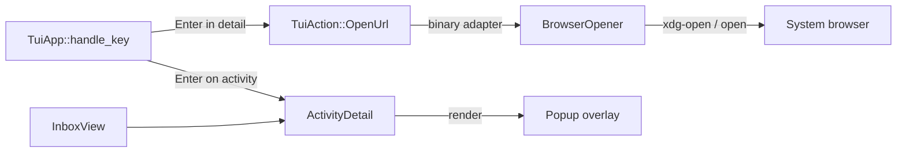

# Design: passuff-activity-detail

## Technology decisions

- Rust, existing workspace; no new dependency.
- Terminal: existing `crossterm` + `ratatui`; the popup is a `Clear` + bordered `Paragraph` overlay drawn after the inbox.
- Browser: a new `BrowserOpener` adapter in `passuff-cli` that runs the platform opener (`xdg-open` on Linux, `open` on macOS) with the pull request URL. No crate is added.
- Tests: existing `cucumber-rs` harness; the E2E injects a fake `xdg-open` into `PATH` (the same technique the sound tests use) and asserts the recorded URL.
- Versions: unchanged from `Cargo.lock`.

## Architecture impact



### Contracts and Components

| Contract | Consumer use case | Consumers | Implementing component today | Split trigger |
|---|---|---|---|---|
| `InboxService` (`view`, `mark_read`, `mark_all_read`) | review-activity-inbox | `TuiApp`, `InboxCli` | `Inbox` | a second projection is needed |
| `BrowserLaunch` (`open`) | review-activity-inbox | `passuff-tui` key handler and snapshot runner | new `SystemBrowserOpener` in `crates/passuff-cli/src/browser.rs` | a configurable or in-app browser is introduced |
| `TuiApp` key contract (`handle_key` → `TuiAction`) | review-activity-inbox | `passuff-tui` input loop, snapshot runner, Gherkin world | `TuiApp` | another front end reuses the app |

`TuiApp` owns key interpretation and popup state; the binary owns the side
effect of launching a browser. `SystemBrowserOpener` owns one external
mechanism.

## Data model

- `PullRequestView` gains `url: String`, copied from `WatchedPullRequest.url`.
  The read model still contains no comment or review body.
- New in `crates/passuff-cli/src/tui.rs`:

```rust
#[derive(Debug, Clone)]
pub struct ActivityDetail {
    pub record: ActivityRecord,
    pub pull_request: Option<PullRequestView>,
    pub url: Option<String>,
}
```

- `TuiApp` gains `popup: Option<ActivityDetail>`.
- `TuiAction` gains `OpenUrl(String)`.

## Key behaviour

In `TuiApp::handle_key`, before the existing match:

- If `popup.is_some()`:
  - `Esc` clears the popup and returns `Continue`.
  - `Enter` returns `OpenUrl(url)` when the URL is known; otherwise `Continue`.
  - Every other key is ignored (no focus, movement, read, or quit changes).
- If no popup:
  - `Enter` with `focus == Pane::Activity` and a selected record sets
    `popup = Some(ActivityDetail { record, pull_request, url })` and returns
    `Continue`.
  - `Enter` in `Pane::Watched` or with no activity returns `Continue` unchanged.
  - `Esc` keeps its current quit meaning.

An observation update reloads the inbox view but never clears an open popup: the
detail is a snapshot of the record and pull request at the moment Enter was
pressed, so a vanished activity does not make the overlay disappear underneath
the developer.

The binary's key handler (interactive and `--keys` snapshot path) handles
`TuiAction::OpenUrl`:

- `SystemBrowserOpener::open(&url)`:
  - success: `app.close_popup()`;
  - failure: `app.set_status(Some(format!("could not open browser: {error}")))`
    and the popup stays.
- `TuiAction::Quit` still exits.

## Popup rendering

`TuiApp::render` draws the inbox, then, when `popup` is `Some`, a centered
overlay: `Clear`, a bordered block titled ` Activity `, 70% of the width and 9
lines high. Content:

```
Activity a1
2026-11-02T12:00:01Z   New comment from @alice
acme/api#42            Pull request acme/api#42
State: open   CI: CI passing   Stack: 7 position 2
Read: unread
Enter open in browser   Esc close
```

Long values are clipped by the paragraph. No comment body, token, helper
command, or enum name is rendered. The footer keeps the normal inbox keys
behind the popup; the popup's own key line is the operative hint.

## Snapshot and E2E surfaces

- `--keys` accepts `enter` and `esc` in addition to the existing names.
- In the snapshot path, `enter,enter` runs the opener for real (the E2E fake
  records the URL) and then renders the frame with the popup closed.
- In-process Gherkin steps drive `TuiApp::handle_key` and apply `OpenUrl`
  through a recording/failing `BrowserOpener` held by the test World.

## Step definitions

| Step definition file | Permanent merge target |
|---|---|
| `crates/passuff-cli/tests/steps/activity_inbox_tui.rs` | same file |

New phrases: `the browser opened "<url>"`, `the browser will fail to open`.

## Test runner

- Regular: `GIVN_FEATURES=$PWD/givn/changes/passuff-activity-detail/specs GIVN_RESULT_SCOPE=change ./scripts/verify.sh`
- E2E: `GIVN_FEATURES=$PWD/givn/changes/passuff-activity-detail/specs ./scripts/verify.sh --e2e`
- Single scenario: `GIVN_SCENARIO="Developer opens the pull request from an activity" GIVN_FEATURES=$PWD/givn/changes/passuff-activity-detail/specs ./scripts/verify.sh --e2e`

Strict mode: `.fail_on_skipped()` in `features_runner.rs`; the delta scenarios
stay `@wip` until their steps exist.

## Decisions

- Decides D1: a successful browser launch closes the popup; a failed launch
  keeps it and reports the failure in the footer. Realized in the binary's
  `OpenUrl` handling and the failure scenario.
- Decides D2: Enter acts only in the activity pane with a selected record; the
  watched pane ignores it. Realized in `TuiApp::handle_key` and the
  empty-activity scenario.
- Decides D3: the platform opener is `xdg-open` on Linux and `open` on macOS,
  resolved through `PATH`; no configuration is added. A missing or failing
  opener is a reported failure, not a crash. Realized in
  `SystemBrowserOpener::open` and R-030.

## Use-case traceability

| Use-case rule | Technical decision | E2E evidence |
|---|---|---|
| T14 detail content | `ActivityDetail` + popup rendering | Developer opens an activity's details |
| T15 Escape closes | popup branch in `handle_key` | Escape closes the activity detail |
| T16 Enter opens the PR, failure keeps the popup | `TuiAction::OpenUrl` + `SystemBrowserOpener` | Developer opens the pull request from an activity |
| T17 Enter is activity-only | pane check in `handle_key` | Enter with no activity shows no detail |
| T2 Escape quits only without a popup | popup branch precedes the quit match | Escape closes the activity detail |

## Visual Design Contract

- Interface: terminal
- Viewports: 100x30 cells (existing snapshot size); the popup is 70% x 9 cells, centered
- Design system: none; the overlay uses the existing bordered-block and text styles (green title, gray border).

## Out of scope

- Comment/review bodies, browser selection, mouse input, copying.
