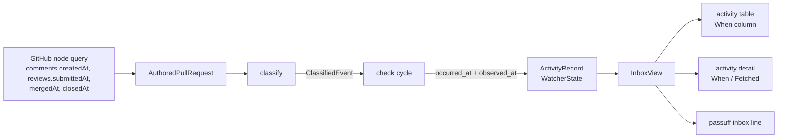

# Design: passuff-activity-time

## Scope and constraints

Record when an activity happened alongside when it was fetched, and show the
occurrence time in the terminal inbox table, the `passuff inbox` line, the
activity detail popup, and the activity ordering. No notification, discovery,
scope, or watched-table behavior changes.

## Technology decisions

| Decision | Choice | Rationale |
|---|---|---|
| Time carrier | `ActivityRecord.occurred_at: Option<String>`, RFC 3339 | The record is the durable unit; `observed_at` stays the fetch time and is the fallback. `#[serde(default)]` keeps version-2 state readable. |
| Event timestamps | `ClassifiedEvent { event, occurred_at }` returned by `classify` | Keeps `ActivityEvent` untouched, so notification grouping, transcripts, and their tests do not change. |
| Merge and close time | Add `mergedAt` and `closedAt` to the existing node query, mapped to `AuthoredPullRequest.merged_at` / `closed_at` | The state-change event's real time exists only on the pull request; no extra request is needed. |
| Missing time | `None` means GitHub reported no time; the renderers show the fetch time prefixed `~` | A CI failure or recovery has no upstream timestamp, and guessing one would be dishonest. |
| Ordering | Newest first by occurrence time, falling back to fetch time | The visible order matches the visible times. |
| Formatting | Keep `chrono` and the existing `%m-%d %H:%M`; no new dependency | Already used by `short_time`. |
| Blank upstream values | An empty `submittedAt` or timestamp maps to `None` | GitHub omits `submittedAt` for pending reviews. |

## Architecture impact



### Contracts and Components

| Contract | Consumer use case | Consumers | Implementing component today | Split trigger |
|---|---|---|---|---|
| `InboxService` (`view`, `mark_read`, `mark_all_read`) | review-activity-inbox | `TuiApp`, `InboxCli` | `Inbox` in `passuff-core::inbox` | a second projection with different ordering |
| `GitHubGateway` (`observe`, `probe`) | watch-pull-requests | `PassuffCore` cycle | `GitHubApiAdapter` in `passuff-core::github` | a second transport or provider |

`classify` is an internal helper of the cycle, not a contract: it has no
consumer outside `PassuffCore` and gains no new responsibility.

One contract per component. No component gains a second responsibility.

## Data model

- `crates/passuff-core/src/domain.rs`
  - `ActivityRecord` gains `#[serde(default)] pub occurred_at: Option<String>`.
  - `AuthoredPullRequest` gains `pub merged_at: Option<String>` and
    `pub closed_at: Option<String>`.
- `crates/passuff-core/src/classifier.rs`

```rust
#[derive(Debug, Clone)]
pub struct ClassifiedEvent {
    pub event: ActivityEvent,
    pub occurred_at: Option<String>,
}

pub struct Classification {
    pub events: Vec<ClassifiedEvent>,
    pub silent: Vec<ClassifiedEvent>,
    pub baseline: Option<Baseline>,
    pub current: CurrentObservation,
}
```

- `crates/passuff-core/src/github.rs`: the node query adds `mergedAt` and
  `closedAt` to the `... on PullRequest` selection; `GqlPr` maps them.
- `Notification.events` stays `Vec<ActivityEvent>`; the cycle builds it from the
  classified events after cloning the event, and records each event with its
  occurrence time.

## Occurrence time selection

| Event | Occurrence time |
|---|---|
| `Comment` | the comment's `created_at` |
| `ReviewComment` | the review comment's `created_at` |
| `Review` | the review's `submitted_at`, when non-empty |
| `Opened` | the pull request's `created_at` |
| `StateChange` to merged | the pull request's `merged_at` |
| `StateChange` to closed | the pull request's `closed_at` |
| `CiFailure`, `CiRecovery` | none — approximate |
| short-lived state change (R27) | the same merge or close time |

An empty upstream string maps to `None`.

## Rendering and ordering

- New helpers in `crates/passuff-core/src/inbox.rs`:

```rust
pub fn effective_time(record: &ActivityRecord) -> &str;
pub fn is_approximate(record: &ActivityRecord) -> bool;
```

`effective_time` returns `occurred_at` when present, otherwise `observed_at`.
The activity sort orders by the parsed effective time, newest first, keeping
the existing `observed_at` and index tiebreaks.

- `crates/passuff-cli/src/tui.rs`
  - `short_record_time(record) -> String`: `MM-DD HH:MM` for the effective time,
    prefixed `~` when approximate.
  - The activity table's `When` cell uses it; the column stays 12 wide
    (`~MM-DD HH:MM` is 12 characters).
  - The detail popup replaces the implicit time with one line under the pull
    request line:
    - exact: `When: MM-DD HH:MM`, followed by `Fetched: MM-DD HH:MM` only when
      the formatted fetch time differs from the formatted occurrence time
    - approximate: `When: ~MM-DD HH:MM (fetch time)`
  - The `Changes on` list uses `short_record_time` for the same record.
- `crates/passuff-cli/src/transcript.rs`: the `passuff inbox` line prints
  `occurred_at` verbatim, or `~` followed by `observed_at` when approximate.

## Decisions

No open question was recorded in the proposal. Two implementation decisions are
settled here and recorded for the reviewer:

- **CLI parity:** `passuff inbox` shows the occurrence time, not only the TUI.
  The read model is shared, and a different time in the two surfaces would be a
  contradiction, not a simplification.
- **Approximate marker:** the `~` prefix is used in both surfaces, and the
  popup adds `(fetch time)`. The benefit is that an estimate is never mistaken
  for a reported time; the cost is one column character.

## Use-case traceability

| Rule or guarantee | Technical decision | Evidence |
|---|---|---|
| R1 inbox lists newest first with the time | effective-time ordering; occurrence time in the line | `Inbox orders activity by when it happened`; `Inbox shows when a comment was written`; permanent `Inbox lists unread activity newest first` |
| T14 detail popup context | popup shows `When` and `Fetched` | `The activity detail shows when the activity happened and when it was fetched`; `The activity detail marks an activity without a reported time as approximate` |
| T7 no unrecorded content leaks | times are rendered from the record only; no body is added | existing `no comment body` assertions |
| T23-style column discipline | `When` keeps 12 characters | `The activity table shows when the activity happened`; `The activity table marks a CI failure as approximate` |
| Persona outcome: see what happened | reported time replaces the fetch time | both TUI scenarios |

## Testing strategy

- Runner: `./scripts/verify.sh` (cucumber-rs, `.fail_on_skipped()` already on
  the `Cucumber` builder in `crates/passuff-cli/tests/features_runner.rs:63`).
- Delta: `GIVN_FEATURES=$PWD/givn/changes/passuff-activity-time/specs GIVN_RESULT_SCOPE=change ./scripts/verify.sh`
- E2E: `GIVN_FEATURES=$PWD/givn/changes/passuff-activity-time/specs ./scripts/verify.sh --e2e`
  (the delta has no `@e2e` scenario, so the script falls back to the permanent
  corpus; the change adds no user action).
- Single scenario:
  `GIVN_SCENARIO="Inbox shows when a comment was written" GIVN_FEATURES=$PWD/givn/changes/passuff-activity-time/specs ./scripts/verify.sh`
- Step files: `crates/passuff-cli/tests/steps/activity_inbox.rs` (activity-inbox)
  and `crates/passuff-cli/tests/steps/activity_inbox_tui.rs` (inbox-navigation).
  New step bodies start with `unimplemented!("<phrase>")` until implemented.
- Unit tests: classifier timestamps per event kind and the empty-`submittedAt`
  case; cycle records `occurred_at`; `effective_time` and ordering; `~` marker
  in the TUI cell and the CLI line; popup lines for exact and approximate
  records.
- `record_lines` in `crates/passuff-cli/tests/steps/activity_inbox.rs:72`
  currently requires a bare `\d{4}-" timestamp; it becomes `~?\d{4}-` so an
  approximate record still counts as an inbox record for the existing
  assertions.
- Strict-mode proof: the runner calls `.fail_on_skipped()` and fails when
  `total == 0`; the setup task records the pre-implementation run failing on
  the undefined steps.

## Visual Design Contract

- Interface: terminal
- Viewports: 100x30 snapshot
- Design system: none; the existing palette and text rules in
  `givn/specs/review-activity-inbox/usecase.md` (T25)
- Screens covered: activity table `When` column; activity detail popup
- Rendered reference (activity pane focused, one exact comment and one
  approximate CI failure):

```text
┌ passuff — Inbox ─────────────────────────────────────────────────────────────────────────────────┐
│personal @octo-personal   |   watch scope: all authored pull requests                            │
│2 unread of 2   |   Focus: activity                                                              │
│                                                                                                  │
│  When         Event                                                         Stack      Read     │
│▶ 11-02 09:15  New comment from @alice: Can you split this migration?                unread     │
│  ~11-02 12:00 CI failing: build                                                     unread     │
└──────────────────────────────────────────────────────────────────────────────────────────────────┘
```

Popup reference for the exact record:

```text
┌ Activity ─────────────────────────────────────────┐
│Activity acme/api#42                              │
│acme/api#42   Pull request acme/api#42            │
│When: 11-02 09:15   Fetched: 11-02 12:00          │
│State: open   CI: CI passing                      │
│  Comment                                         │
│  Can you split this migration?                   │
│Changes on acme/api#42: 1                         │
│11-02 09:15   New comment from @alice   unread    │
└──────────────────────────────────────────────────┘
```

- Capture mechanism: `givn/changes/passuff-activity-time/evidence/visual/<scenario-slug>/transcript.txt`
  for the `@e2e` scenarios that already belong to the touched capabilities; the
  change adds no new `@e2e` scenario.

## E2E smoke test infrastructure

- E2E runner: `./scripts/verify.sh --e2e` with `GIVN_RESULT_SCOPE=e2e`.
- E2E step location: existing `crates/passuff-cli/tests/steps/activity_inbox_tui.rs`
  drives the in-process TUI snapshot; `crates/passuff-cli/tests/steps/pr_activity_notification_e2e.rs`
  drives the spawned binary.
- Local infrastructure: the existing wiremock GitHub twin and the spawned
  `passuff-tui --snapshot`; no live call.
- Strict-mode proof: `.fail_on_skipped()` plus the `total == 0` failure in the
  runner.

## Interaction Coverage Matrix

| Inventory entry | @e2e scenario title | Real interface | Driving mechanism |
|---|---|---|---|
| activity-inbox / list unread activity | Developer lists unread activity | CLI / terminal | Spawn `passuff inbox`; assert stdout and exit 0. |
| activity-inbox / mark activity read | Developer marks activity read | CLI / terminal | Spawn `passuff read --all`; assert stdout and state. |
| activity-inbox / open the inbox in the terminal UI | Developer opens the inbox TUI | CLI / terminal | Spawn `passuff-tui --snapshot --observe`; assert the frame. |
| activity-inbox / open an activity's detail | Developer opens an activity's details | CLI / terminal | Spawn `passuff-tui --snapshot --keys "enter"`; assert the frame. |
| activity-inbox / open the pull request from an activity | Developer opens the pull request from an activity | CLI / terminal | Spawn `passuff-tui --snapshot --keys "enter,enter"` with a fake opener. |
| inbox-navigation / navigate the watched pull requests and activity | Developer navigates the inbox panes | CLI / terminal | Spawn `passuff-tui --snapshot --keys`; assert the frame. |
| inbox-navigation / leave the inbox open while activity arrives | The inbox shows activity observed while it is open | CLI / terminal | Spawn `passuff-tui --snapshot --observe-for` against a live wiremock change. |

No inventory entry is added or removed: the `When` cell, the popup line, and
the CLI line are variants of existing actions.

## Coverage process boundaries

| Process | Started by | Instrumented artifact | Profile output | Merge step | Non-zero production probe |
|---|---|---|---|---|---|
| test runner and in-process TUI | `./measure-coverage.sh` | `target/llvm-cov-target/debug/deps/features_runner-*` | `%p-%m.profraw` | `cargo llvm-cov report`; `scripts/json_to_cobertura.py` | `classifier.rs` timestamp selection and `tui.rs` `short_record_time` |
| `passuff-tui` / `passuff` child processes | `./measure-coverage.sh` (e2e scope) | `target/llvm-cov-target/debug/passuff-tui`, `passuff` | `e2e-child-%p-%m.profraw` | same | `transcript.rs` inbox line |

Measured: production sources under `crates/*/src`. Excluded: tests, support
harness, generated code. Not changed after the first run.

## External boundary cases

- A review with an empty `submittedAt`: occurrence time unknown → approximate.
- A merge or close without `mergedAt`/`closedAt` (GitHub omits them in some
  transitions): unknown → approximate.
- A timestamp that does not parse as RFC 3339: the renderer falls back to the
  raw string; ordering falls back to `observed_at`.
- A state file written before this change (no `occurred_at`): records load with
  `None` and render as approximate.
- A state file with an unknown version: existing quarantine behavior is
  unchanged.
- A CI failure and a CI recovery in the same check: both approximate, both
  ordered by the fetch time with the existing index tiebreak.

## Local runnability

- One pass: `cargo run -p passuff-cli -- --config <path> --state <path> check`.
- Inbox: `cargo run -p passuff-cli -- --config <path> --state <path> inbox --all`.
- TUI snapshot: `cargo run -p passuff-cli --bin passuff-tui -- --config <path> --state <path> --snapshot --keys "tab,enter"`.
- Tests use the wiremock GitHub twin; no live third-party call.

## Risks

- Upstream omission of `mergedAt`/`closedAt`: the event shows an approximate
  time rather than a wrong one.
- Mixing reported and fetch times in one list can place an approximate event
  above a reported event that happened later; this is inherent and is visible
  through the `~` marker.
- `AuthoredPullRequest` gains two fields; every fixture constructor is updated,
  which touches test support but no behavior.
