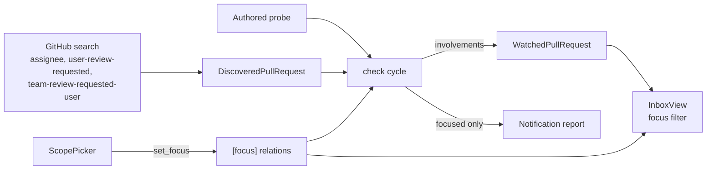

# Design: passuff-involvement-focus

## Scope and constraints

Record why each watched pull request is watched, persist a focus set of those
relations, and apply the focus to the inbox read model and notification
production. Fetching and discovery stay unchanged. The watch-scope screen gains
the focus toggles and loses the manual repository entry.

## Technology decisions

| Decision | Choice | Rationale |
|---|---|---|
| Relation enum | `Involvement { Authored, Assigned, ReviewRequested, TeamReviewRequested }` in `passuff-core::domain`, serialized `kebab-case` | One vocabulary shared by the state, the configuration, and the view; the config value is the domain value. |
| Discovery result | `DiscoveredPullRequest { node_id, involvements }` on `AccountObservation` | The reason is known exactly where the search runs; a bare node-id list loses it. |
| Search split | `assignee:@me` → assigned; `user-review-requested:@me` → review requested; `team-review-requested-user:@me` → team review requested | The documented qualifiers separate direct from team requests; `review-requested:@me` merges both and is dropped. |
| Authored | Derived in the cycle from `author == login`, not from a search | The probe already returns the viewer's authored pull requests. |
| Stored relations | `WatchedPullRequest.involvements: Vec<Involvement>` with `#[serde(default)]` | Survives cycles in which discovery does not report the pull request; old state loads with an empty list. |
| Relation refresh | Replace when the cycle's discovery reports the node; otherwise keep the previous set; always union `Authored` for the account | A reconciliation pass reports the current relations; a targeted pass reports only new nodes. |
| Focus config | `[focus] relations = [...]`, mapped to `CoreConfig.focus`; absent → all four | The cycle and the read model both see it; an old configuration behaves exactly as today. |
| Empty focus | Nothing that has a known relation is shown or notified; unknown relations stay visible | An explicit empty set is a deliberate silence, and legacy records must not vanish on upgrade. |
| Notification gate | In `PassuffCore`'s cycle, around `report.notifications.push` | One gate for the TUI and `check`; the activity records are still appended before it. |
| View gate | `Inbox::view_from_state`, for pull requests and for activity by key lookup | Every consumer of `InboxService` (`passuff status`, `inbox`, the TUI) follows the same rule. |
| Picker | One cursor over the relation rows then the repository rows; `space` toggles the row, `m` switches the scope mode | The screen owns one persisted scope; no second screen. |
| Manual entry | Removed: the `Add:` buffer, insert mode, `ScopeEditor::add`, `--scope-add`, the `type owner/name` hint, and their steps | A manually entered repository could never contribute a pull request; observation needs an authored or involved pull request there. |
| E2E focus action | `passuff-tui --focus-set <relations>` (comma-separated) | A deterministic real-process action for the picker capability, matching the existing `--scope-*` surface. |

## Architecture impact



### Contracts and Components

| Contract | Consumer use case | Consumers | Implementing component today | Split trigger |
|---|---|---|---|---|
| `InboxService` (`view`, `mark_read`, `mark_all_read`) | review-activity-inbox | `TuiApp`, `InboxCli` | `Inbox` in `passuff-core::inbox` | a second projection with different filtering |
| `GitHubGateway` (`observe`, `probe`) | watch-pull-requests | `PassuffCore` cycle | `GitHubApiAdapter` in `passuff-core::github` | a second transport or provider |
| `WatchScope` (`select`, `deselect`, `set_mode`, `set_focus`) | change-watch-scope | `ScopePicker`, scripted `passuff-tui` flags, interactive loop | `ScopeEditor` in `passuff-cli::scope` | a second configuration format or per-account scope |

`ScopeEditor` owns the persisted scope; the picker and the binary flags are its
two consumers. The core never reads the picker.

## Data model

- `crates/passuff-core/src/domain.rs`

```rust
#[derive(Debug, Clone, Copy, PartialEq, Eq, PartialOrd, Ord, Hash, Serialize, Deserialize)]
#[serde(rename_all = "kebab-case")]
pub enum Involvement {
    Authored,
    Assigned,
    ReviewRequested,
    TeamReviewRequested,
}

impl Involvement {
    pub fn all() -> [Involvement; 4];
    pub fn label(&self) -> &'static str; // "authored", "assigned", "review requested", "team review"
}
```

- `WatchedPullRequest` gains `#[serde(default)] pub involvements: Vec<Involvement>`.
- `PullRequestView` gains `pub involvements: Vec<Involvement>`.
- `AccountObservation.involved_node_ids: Vec<String>` becomes
  `pub discovered: Vec<DiscoveredPullRequest>`, with
  `pub struct DiscoveredPullRequest { pub node_id: String, pub involvements: Vec<Involvement> }`.

- `crates/passuff-config/src/lib.rs`

```rust
#[derive(Debug, Clone, PartialEq, Eq, Deserialize)]
#[serde(default, deny_unknown_fields)]
pub struct FocusConfig {
    pub relations: Vec<Involvement>,
}

impl Default for FocusConfig {
    fn default() -> Self { Self { relations: Involvement::all().to_vec() } }
}

impl FocusConfig {
    /// Unknown relations stay visible; an empty focus matches nothing known.
    pub fn includes(&self, involvements: &[Involvement]) -> bool {
        involvements.is_empty() || involvements.iter().any(|i| self.relations.contains(i))
    }
}
```

`CoreConfig` gains `pub focus: FocusConfig`. The TOML table is top-level
`[focus]`, parsed into `CoreConfig.focus`; an absent table yields the default.

## Discovery

`observe_with` runs three searches on a discovery pass:

| Query | Involvement |
|---|---|
| `is:pr is:open assignee:@me` | `Assigned` |
| `is:pr is:open user-review-requested:@me` | `ReviewRequested` |
| `is:pr is:open team-review-requested-user:@me` | `TeamReviewRequested` |

Each result is deduplicated by node id and keeps the union of matching
relations. A failed search logs at `warn` with the query and continues with the
others; it does not fail the account. The discovery filter (`Discovery::New`
versus `All`) applies as today.

In the cycle, for every observed pull request:

1. start from the involvements the current discovery reported for its node id;
2. if the discovery reported nothing this cycle, keep the stored involvements;
3. add `Authored` when the author is the account login;
4. store the result and use `config.focus.includes` to decide whether a
   notification is pushed. Activity records are appended regardless.

## Read model

`Inbox::view_from_state` builds a map of pull request key → involvements from
state, filters `pull_requests` with `focus.includes`, and filters activity to
records whose key is visible. A record whose key is absent from state is
retained (compatibility). `unread` is computed after filtering. The sort and the
occurrence time from the previous change are unchanged.

## Watch-scope picker

Rows in order:

```text
Focus:
  [x] authored
  [x] assigned
  [x] review requested
  [x] team review

Repositories:
▶ [x] acme/api
  [ ] acme/web
```

- One cursor index spans the four relation rows then the known repositories.
  `j`/`k` and the arrow keys move it; the repository rows keep `▶`.
- `space` toggles the focused row: a relation calls `ScopeEditor::set_focus`,
  a repository calls `select`/`deselect`.
- `m` still switches all/selected; the mode line and footer are unchanged apart
  from the removed add hints.
- The `Add:` line, insert mode, the `i` key, `enter`-to-add, and the
  `type owner/name` hint are removed.
- The footer becomes `↑↓ move · space toggle · m mode · esc/q close`.

### Removed surfaces

- `ScopeEditor::add`; `--scope-add` on `passuff-tui`; the `enters` step and the
  `Adding a repository by owner/name` scenario (removed with a placeholder).
- The permanent e2e `Developer toggles a repository in the watch scope` loses
  its manual-entry steps (modified).

### New surfaces

- `ScopeEditor::set_focus(&[Involvement]) -> Result<(), ScopeError>` writes
  `[focus] relations` with `toml_edit`.
- `passuff-tui --focus-set <relations>` sets the focus before the view loads;
  unknown values exit 2 with a message naming the accepted values.

## Decisions

The proposal records no open question. Implementation decisions settled here:

- **Gate placement:** notification gating in the cycle, not in delivery. The
  cycle knows the stored relations and records activity in the same step; a
  delivery-layer gate would need the read model again.
- **Unknown relations:** visible and notifiable. The alternative — hide them
  until observed — would empty the inbox of a long-time user the moment the
  configuration gains a `[focus]` table.
- **Manual entry:** deleted rather than repaired. Repairing it would need an
  observation mode that fetches every pull request in a repository, which is a
  different capability.

## Use-case traceability

| Rule or guarantee | Technical decision | Evidence |
|---|---|---|
| watch-scope R12 focus relations and default | `Involvement`, `FocusConfig::default` | `The picker shows the focus relations`; config unit test |
| R13 focus changes no observation | Discovery and cycle record before the gate; no fetch depends on `focus` | `A pull request outside the focus produces no notification` |
| R14 unknown relations visible | `includes` returns true for an empty relation list | unit test |
| R9 inbox shows only focused PRs | `Inbox::view_from_state` filter and unread recomputation | `Inbox hides activity outside the focus` |
| TUI watched table follows the focus | the same filtered `InboxView` | `The watched table hides a pull request outside the focus` |
| pr-activity-notification R11 | cycle notification gate | `A pull request outside the focus produces no notification` |
| watch-scope manual entry removed | picker and flag removal | `Developer toggles a repository in the watch scope` (modified); removed scenario |
| Persona outcome: less team-queue noise | focus defaults and toggles | picker snapshot + inbox scenario |

## Testing strategy

- Runner: `./scripts/verify.sh`; strict `.fail_on_skipped()` unchanged.
- Delta: `GIVN_FEATURES=$PWD/givn/changes/passuff-involvement-focus/specs GIVN_RESULT_SCOPE=change ./scripts/verify.sh`
- E2E: `GIVN_FEATURES=$PWD/givn/changes/passuff-involvement-focus/specs ./scripts/verify.sh --e2e`
- Single scenario:
  `GIVN_SCENARIO="A pull request outside the focus produces no notification" GIVN_FEATURES=$PWD/givn/changes/passuff-involvement-focus/specs ./scripts/verify.sh`
- Step files: `crates/passuff-cli/tests/steps/watch_scope.rs` (watch-scope),
  `crates/passuff-cli/tests/steps/activity_inbox.rs` (activity-inbox),
  `crates/passuff-cli/tests/steps/activity_inbox_tui.rs` (inbox-navigation),
  `crates/passuff-cli/tests/steps/pr_activity_notification.rs`
  (pr-activity-notification).
- New phrases start as `unimplemented!` until implemented:
  `the developer focuses on "..."`, `the focus relations are "..."`,
  `the picker does not show "..."`, `a team review is requested on "..."`,
  plus the `at` variant already bound by the previous change.
- Unit tests: `FocusConfig` default, inclusion, and unknown relations; config
  parsing of `[focus]`; picker snapshot with the focus rows and without the add
  field; `ScopeEditor::set_focus` persistence; discovery query tags and
  deduplication; the cycle gate; the read-model filter and unread count.
- Strict-mode proof: the setup task records the failing pre-implementation run.

## Visual Design Contract

- Interface: terminal
- Viewports: 100x30 snapshot
- Design system: the existing palette and text rules (review-activity-inbox T25)
- Screens covered: watch-scope picker
- Rendered reference (selected mode, focus narrowed to authored and assigned):

```text
┌ passuff — Watch scope ───────────────────────────────────────────────────────────────────────────┐
│Mode: selected   (m switches all/selected)                                                        │
│                                                                                                  │
│Focus:                                                                                            │
│  [x] authored                                                                                    │
│  [x] assigned                                                                                    │
│  [ ] review requested                                                                            │
│  [ ] team review                                                                                 │
│                                                                                                  │
│Repositories:                                                                                     │
│▶ [x] acme/api                                                                                    │
│  [ ] acme/web                                                                                    │
│                                                                                                  │
│↑↓ move · space toggle · m mode · esc/q close                                                     │
└──────────────────────────────────────────────────────────────────────────────────────────────────┘
```

- Capture mechanism: the `@e2e` scenario
  `Developer narrows the focus in the watch scope` writes
  `givn/changes/passuff-involvement-focus/evidence/visual/<scenario-slug>/transcript.txt`.

## E2E smoke test infrastructure

- E2E runner: `./scripts/verify.sh --e2e` with `GIVN_RESULT_SCOPE=e2e`.
- E2E step location: the same four capability step files; the spawned binary is
  `passuff-tui --snapshot --picker --focus-set ...`.
- Local infrastructure: temp config/state paths, no GitHub call for the picker.
- Strict-mode proof: `.fail_on_skipped()` plus the runner's `total == 0` failure.

## Interaction Coverage Matrix

| Inventory entry | @e2e scenario title | Real interface | Driving mechanism |
|---|---|---|---|
| watch-scope / toggle a repository in the watch scope | Developer toggles a repository in the watch scope | CLI / terminal | Spawn `passuff-tui --snapshot --picker --scope-select/--scope-deselect`; assert config and stdout. |
| watch-scope / switch the watch scope mode | Developer switches the watch scope mode | CLI / terminal | Spawn `passuff-tui --snapshot --picker --scope-mode all/selected`; assert config and stdout. |
| watch-scope / narrow the focus to a subset of involvement relations | Developer narrows the focus in the watch scope | CLI / terminal | Spawn `passuff-tui --snapshot --picker --focus-set authored,assigned`; assert config and the picker frame. |
| actor / start continuous watching | Developer starts watching and is notified of a new comment | CLI / terminal | Spawn `passuff` in watch mode against the wiremock twin. |
| actor / run one observation pass | Developer runs a single check and sees the current activity | CLI / terminal | Spawn `passuff check`. |
| actor / show usage | Developer asks for usage | CLI / terminal | Spawn `passuff --help`. |
| actor / show version | Developer asks for the version | CLI / terminal | Spawn `passuff --version`. |
| actor / test the notification surfaces on the command line | The developer tests notifications on the command line | CLI / terminal | Spawn `passuff notify-test`. |
| activity-inbox / list unread activity | Developer lists unread activity | CLI / terminal | Spawn `passuff inbox`. |
| activity-inbox / mark activity read | Developer marks activity read | CLI / terminal | Spawn `passuff read --all`. |
| activity-inbox / open the inbox in the terminal UI | Developer opens the inbox TUI | CLI / terminal | Spawn `passuff-tui --snapshot --observe`. |
| activity-inbox / open an activity's detail | Developer opens an activity's details | CLI / terminal | Spawn `passuff-tui --snapshot --keys "enter"`. |
| activity-inbox / open the pull request from an activity | Developer opens the pull request from an activity | CLI / terminal | Spawn `passuff-tui --snapshot --keys "enter,enter"` with a fake opener. |
| inbox-navigation / navigate the watched pull requests and activity | Developer navigates the inbox panes | CLI / terminal | Spawn `passuff-tui --snapshot --keys`. |
| inbox-navigation / leave the inbox open while activity arrives | The inbox shows activity observed while it is open | CLI / terminal | Spawn `passuff-tui --snapshot --observe-for` against a live wiremock change. |

No inventory entry is unmapped and no extra `@e2e` scenario is added: the new
focus action has exactly one.

## Coverage process boundaries

| Process | Started by | Instrumented artifact | Profile output | Merge step | Non-zero production probe |
|---|---|---|---|---|---|
| test runner and in-process picker | `./measure-coverage.sh` | `target/llvm-cov-target/debug/deps/features_runner-*` | `%p-%m.profraw` | `cargo llvm-cov report`; `scripts/json_to_cobertura.py` | `scope.rs` focus writer and `inbox.rs` focus filter |
| `passuff-tui` / `passuff` child processes | `./measure-coverage.sh` (e2e scope) | `target/llvm-cov-target/debug/passuff-tui`, `passuff` | `e2e-child-%p-%m.profraw` | same | `scope.rs` picker render and focus flag |

Measured: production sources under `crates/*/src`. Excluded: tests, support
harness, generated code. Not changed after the first run.

## External boundary cases

- A search query the token or GitHub version rejects: logged at `warn`, the
  other queries still run, the account is not failed.
- A pull request discovered by two queries: deduplicated, both relations kept.
- An old state file with no involvements: visible and notifiable.
- A `[focus]` value that is not one of the four: configuration error, exit 2.
- An empty `relations` list: known relations are all excluded; unknown
  relations remain visible.
- `--focus-set` with an unknown value: exit 2 naming the accepted values.
- An activity record whose pull request is missing from state: kept.
- A failed focus write: previous focus kept, error reported, view unchanged.

## Local runnability

- Picker: `cargo run -p passuff-cli --bin passuff-tui -- --config <path> --state <path>`; press `p`.
- Scripted snapshot: add `--snapshot --picker --focus-set authored,assigned`.
- One pass: `cargo run -p passuff-cli -- --config <path> --state <path> check`.
- Inbox: `cargo run -p passuff-cli -- --config <path> --state <path> inbox --all`.
- Tests use the wiremock GitHub twin; no live third-party call.

## Risks

- `team-review-requested-user:@me` may be unavailable on an older GitHub
  Enterprise version; that search fails, team-requested pull requests stop being
  discovered, and nothing is notified or shown for them. The failure is logged.
- Focus is global; a developer who wants different focuses per account cannot
  express it, matching the existing global repository scope.
- Removing `--scope-add` breaks a script that used it; the flag was a test and
  observer surface, and no observation path could use it.
- A stale relation on a pull request that no longer matches anything is kept
  until a reconciliation pass reports the current set; the read model may show
  it under the old relation.
