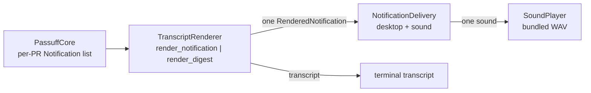

# Design: passuff-notification-digest

## Technology decisions

- Language: Rust, existing workspace; no new dependency.
- Delivery and rendering: the existing `TranscriptRenderer`, `NotificationDelivery`, `SoundPlayer`, and `render_delivery_errors` paths.
- Sound asset: replace the bundled PCM WAV (`crates/passuff-cli/assets/notification.wav`) with a generated 1.0 s file; the player selection is unchanged.
- Test runner: the existing cucumber-rs harness with the delta scenarios and unit tests.

## Architecture impact

The core keeps one `Notification` per pull request (`passuff_core::domain::Notification`); classification and the `RefreshReport` contract do not change. The change is in the CLI delivery adapter: `CliRuntime::process_report` renders the whole pass once and calls the delivery port once.

A single pull request with one event keeps `render_notification` and the existing title/body. A single pull request with several events uses the count title. More than one pull request uses `render_digest`.

## Digest format

Counts use the total number of `ActivityEvent`s in the pass and the number of notifications (pull requests).

- One notification, one event:
  - title `passuff: <key>`
  - body: the event line
  - transcript: the existing block
- One notification, `n > 1` events:
  - title `passuff: <n> activities on <key>`
  - body: `<n> activities on <key>` followed by the event lines
  - transcript: the title followed by the event lines
- More than one notification:
  - title `passuff: <n> activities in <m> pull requests`
  - body: the title line, then `<key>: <count> activit(y|ies)` for the first five pull requests, then `+<k> more pull requests`
  - transcript: the title, then for every pull request its key line and its event lines, with the existing two-space event indentation
  - plural rules: `1 activity` / `2 activities`; `1 pull request` / `2 pull requests`

The transcript is never truncated by the desktop cap; it always lists every pull request and event.

## Delivery

`process_report`:

1. Render the digest (`render_digest`) when `report.notifications.len() > 1`; otherwise `render_notification`.
2. Call `NotificationDelivery::deliver` exactly once for the pass.
3. Append the rendered transcript, then the delivery errors and sound outcome from the single report.
4. Baselines, account failures, and the no-change line keep their current order.

The sound plays once per delivered notification, which is once per pass. `notify-test` keeps its single delivery.

## Sound asset

`crates/passuff-cli/assets/notification.wav`:

- PCM, mono, 44.1 kHz, 16-bit.
- Total 1.0 s (44,100 frames).
- Three 120 ms beeps at 880 Hz, starting at 0 ms, 340 ms, and 680 ms, each with a 20 ms linear fade in and out.
- Peak amplitude about 0.3 full scale, leaving headroom.

A unit test in `crates/passuff-cli/src/sound.rs` reads the asset with `include_bytes!`, parses the RIFF/WAVE header, asserts a 1.0 s duration, and counts three non-silent regions separated by silence.

## Step definitions

No new phrases. The delta scenarios reuse:

- `an authored pull request "<key>" by "<login>"`, `the watcher has already observed "<a>" and "<b>"`, `"<login>" comments "<text>" on "<key>"`, `passuff runs one check`
- `the transcript reports "<text>"`, `the transcript reports one notification for "<key>"`, `the notification mentions ...`, `the desktop notification reports "<text>"`, `the configured sound is played once`

Files stay `crates/passuff-cli/tests/steps/pr_activity_notification.rs` and the existing support fixtures.

## Test runner

- Regular: `GIVN_FEATURES=$PWD/givn/specs ./scripts/verify.sh`
- Delta: `GIVN_FEATURES=$PWD/givn/changes/passuff-notification-digest/specs GIVN_RESULT_SCOPE=change ./scripts/verify.sh`
- E2E: `./scripts/verify.sh --e2e`
- Single scenario: `GIVN_SCENARIO="Activity on two pull requests produces one digest notification" GIVN_FEATURES=$PWD/givn/changes/passuff-notification-digest/specs cargo test -p passuff --features test-support --test features_runner`

Strict mode: `.fail_on_skipped()` is already set. The change adds no `@e2e` scenario; the digest is an output variant of the existing check action, and the in-process fake records the desktop delivery and sound calls.

## Decisions

- Decides D1: one digest heading with the per-pull-request event detail in the terminal transcript. Realized in `TranscriptRenderer::render_digest` and `process_report`.
- Decides D2: a single pull request with multiple events names the count in title and body. Realized in `render_notification`.
- Decides D3: the desktop body lists at most five pull requests and then `+N more pull requests`; the transcript lists all. Realized in `render_digest`.
- Decides D4: the bundled default is three 120 ms beeps inside a 1.0 s WAV. Realized in the asset and its unit test.

## Use-case traceability

| Use-case rule | Technical decision | Evidence |
|---|---|---|
| R13 grouping per pass | one delivery per pass; digest when several notifications | Activity on two pull requests produces one digest notification |
| R13 count and detail | count title/body; transcript keeps events | Multiple events on one pull request produce one notification; the digest scenario |
| R24 sound once per delivered notification | one `deliver` call; existing sound port | The digest scenario's `the configured sound is played once` |
| R42 digest body cap | five count lines plus `+N more`, transcript complete | `render_digest` unit tests |
| R43 three short beeps in one second | generated 1.0 s WAV | `the_bundled_sound_is_three_short_beeps_in_one_second` |

## Interaction coverage

| Inventory entry | Matrix row | Scenario | Layer |
|---|---|---|---|
| watch-pull-requests / run one observation pass | yes | Developer runs a single check and sees the current activity (permanent) | E2E, unchanged |
| watch-pull-requests / start continuous watching | yes | Developer starts watching and is notified of a new comment (permanent) | E2E, unchanged |

The digest is a variant of the check action, so it is a regular scenario; the existing `@e2e` action evidence is unchanged.

## Visual Design Contract

- Interface: terminal and desktop notification text.
- Viewports: terminal 100x30; the desktop banner is text-only.
- Design system: none; the TUI layout is unchanged. The change is visible as notification text and the bundled sound.

## External boundary cases

- Desktop delivery unavailable: the digest delivery reports the existing error once.
- Sound player unavailable: the existing unavailable outcome is reported once; the digest still delivers.
- Sound disabled or desktop disabled: unchanged toggles.
- A digest with more than five pull requests: the desktop cap, the transcript complete.
- A single event: the previous text is preserved.

## Out of scope

- Changing event classification or the per-pull-request `Notification` type.
- The inbox/history UI.
- User-configurable digest size.
- Custom sound files.
