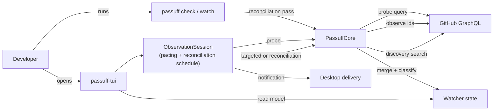

# Design: passuff-observation-targets

## Technology decisions

- Language: Rust, existing workspace; no new crate, runtime, or dependency.
- Async runtime: the existing `tokio` runtime in `passuff` and `passuff-tui`.
- HTTP: the existing `reqwest` client and `GitHubApiAdapter`.
- Test runner: the existing `cucumber-rs` harness (`crates/passuff-cli/tests/features_runner.rs`) with `wiremock` for the E2E GitHub boundary.
- Versions: no dependency is added or upgraded; versions stay as pinned in `Cargo.lock`.

## Query shapes and costs

The change replaces the full-observation page with a probe-driven target set. Three query shapes remain; `MAIN_QUERY` is removed.

| Query | Purpose | Fields | When | Cost (operator account) |
|---|---|---|---|---|
| `PROBE_QUERY` | Change signal and target identity | `rateLimit`, viewer login, authored pull requests in all states (`first: 100`, paginated), `id`, `number`, `updatedAt`, `createdAt`, `state`, `merged`, `repository`, `commits(last: 1)` with `oid` and rollup `state` | Every probe tick and at the start of each headless check pass | 1 point measured |
| `NODES_QUERY` | Observation by node id | The current deep observation fields: title, body, state, CI contexts, comments/reviews/threads, stack, labels, assignees, milestone | Every targeted cycle and every reconciliation pass, only for selected ids | About 0.6-0.8 points per observed pull request; 31-40 for the old 50-PR page |
| `SEARCH_QUERY` ×2 | Discovery of assigned and review-requested pull requests | `is:pr is:open assignee:@me`, `is:pr is:open review-requested:@me`, returning node ids | Every targeted cycle and every reconciliation pass | 1 point each |

The probe gains `createdAt` and `state` (plus `merged` for the mapping). `createdAt` is immutable per pull request and selects short-lived ones; `state` turns an `updatedAt`-only change on a terminal pull request into a non-target. The probe already paginates up to ten pages, so it also covers accounts with more than 100 authored pull requests.

Expected cost after the change:

- A probe tick with no target: 1 point (unchanged).
- A targeted cycle for one changed open pull request: two searches plus one observation, about 3-5 points, instead of 31-40.
- A reconciliation pass with zero open and zero involved pull requests: about 2 points (the two searches).
- A reconciliation pass with `n` open watched and `m` involved open pull requests: about `2 + 0.6 × (n + m)` points.

## Architecture impact

The core stops being a full-snapshot observer on every cycle. It selects observation targets from the probe diff and the persisted watch state, observes those ids, merges the results into the existing state, and commits each account's probe baseline only after its observation succeeded.



### Contracts and Components

| Contract | Consumer use case | Consumers | Implementing component today | Split trigger |
|---|---|---|---|---|
| `GitHubGateway` (`probe`, `observe(ids)`, `search`) | watch-pull-requests | `PassuffCore` for the watch command and the terminal inbox | `GitHubApiAdapter` | a second external provider is supported |
| `PassuffCore` (`probe`, `refresh_targeted`, `refresh_reconciliation`) | watch-pull-requests | `CliRuntime`, `ObservationSession` | `PassuffCore` in `crates/passuff-core/src/cycle.rs` | a second observation strategy is supported |
| `LiveObservation` (`tick`, `next_delay`, reconciliation schedule) | review-activity-inbox | `passuff-tui` input loop | `ObservationSession` in `crates/passuff-cli/src/live.rs` | the headless watch command adopts the same pacing |
| `InboxService` (`view`, `mark_read`) | review-activity-inbox | terminal inbox, CLI inbox/read | `Inbox` | a second read-model consumer needs different projections |

`PassuffCore` keeps one responsibility: select observation targets, observe them, classify, and commit. `ObservationSession` keeps one responsibility: decide when to probe, when to target, and when to reconcile. The terminal inbox keeps input and rendering.

## Data model

`crates/passuff-core/src/domain.rs`:

```rust
pub struct ProbePullRequest {
    pub repository: String,
    pub number: u64,
    pub node_id: String,
    pub updated_at: String,
    pub created_at: String,
    pub head_oid: String,
    pub ci_state: Option<CiState>,
    pub state: PrState,
}

pub enum Discovery {
    None,
    New,   // observed assigned/review-requested ids not already watched
    All,   // every open assigned/review-requested id
}

pub struct ChangeSignal {
    pub changed: bool,
    pub allowance: Option<ApiAllowance>,
    pub failures: Vec<AccountFailure>, // probe failures per account
}
```

`PrState` already has `Open`, `Merged`, `Closed` and `is_terminal()`.

`ChangeProbe` carries the account label beside the login so the probe baseline can be committed per account. The target set is a `Vec<String>` of node ids computed by the private `relevant_targets(current, pending, last_check_at)` function; it does not need a public type.

`PassuffCore` caches `last_check: BTreeMap<String, Option<String>>` (account label -> last successful check) from every successful refresh. The watched-open set is read from the loaded state by the reconciliation pass, so the cache holds only the last check times.

`probe` uses the cache to decide whether the pending diff contains a relevant target, so a comment on a known terminal pull request does not report a change and does not start a cycle. If the cache is absent (start of a session), the session performs a reconciliation pass first.

The probe continues past a failed account and reports the failure in its signal, matching the check cycle's account isolation; one bad credential must not suppress the other accounts' targets or turn a check into a state error.

`AppConfig` and the configuration file gain a top-level `reconciliation_interval_secs: u64`, default `3600`, validated to be at least `1` (the same rule as `poll_interval_secs`). It sits beside `poll_interval_secs`; the two are independent:

- `poll_interval_secs` remains the headless `passuff watch` cadence. Each watch tick is a reconciliation pass, so the headless watcher needs no separate reconciliation pass.
- `reconciliation_interval_secs` is the live inbox reconciliation interval. The live inbox ticks at the allowance-paced probe cadence.

## Target selection

For one account, given the accepted probe (`current`) and the fresh probe (`pending`):

```
new          = pending ids not in current
changed      = ids in both whose (updated_at, head_oid, ci_state, state) differ
transitions  = ids in both whose state differs
short_lived  = new ids with a terminal state and created_at > last_check_at
targets      = { open ids in new or changed } ∪ transitions ∪ short_lived
```

Rules:

- A new open pull request is a target so its baseline and possible `Opened` event are recorded.
- A new terminal pull request is a target only when it was created after the account's last successful check. Older terminal pull requests entering the probe (scope change, transferred repository) are not fetched.
- A known terminal pull request whose only change is `updated_at` is not a target. This is the terminal retirement rule.
- A transition from terminal to open is a target; classification treats it as a `Reopen`.
- A transition from open to terminal is a target; classification emits the `StateChange`.
- A missing snapshot (first tick) selects open ids plus short-lived ids; the session runs a reconciliation first, so this path is only a safety net.
- Target selection applies the current watch scope and ignore list. A transition of an out-of-scope pull request is not a target, and scope catch-up keeps its existing meaning.

## Query removal

`MAIN_QUERY` is deleted. The stack-preview retry (`without_stack_fields`) now applies to `NODES_QUERY` only: a stack-field error retries the selected ids once without the stack fields and otherwise degrades to standalone rows.

## Reconciliation pass

`PassuffCore::refresh_reconciliation`:

1. Load the watcher state.
2. Run the probe for every account (the reconciliation pass needs the probe to find short-lived and transitioned ids, and to report the allowance).
3. Select targets with the rules above.
4. Add every watched open node id from the state; a watched open pull request is refreshed even when its fingerprint did not change.
5. Run both discovery searches and add every open assigned or review-requested id, including already watched ones.
6. Observe the union by node id, merge the observations into the state, and classify.
7. Commit the probe baseline per account whose observation succeeded; keep the previous baseline for a failed account.

## Targeted pass

`PassuffCore::refresh_targeted`:

1. Load the watcher state.
2. Select targets from the accepted and pending probes.
3. Run both discovery searches and add **new** assigned or review-requested ids only; known involved pull requests wait for the reconciliation pass.
4. Observe the union by node id, merge, and classify.
5. Commit the probe baseline per account whose observation succeeded.

Both passes skip the state write when no target was observed and nothing else changed.

## Baseline commitment

The existing `self.current = self.pending` wholesale commit is replaced by a per-account merge:

- An account whose observation succeeded commits its pending probe entry.
- An account that failed keeps its previous `current` entry, so the same change is retried.
- A node id present in the observation request but absent from the response is not committed as observed: the previous entry is retained (or the id stays absent when new). The change is retried on the next probe.
- A state save failure commits nothing.

## Scheduling

`ObservationSession` (live inbox, `crates/passuff-cli/src/live.rs`):

- On open, set `next_reconciliation_at = now`; the first tick runs a reconciliation pass.
- On each tick: run the probe, update the allowance; if `now >= next_reconciliation_at`, run the reconciliation pass and set `next_reconciliation_at = now + interval`; else if the probe reported a relevant target, run the targeted pass.
- Reload the interval with the rest of the configuration; a changed interval reschedules the next pass from the last pass time.
- The reconciliation pass is deferred while the remaining allowance is below 100 points, matching the existing check-cycle deferral; the probe keeps ticking. The pacing formula is unchanged.

`CliRuntime::run_watch_cycle` and the continuous watch loop call the reconciliation pass; `poll_interval_secs` still controls the loop period. `passuff check` performs one reconciliation pass.

## Step definitions

| Step definition file | Permanent merge target |
|---|---|
| `crates/passuff-cli/tests/steps/pr_activity_notification.rs` | same file |
| `crates/passuff-cli/tests/steps/inbox_navigation.rs` | same file |

New phrases:

- `the reconciliation interval is "<n>" seconds` — writes `reconciliation_interval_secs` into the world configuration.
- `the inbox has observed only "<key>"` — asserts the ids present in the fake gateway's observation requests. The startup reconciliation observes every watched open pull request, so the assertion inspects the observation request issued after the first update, not the startup pass.
- The terminal scenarios reuse the existing state, comment, and review phrases.

The reconciliation scenario uses a delayed fake response: the comment on the assigned pull request is served only after the startup reconciliation, so the pass that observes it is the interval-triggered one rather than the startup pass. The existing `after the first observation` respond seam is the model; the fake returns the comment from the second observation onward, and the short configured interval keeps the e2e run below ten seconds.

Support changes:

- `crates/passuff-cli/tests/support/mod.rs`: `AppConfig`/config builders gain `reconciliation_interval_secs`; `FakeGateway` records observation id sets and probe calls; `World` exposes the recorded sets.
- `crates/passuff-cli/tests/support/e2e.rs`: the TUI config text carries the interval; the wiremock request log is inspectable for the observed ids.

## Test runner

- Regular: `GIVN_FEATURES=$PWD/givn/specs ./scripts/verify.sh`
- Delta: `GIVN_FEATURES=$PWD/givn/changes/passuff-observation-targets/specs GIVN_RESULT_SCOPE=change ./scripts/verify.sh`
- E2E: `./scripts/verify.sh --e2e`
- Single scenario: `GIVN_SCENARIO="The inbox reconciles open pull requests when the interval elapses" GIVN_FEATURES=$PWD/givn/changes/passuff-observation-targets/specs cargo test -p passuff-cli --features test-support --test features_runner`

Strict mode: `.fail_on_skipped()` is already set in `features_runner.rs`; an undefined or `@wip` step fails the run. Delta scenarios stay `@wip` until their steps are implemented.

E2E infrastructure: the existing `wiremock` GitHub boundary and the `passuff-tui --observe-for <ms>` test surface. The observed-id assertion is a test-surface assertion, matching the existing probe/full-history counters.

## Decisions

- Decides D1: terminal watched pull requests retire from observation after their terminal transition. Only a transition, a short-lived pull request, or a reopen is observed. Realized in target selection and in the classification filter; the activity history and the 30-day reopen rule keep the persisted records.
- Decides D2: terminal records stay visible in the watched pane; hiding them is a separate change. Realized by leaving `view_from_state` unchanged.
- Decides D3: the live inbox runs a reconciliation pass hourly by default, configurable. Realized in `ObservationSession::next_reconciliation_at` and `reconciliation_interval_secs`. The headless watcher reconciles on its existing `poll_interval_secs` cadence.
- Decides D4: `reconciliation_interval_secs` is a top-level integer, default `3600`, minimum `1`. A short value is allowed for tests and for an operator who wants frequent reconciliation passes; the below-100-point deferral bounds the spend. Realized in `passuff-config` parsing and validation plus the session deferral.

## Use-case traceability

| Use-case rule | Technical decision | Evidence |
|---|---|---|
| R3/R4 comments and review comments notify | Exception for terminal pull requests: they are no longer observed | Activity on a merged or closed pull request does not notify |
| R8 a terminal transition notifies | Transitions are observation targets | A pull request merged or closed while the watcher was stopped is reported (permanent) |
| R14 the first observation is a baseline | New open ids are targets; new terminal ids only when short-lived | A pull request first seen after the first cycle records a baseline (permanent) |
| R16 a merge while stopped notifies | Watched open ids are observed on every reconciliation | A pull request merged or closed while the watcher was stopped is reported (permanent) |
| R21 the one-shot check performs one pass | `passuff check` runs one reconciliation pass | Developer runs a single check and sees the current activity (permanent) |
| R22 the continuous watcher observes at its interval | `poll_interval_secs` still governs the watch loop; each tick reconciles | (permanent) |
| R27 a short-lived pull request notifies | Probe `createdAt` + terminal state select it | A short-lived pull request merged or closed between checks notifies (permanent) |
| R28 reopen | Terminal-to-open transition is a target | A reopened pull request stays silent / notifies again (permanent) |
| R40 post-terminal activity is silent | Terminal retirement in target selection | Activity on a merged or closed pull request does not notify |
| R41 check cycles observe selected targets; reconciliation observes the open set | Target selection plus the reconciliation pass | The inbox observes only the open pull request that changed; The inbox reconciles open pull requests when the interval elapses |
| Failed observation keeps the change pending | Per-account baseline commitment and missing-id retention | A failed observation keeps the change pending |
| Assigned/review-requested freshness | Discovery searches on every pass; reconciliation refreshes all open involved ids | The inbox reconciles open pull requests when the interval elapses |

Persona impact: `multi-account-developer` (confirmed). The change reduces allowance spend and keeps the inbox fresh for the watched open set; the visible inbox layout is unchanged.

## Interaction Coverage Matrix

| Inventory entry (usecase.md) | Scenario | Implementation | Layer |
|---|---|---|---|
| pr-activity-notification / start continuous watching | Developer starts watching and is notified of a new comment (permanent) | `CliRuntime::run_watch_with` reconciliation tick | E2E, unchanged |
| pr-activity-notification / run one observation pass | Developer runs a single check and sees the current activity (permanent) | `CliRuntime::run_watch_cycle` reconciliation | E2E, unchanged |
| inbox-navigation / leave the inbox open while activity arrives | The inbox shows activity observed while it is open (permanent, modified behavior) | `ObservationSession` targeted pass | E2E, unchanged surface |
| inbox-navigation / navigate the watched pull requests and activity | Developer navigates the inbox panes (permanent) | `TuiApp::handle_key` | E2E, unchanged |

## Interface classification and Visual Design Contract

- Interface: terminal
- Viewports: terminal, 100x30 cells (the existing snapshot size)
- Design system: none; the screen is unchanged. The configuration gains a number; the watched and activity panes, the footer, and the dialogs keep their current rendering. No screenshot or transcript is added because no rendered state changes.
- Persona: `multi-account-developer` (confirmed), relevance is allowance spend and freshness.

## External boundary cases

- GitHub identity: a credential that resolves to a different login is an existing account failure; targeted observation never runs for that account.
- Probe shape: missing `createdAt`/`state`, an empty page, a truncated page, or a malformed node leaves those ids out of the target set; the next probe retries.
- Observation shape: a null node for a requested id is not treated as observed and is retried.
- Timeout and transport failure: the account failure path is reused; the probe baseline is not committed.
- Replay: a failed account keeps its baseline, so the same change is reported again after recovery.
- Configuration: a missing interval uses 3600; a value of zero, a wrong type, or an unknown key fails configuration validation.
- State: corrupt or unknown-version state keeps the existing quarantine path.

## Local runnability

- `cargo test -p passuff-cli --features test-support --test features_runner` runs the delta and permanent features against the fake gateway.
- `./scripts/verify.sh --e2e` runs the wiremock-backed TUI scenarios.
- `cargo run -p passuff-cli --bin passuff -- check --config <path> --state <path>` runs one reconciliation pass by hand.
- No container, external service, or network dependency is added.

## Out of scope

- Hiding terminal rows from the watched pane; separate read-model change.
- Moving the watch scope into the probe or observation query.
- Changing the pacing formula, the probe cadence, or the below-100-point deferral.
- Pruning terminal records or the activity history.
