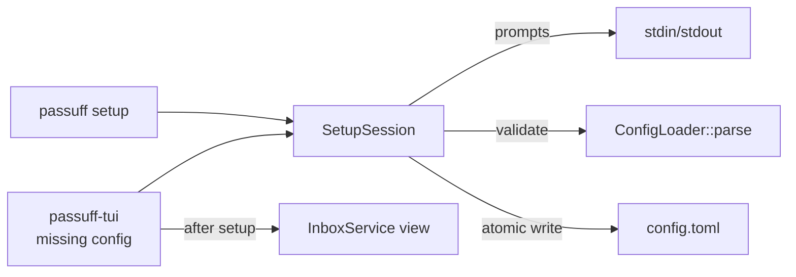

# Design: passuff-setup

## Scope and constraints

Add a line-based interactive setup flow shared by `passuff setup` and the
first-run terminal UI. Setup creates the configuration atomically, validates
it, and never stores a token value. No hosted or browser onboarding.

## Technology decisions

| Decision | Choice | Rationale |
|---|---|---|
| Surfaces (D1) | Both `passuff setup` and the first-run `passuff-tui` path | Fixes the reported inbox failure and gives a scriptable CLI path. |
| Prompt IO (D2) | `SetupSession<R: BufRead, W: Write>` with injected streams | The real service is tested with scripted input; the binaries use stdin/stdout. |
| Credential check (D3) | Shape and token-file permission only; no GitHub call | Setup works offline; a bad token is reported on the first check. |
| Existing config (D4) | Ask before replacing, default no | Preserves an existing configuration without a delete step. |
| Config writer | `toml_edit` (direct dependency) plus temp file and rename | Preserves unrelated formatting where present and avoids partial writes. |
| UI | Line-based prompts before the alternate screen | No new full-screen layout; the inbox remains the only TUI screen. |

## Architecture impact

### Contracts and Components

| Contract | Consumer use case | Consumers | Implementing component today | Split trigger |
|---|---|---|---|---|
| `InitialSetup` (`run`) | set-up-passuff | `passuff setup`, first-run `passuff-tui` | `SetupSession` in `passuff-cli::setup` | A second configuration backend or a hosted onboarding flow. |
| `ConfigLoader` | all use cases | `SetupSession`, `CliRuntime`, `passuff-tui` | `passuff-config` | A second configuration source. |
| `SnapshotStore` | set-up-passuff (not written by setup) | `passuff-tui` after setup | `JsonStateStore` | The state stops being the first-run source. |

### Data model

- `SetupSession` fields: `path`, `input`, `output`, `replace_allowed`.
- Answers: account label, auth mode (`gh_oauth`, `token_env`, `token_command`,
  `token_file`), expected login, token variable/command/file, watch mode
  (`all`/`selected`), repositories, add-another, replace confirmation.
- The session builds a TOML document with `toml_edit`, validates it through
  `ConfigLoader::parse`, and writes a temporary file in the target directory
  followed by a rename. Parent directories are created with private
  permissions where the platform supports it.
- A token file answer is checked with the same absolute/`~` and `0o077` rules
  as `passuff-config`; an insecure file stops setup with exit 3.
- A literal token is never accepted as an answer.

### Flows

1. `passuff setup` with no config: prompt, validate, write, exit 0.
2. `passuff setup` with an existing config: ask "replace? [y/N]"; no exits 0
   without writing; yes continues.
3. `passuff-tui` with no config and an interactive terminal: run the same
   session, then load the config and open the inbox.
4. `passuff-tui --snapshot` or any non-terminal start with no config: print
   `passuff: no configuration; run passuff setup` and exit 2.
5. A failed validation re-prompts the affected value; EOF at a required
   prompt stops setup with exit 2 and no write.
6. A failed write reports `cannot write configuration: <detail>` and exits 3;
   a temporary file is removed.

## Decisions

- **Decides D1:** both surfaces over one `SetupSession`; realize in `main.rs`
  and `tui_main.rs`.
- **Decides D2:** injected `BufRead`/`Write`; the Gherkin harness uses a
  scripted answer vector.
- **Decides D3:** shape-only validation; no credential resolution during
  setup. A token file is permission-checked.
- **Decides D4:** replacement asks and defaults to no.

## Use-case traceability

| Rule | Technical decision | Evidence |
|---|---|---|
| R1 missing or confirmed replace | `replace_allowed` prompt | first-run; preserves/replaces scenarios |
| R2 account label/mode/login | prompt sequence and TOML validation | first-run, token-env scenarios |
| R3 no token value | only variable/command/path answers; no literal field | `the configuration does not contain "token-value"` |
| R4 token file permissions | `0o077` check | insecure-file scenario |
| R5 watch scope | all/selected prompt, `owner/name` validation | invalid-repository scenario |
| R6 atomic validated write | `toml_edit` temp+rename | failed-write scenario |
| R7 CLI exits 0 | `Command::Setup` path | first-run e2e |
| R8 TUI first-run / non-terminal hint | interactive check in `tui_main` | non-terminal scenario |
| R9 config usable | setup output loaded by TUI/CLI | first-run e2e |
| Persona | `multi-account-developer` | setup transcript |

## Testing strategy

- Runner: existing `./scripts/verify.sh`; strict `.fail_on_skipped()`.
- Delta: `GIVN_FEATURES=$PWD/givn/changes/passuff-setup/specs ./scripts/verify.sh`.
- E2E: `GIVN_FEATURES=$PWD/givn/changes/passuff-setup/specs ./scripts/verify.sh --e2e`.
- Single scenario: `GIVN_SCENARIO="Developer sets up passuff on first run" ...`.
- Step file: `crates/passuff-cli/tests/steps/setup.rs`, registered in
  `tests/features_runner.rs`.
- Unit tests: session prompt/parse/validate/write/replace/token-file/write
  failure; TUI missing-config interactive/non-interactive decision.
- New step bodies start as `unimplemented!`; the strict proof is recorded in
  `tasks.md`.

## Visual Design Contract

- Interface: terminal
- Viewports: 100x30 (setup is line-based; the inbox after setup is 100x30)
- Design system: none; the setup prompts use the existing `passuff:` prefix
- Screens covered: setup prompt transcript, inbox after setup
- Approval: the operator approved the terminal style in the archived
  `passuff-tui` design; the setup prompts reuse it.
- Capture: setup transcript for the @e2e scenario under
  `givn/changes/passuff-setup/evidence/visual/<slug>/transcript.txt`; no
  screenshot is required for line-based prompts, the inbox screenshot is the
  existing TUI contract.
- Motion: none.
- Accessibility: plain text prompts, default answers shown, no color-only
  meaning.

## E2E smoke test infrastructure

- E2E runner: delta scope above with `GIVN_RESULT_SCOPE=e2e`.
- Step file: `crates/passuff-cli/tests/steps/setup.rs`; the setup child spawn
  helper writes the scripted stdin in `tests/support/e2e.rs`.
- Local infrastructure: no GitHub call; the setup child writes a temp config;
  the TUI snapshot then reads it and the e2e state.
- Strict proof: existing `.fail_on_skipped()`.

## Interaction Coverage Matrix

| Inventory entry | @e2e scenario title | Real interface | Driving mechanism |
|---|---|---|---|
| set up passuff on first run | Developer sets up passuff on first run | CLI / terminal | Spawn `CARGO_BIN_EXE_passuff` with `setup --config <temp>` and scripted stdin; assert config and the spawned TUI snapshot. |

## Coverage process boundaries

| Process | Started by | Instrumented artifact | Profile output | Merge step | Non-zero production probe |
|---|---|---|---|---|---|
| `passuff setup` child | `./measure-coverage.sh` (e2e) | `target/llvm-cov-target/debug/passuff` | `e2e-child-%p-%m.profraw` | `cargo llvm-cov report`; `scripts/json_to_cobertura.py` | `setup.rs` prompt/validate/write |

## External boundary cases

- EOF at a required prompt: exit 2, no file.
- Invalid auth mode, login, repository, or duplicate repository: re-prompt.
- Insecure/missing token file: report and stop; no file.
- Existing config and no confirmation: exit 0, file unchanged.
- Write failure: exit 3, no partial file.
- Parent directory missing: create it.
- Non-terminal TUI: hint `passuff setup`, exit 2.
- Config path is a directory or unwritable: exit 3.

## Local runnability

- `cargo run -p passuff-cli -- setup --config /tmp/passuff.toml`
- `cargo run -p passuff-cli --bin passuff-tui -- --config /tmp/passuff.toml`
- The e2e writes a temp config; no live GitHub call.

## Risks

- Interactive prompts are line-based; pasted multiline input is not supported.
- Setup does not verify credentials; a wrong token is found on the first check.
- The config writer must preserve unrelated existing content when replacing.
- A TUI started without a TTY cannot prompt; it exits 2 with the CLI hint.
