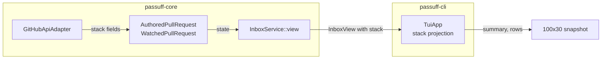

# Design: passuff-stacked-inbox

## Scope and constraints

Add GitHub-reported stack membership to the observation and persisted watch
state, then project stacked groups in the terminal inbox. The watch contract,
notification rules, and read state are unchanged. Grouping is read-only and
degrades to standalone rows when metadata is absent or rejected.

## Technology decisions

| Decision | Choice | Rationale |
|---|---|---|
| GraphQL client | Existing `reqwest` adapter, no new dependency | The stack fields extend the existing query. |
| Stack fields | `stack { number size baseRefName }` and `stackEntry { position }` on `PullRequest` | GitHub's GraphQL stack object and entry expose exactly the confirmed stack number, size, base, and position. |
| State schema | Version 2 with an optional `stack` field | Old state files parse with `#[serde(default)]`; no migration and no downgrade break for readers that ignore unknown fields. |
| Inbox grouping | Projection in `TuiApp` over the existing `InboxView` | The core view already carries pull requests and activity; the CLI's flat inbox contract stays unchanged. |
| Preview rejection | Retry the account observation once without the stack fields | Preserves the account's other observations; no cache, because the cost is exceptional and the schema may become available later. |
| Versions | ratatui 0.30.2, crossterm 0.29.0 (existing `Cargo.lock`) | No framework upgrade is needed. |

No version number is newly introduced; the existing lockfile is authoritative.

## Architecture impact

### Contracts and Components

| Contract | Consumer use case | Consumers | Implementing component today | Split trigger |
|---|---|---|---|---|
| `GitHubGateway` | watch-pull-requests | `PassuffCore` | `GitHubApiAdapter` in `passuff-core::github` | A second observation API or a different transport. |
| `InboxService` | review-pull-request-stacks (also review-activity-inbox) | `TuiApp`, `InboxCli` (flat, unchanged) | `Inbox` in `passuff-core::inbox` | A second read model with different consistency rules. |



### Data model

```rust
pub struct PullRequestStack {
    pub number: u64,
    pub size: u64,
    pub position: u64,
    pub base: String,
}
```

- `AuthoredPullRequest` gains `stack: Option<PullRequestStack>`.
- `WatchedPullRequest` gains `stack: Option<PullRequestStack>` with
  `#[serde(default)]`; the state version stays 2.
- `PassuffCore::refresh` copies `stack` on the existing-record path, and
  `WatchedPullRequest::from_baseline` records it on the baseline path. Both
  paths are named so the next cycle cannot silently drop the membership.
- `PullRequestView` gains `stack: Option<PullRequestStack>`.
- `GqlStack` and `GqlStackEntry` map the GraphQL fields; every field is
  optional at the wire boundary. A stack maps only when number, size, base,
  and position are present and `1 <= position <= size` and `size >= 1`.
  Otherwise the pull request is standalone, so a malformed stack object does
  not fail the account.
- `baseRefName` on the direct pull request already maps to `base_ref`; the
  stack base is the stack object's `baseRefName`, not the direct base.

### GraphQL query and rejection handling

The field names are verified against the GitHub GraphQL Pull requests reference
(`PullRequest.stack` with `number`, `size`, `baseRefName`; `PullRequest.stackEntry`
with `position`) on 2026-11-03. Both `MAIN_QUERY` and `NODES_QUERY` add:

```graphql
stack { number size baseRefName }
stackEntry { position }
```

`observe` runs the account observation with these queries. If a GraphQL error
names `stack` or `stackEntry`, it retries the whole account observation once
from a fresh accumulator (login, pull requests, seen nodes, and pagination
reset) with the two stack field lines removed; the retry yields standalone rows
and does not fail the account. The retry must cover both `MAIN_QUERY` and
`NODES_QUERY`: `GqlNodesResponse` gains an `errors` field, and a stack-field
error from the nodes call propagates to the retry instead of being swallowed.
Other GraphQL errors keep the existing failure behavior; a response that still
carries usable `data` keeps the existing partial-data behavior. No capability
cache: a rejection costs one extra observation attempt and the schema may become available
later.

### Inbox projection

`TuiApp` builds stack groups from `InboxView.pull_requests`:

- Group members by `(repository, stack.number)`; sort groups by repository and
  stack number; sort members by `position` ascending.
- Stack summary line per group:
  `acme/api stack 7 | base main | size 2 | 2 unread in stack`.
- The watched pull request table adds `Position` and `Stack` columns and lists
  group members first, then standalone pull requests sorted by key.
- The activity table adds a `Stack` column (`stack 7` for a member, blank for
  standalone) and keeps the existing newest-first order; the group unread count
  is the number of unread records whose key belongs to the group.
- A standalone pull request has blank position and stack cells; no summary
  line is emitted.
- The watched block uses a nested vertical layout: a `Paragraph` of stack
  summary lines above the table, then the table. The paragraph is clipped to
  the available block height; it does not scroll.
- The activity table remains newest-first, as required by the existing inbox
  contract; the `Stack` column associates each record with its group, and the
  summary line carries the group count.

Layout (100x30 target frame; the implemented renderer's snapshot is authoritative):

```text
┌ passuff — Inbox ─────────────────────────────────────────────────────────────────────────────────┐
│personal @octo-personal   |   watch scope: all authored pull requests                             │
│                                                                                                  │
│2 unread of 2   |   Focus: activity                                                               │
│┌ Watched pull requests ─────────────────────────────────────────────────────────────────────────┐│
││acme/api stack 7 | base main | size 2 | 2 unread in stack                                       ││
││Pull request  State  CI          Position   Stack     Title                                     ││
││acme/api#42   open   CI passing  position 1 stack 7   Title A                                   ││
││acme/api#43   open   CI passing  position 2 stack 7   Title B                                   ││
││                                                                                                ││
││                                                                                                ││
│└────────────────────────────────────────────────────────────────────────────────────────────────┘│
│┌ Activity ──────────────────────────────────────────────────────────────────────────────────────┐│
││ID   Observed   Pull request   State   Stack     Event                                          ││
││▶ a1 2026-11-02 acme/api#43    unread  stack 7   New comment from @alice                        ││
││                                                                                                ││
││                                                                                                ││
││                                                                                                ││
││                                                                                                ││
││                                                                                                ││
││                                                                                                ││
││                                                                                                ││
││                                                                                                ││
││                                                                                                ││
││                                                                                                ││
│└────────────────────────────────────────────────────────────────────────────────────────────────┘│
│┌ Controls ──────────────────────────────────────────────────────────────────────────────────────┐│
││j/k move   r read   a read all   q quit                                                         ││
│└────────────────────────────────────────────────────────────────────────────────────────────────┘│
└──────────────────────────────────────────────────────────────────────────────────────────────────┘
```

## Decisions

- **Decides D1:** retry the account observation once from a fresh accumulator
  without the stack fields when a GraphQL error names them; realize in
  `github.rs` and the adapter unit test
  `rejects_stack_fields_and_retries_without_them`.
- **Decides D2:** keep state version 2 and add `stack` as an optional field
  with a default; realize in `domain.rs` and the state fixtures. ADR-0005
  rejected keeping version 1 with defaulted fields because readers could not
  distinguish an old file from a new one and future migrations lost an explicit
  boundary; adding `stack` to version 2 stays within that boundary, old readers
  ignore it, and new readers default it to `None`.
- **Decides D3:** the capability is `stacked-inbox` under
  `review-pull-request-stacks`; realize in the delta feature and the use-case
  document.

## Use-case traceability

| Rule or guarantee | Technical decision | Evidence |
|---|---|---|
| R1 metadata only; absent means standalone | Optional stack on the observation and state; map only a complete object. | `A pull request without stack metadata stays standalone` |
| R2 group by repository and stack number; order by position | `TuiApp` projection sorts groups and members. | `The stack orders members by position` |
| R3 show base and size once; member position and state | Stack summary line; `Position` and `Stack` columns. | `Developer reviews a stacked inbox`; `A merged stack member remains in the group` |
| R4 omit unwatched members; keep size; gaps allowed | Group members are the watched pull requests only; summary keeps `size`. | `An unwatched stack member leaves a position gap` |
| R5 activity under the stack; aggregated unread | Activity `Stack` column; group count from member keys. | `The stack unread count aggregates its members` |
| R6 standalone keeps existing presentation | Blank stack cells and no summary; existing table columns remain. | `A pull request without stack metadata stays standalone` |
| R7 rejection degrades without account failure | Retry without stack fields. | Adapter unit test `rejects_stack_fields_and_retries_without_them`; `A pull request without stack metadata stays standalone` covers the display side. |
| R8 read-only | `GitHubGateway` exposes only `observe`; no mutation method exists. | Unit test `queries_are_read_only` asserts the observation queries contain no `mutation`. |
| Minimal guarantee | Complete-object validation and the retry path. | R1 scenario; R7 adapter unit test |
| Persona outcome | Grouped inbox for `multi-account-developer`. | Visual review of the stacked snapshot |

## Testing strategy

- Runner: existing `./scripts/verify.sh`; Cucumber strict mode is
  `.fail_on_skipped()` in `features_runner.rs`.
- Delta: `GIVN_FEATURES=$PWD/givn/changes/passuff-stacked-inbox/specs ./scripts/verify.sh`.
- E2E: delta scope `GIVN_FEATURES=$PWD/givn/changes/passuff-stacked-inbox/specs ./scripts/verify.sh --e2e`; permanent scope `./scripts/verify.sh --e2e`.
- Single scenario:
  `GIVN_SCENARIO="Developer reviews a stacked inbox" GIVN_FEATURES=$PWD/givn/changes/passuff-stacked-inbox/specs ./scripts/verify.sh`.
- Step definition file: `crates/passuff-cli/tests/steps/stacked_inbox.rs`, one
  file for the `stacked-inbox` capability; register it in
  `tests/features_runner.rs`. Permanent merge target: the same file; it is
  durable project source.
- New step bodies start as `unimplemented!("<phrase>")`; the RED run executes
  the delta and fails on the stub. No step body is empty.
- Unit tests in `passuff-core::github` for the query mapping, incomplete
  stack objects, the read-only queries (`queries_are_read_only`), and the retry
  (`rejects_stack_fields_and_retries_without_them`, with a wiremock first
  response containing a stack-field error and a second response without the
  fields); in `passuff-cli::tui` for grouping, gaps, ordering, standalone rows,
  unread aggregation, and the activity stack label.
- Strict-mode proof: the tasks setup runs the undefined-step probe and records
  the nonzero failure.

## Visual Design Contract

- Interface: terminal
- Viewports: 100x30
- Design system: none; text rules above
- Screens covered: stacked inbox (group summary, position, stack columns), standalone inbox
- Approval: the operator approved the 100x30 terminal layout in the archived
  `passuff-tui` design on 2026-11-02; this change extends that contract with a
  stack summary line and `Position`/`Stack` columns, authorized by the
  operator's 2026-11-03 instruction to work through the change.
- Rendered reference: the 100x30 target frame in the design above; the
  implemented renderer's `--snapshot` transcript is the authoritative evidence.
- Capture mechanism: one transcript for the `@e2e` scenario under
  `givn/changes/passuff-stacked-inbox/evidence/visual/developer-reviews-a-stacked-inbox/transcript.txt`;
  an Alacritty screenshot `alacritty.png` from the real binary with
  `alacritty -o window.dimensions.columns=100 -o window.dimensions.lines=30`
  and `import`.
- Motion: none
- Accessibility: keyboard navigation, text labels for position/base/size so no
  meaning relies on color alone, `▶` selection marker preserved.

## E2E smoke test infrastructure

- E2E runner: delta scope `GIVN_FEATURES=$PWD/givn/changes/passuff-stacked-inbox/specs ./scripts/verify.sh --e2e` with `GIVN_RESULT_SCOPE=e2e`; permanent scope `./scripts/verify.sh --e2e`.
- Step file: `crates/passuff-cli/tests/steps/stacked_inbox.rs`; the shared TUI
  spawn helper and the mock GitHub response branch for `stack`/`stackEntry`
  are in `tests/support/e2e.rs`.
- Local infrastructure: the existing wiremock GitHub server in the Cucumber
  harness; the `passuff-tui --snapshot` child process uses the seeded config
  and state. No live GitHub call.
- Framework: cucumber-rs spawning the real binary, matching the terminal
  interface.
- Strict-mode proof: the existing `.fail_on_skipped()` proof covers the e2e
  scope.

## Interaction Coverage Matrix

| Inventory entry | @e2e scenario title | Real interface | Driving mechanism |
|---|---|---|---|
| review a stack and its activity | Developer reviews a stacked inbox | CLI / terminal | Spawn `CARGO_BIN_EXE_passuff-tui --snapshot` against the mock GitHub server and seeded state; assert stdout and exit 0. |

## Coverage process boundaries

| Process | Started by | Instrumented artifact | Profile output | Merge step | Non-zero production probe |
|---|---|---|---|---|---|
| `passuff-tui` snapshot | `./measure-coverage.sh` (e2e scope) | `target/llvm-cov-target/debug/passuff-tui` | `e2e-child-%p-%m.profraw` under the child profile directory | `cargo llvm-cov report` inside `measure-coverage.sh`; `scripts/json_to_cobertura.py` | `tui.rs` render and grouping lines |

Measured: production source under `crates/*/src`. Excluded: tests, fixtures,
generated coverage. The measured population is unchanged from the archived
baseline; no post-result changes.

## External boundary cases

- Stack present, `stackEntry` absent or position 0/out of range: standalone.
- Stack size 0 or fields missing: standalone, no account failure.
- GraphQL error naming the stack fields: retry without them; account succeeds.
- Old state without `stack`: loads with `None`; no migration.
- Duplicate node IDs across pages: existing `seen_nodes` deduplication.
- Stack number reuse after a merge: the next observation replaces the recorded
  membership; the group follows the latest metadata.
- Wrong repository grouping: the key includes the repository, so two
  repositories with stack 7 never merge.

## Local runnability

- Full watcher: `cargo run -p passuff-cli -- check --config <path> --state <path>`.
- Inbox: `cargo run -p passuff-cli --bin passuff-tui -- --config <path> --state <path>`.
- Snapshot: add `--snapshot`; no TTY required.
- Tests use the wiremock GitHub twin; no live third-party call.

## Risks

- The stacked-PRs preview may be unavailable for a repository; the inbox then
  shows standalone rows, which is the documented degradation.
- A preview rejection costs one extra observation attempt per cycle on the retry
  path.
- The 100x30 viewport constrains the number of visible stack summaries; extra
  summaries are clipped by the watched pull request block, not scrolled.
- Table columns can truncate long titles; existing behavior, not a new
  regression.
