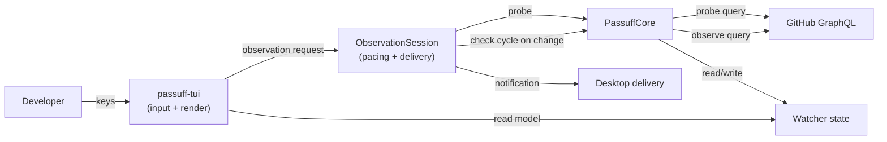

# Design: passuff-tui-live

## Technology decisions

- Language: Rust, existing workspace; no new runtime or framework.
- Async runtime: the existing `tokio` multi-thread runtime in the `passuff-tui` binary.
- Terminal: the existing `crossterm` + `ratatui` stack. No new crate.
- HTTP: the existing `reqwest` client and the existing `GitHubApiAdapter`.
- Test runner: the existing `cucumber-rs` harness (`crates/passuff-cli/tests/features_runner.rs`) with `wiremock` for the E2E GitHub boundary.
- Versions: no dependency is added or upgraded; versions stay as pinned in `Cargo.lock`.

Measured on the operator's account on 2026-11-03 (GraphQL `rateLimit.cost`):

| Query | Nodes returned | Cost (points) |
|---|---|---|
| Full observation (`MAIN_QUERY`, 100 pull requests, all states, comments/reviews/threads/CI) | 100 pull requests | 57 |
| Change probe (open pull requests, identity + timestamps + CI state) | 2 pull requests | 1 |

GitHub allows 5,000 points per hour per token. A full observation every 60 seconds costs 3,420 points/hour; a full observation every second is impossible. A change probe at the measured cost is affordable at roughly one per 1.5 seconds for one account.

## Architecture impact

The terminal inbox stops being a read-only view over the persisted state and becomes a second watcher: it owns a check cycle while it is open. The core gains a cheap change probe ahead of the expensive check cycle. Scheduling and delivery stay in the UI adapter, as the glossary already states for the watcher role.



### Contracts and Components

| Contract | Consumer use case | Consumers | Implementing component today | Split trigger |
|---|---|---|---|---|
| `GitHubGateway` (`observe`, new `probe`) | review-activity-inbox | `PassuffCore` on behalf of the watch command and the terminal inbox | `GitHubApiAdapter` | a second external provider is supported |
| `LiveObservation` (`tick`, `next_delay`) | review-activity-inbox | `passuff-tui` input loop | new `ObservationSession` in `crates/passuff-cli/src/live.rs` | the `passuff` watch command adopts the same pacing |
| `InboxService` (`view`, `mark_read`) | review-activity-inbox | terminal inbox, CLI inbox/read | `Inbox` | a second read-model consumer needs different projections |

The terminal inbox keeps one responsibility: input and rendering. `ObservationSession` keeps one responsibility: deciding when to probe, when to run a check cycle, and delivering what the cycle reported. `PassuffCore` keeps one responsibility: performing probes and check cycles. No unit owns two of these.

## Data model

New core types (domain language, `crates/passuff-core/src/domain.rs`):

```rust
pub struct ApiAllowance {
    pub cost: u32,
    pub remaining: u32,
    pub reset_at: String, // RFC 3339, as returned by GitHub
}

pub struct ProbePullRequest {
    pub repository: String,
    pub node_id: String,
    pub updated_at: String,
    pub head_oid: String,
    pub ci_state: Option<CiState>,
}

pub struct ChangeProbe {
    pub login: String,
    pub pull_requests: Vec<ProbePullRequest>, // sorted by node_id
}

pub struct ChangeSignal {
    pub changed: bool,
    pub allowance: ApiAllowance,
}
```

`PassuffCore` keeps `current: Option<Vec<ChangeProbe>>` and `pending: Option<Vec<ChangeProbe>>`. The first probe after start reports a change (no baseline). A successful check cycle commits `pending` to `current`; a failed or deferred check cycle keeps `pending`, so the next probe still reports the change.

The persisted `WatcherState` does not change: the probe is a GitHub-side query, not stored history.

## Refresh pacing

`ObservationSession::next_delay(&self, allowance: &ApiAllowance, now: DateTime<Utc>) -> Duration`:

```
seconds_to_reset = max(reset_at - now, 1)
budget           = max(remaining / 2, 1)
delay            = clamp(seconds_to_reset / budget, 1s, seconds_to_reset)
```

With 5,000 remaining and 3,600 seconds to reset the delay is 1.44 s; with 100 remaining it is 72 s; with 10 remaining it is 720 s. The inbox never spends more than half of the remaining allowance across the window, never probes more than once per second, and never schedules past the reset.

A failed probe uses exponential backoff (2 s, 4 s, 8 s, capped at 60 s) and keeps the current view.

A check cycle is deferred while `remaining < 100`; `pending` stays set, so the cycle runs after the allowance recovers. This leaves room for the 57-point measured cost and prevents a burst of changes from exhausting the window.

## Terminal loop

`crates/passuff-cli/src/tui_main.rs`:

- Spawn a blocking input thread that reads `crossterm` events with `event::read()` and sends them over an `mpsc` channel. The 1-second `event::poll` and the `next_event` helper are removed.
- Spawn an observation task that owns the `ObservationSession` and, for each tick, sleeps `next_delay`, runs `tick`, and sends an update over a second channel. The update carries the check-cycle report presence, the failure message (if any), and the next delay.
- The main loop uses `tokio::select!` over the input channel and the observation channel. On an observation it reloads the read model through `InboxService::view` (a local state read), preserving the selected pull request through the existing `TuiApp::reload`, and redraws immediately. A failed probe or check cycle only records a status line in the footer; it never breaks the loop.
- The scope picker stays inside the same `select!` loop rather than its own polling loop; observation continues behind it, and the picker's known repositories are refreshed on each observation update.
- Config is reloaded from the existing path on every observation update; a changed configuration rebuilds the `ObservationSession` (which resets the probe baseline and forces one check cycle).

`CliRuntime` gains a public constructor for the session (`observation_session(config)`) and a public `deliver_report(config, report)` wrapper around the existing notification processing. The TUI discards the notification transcript; in full-screen mode the report is visible as the refreshed view, not as printed lines. Notification delivery behaves exactly as in the watch command.

Each tick returns one update:

```rust
pub struct ObservationUpdate {
    pub config: AppConfig,        // reloaded from the config path every tick
    pub changed: bool,            // a check cycle ran and the view must reload
    pub failure: Option<String>,  // probe or cycle failure, rendered in the footer
    pub next_delay: Duration,
}
```

The main loop swaps `config` before redrawing, so a scope edit made in the picker or by another process takes effect on the next tick. A probe response without an allowance falls back to a 5-second delay; the allowance is never assumed from the measured 1-point cost. A failed probe or cycle sets `failure`, which the footer shows until the next successful update; it never replaces the view.

`crates/passuff-cli/src/delivery::build_delivery` becomes a shared helper so `main.rs` and `tui_main.rs` build the same delivery adapter (the `PASSUFF_NOTIFICATION_SINK` test seam stays in one place).

## Snapshot and E2E surfaces

- `--snapshot` without flags stays view-only and deterministic: it renders the current read model and exits.
- `--snapshot --observe` performs one probe and, if the probe reports a change, one check cycle before rendering. Used by the modified `Developer opens the inbox TUI` scenario.
- `--snapshot --observe-for <MILLIS>` runs the real input and observation loop against a `TestBackend` for the given duration, then prints the last frame. Used by `The inbox shows activity observed while it is open`. The loop still honours `next_delay`, so the E2E run must exceed one delay.
- `--keys` composes with both modes as it does today.

These flags are test surfaces only; the interactive binary runs the loop without them.

## Step definitions

| Step definition file | Permanent merge target |
|---|---|
| `crates/passuff-cli/tests/steps/inbox_navigation.rs` | same file |
| `crates/passuff-cli/tests/steps/activity_inbox_tui.rs` | same file |

New phrases: `the developer opens the inbox TUI observing the account` (snapshot with one probe and, on a change, one cycle), `the developer opens the inbox TUI and lets it observe for "<seconds>" seconds`, `the inbox observes the account`, `the inbox observes the account three times with no change`, `the inbox has asked GitHub for the full account history "<n>" time(s)`, `the inbox has asked GitHub for a change signal "<n>" times`, `the account has "<n>" API points left until the allowance resets in "<n>" seconds`, `the inbox plans its next observation`, `the inbox waits at least "<n>" seconds before observing again`, `GitHub becomes unavailable for the next observation`, `"alice" comments "<text>" on "<pr>" after the first observation`, `the TUI still shows "<text>"`.

The existing `the developer opens the inbox TUI` phrase keeps its view-only snapshot meaning and is still used by the other scenarios; the observing-open phrase is distinct so those scenarios do not gain a network dependency.

Support: `crates/passuff-cli/tests/support/e2e.rs` gains `e2e_run_tui_observe` and `e2e_run_tui_observe_for`, plus a `Respond` implementation that returns the baseline observation first and the comment on later observations. `crates/passuff-cli/tests/support/mod.rs` gains probe controls on the fake gateway and an observation-session helper.

## Test runner

- Regular: `GIVN_FEATURES=$PWD/givn/changes/passuff-tui-live/specs GIVN_RESULT_SCOPE=change ./scripts/verify.sh`
- E2E: `GIVN_FEATURES=$PWD/givn/changes/passuff-tui-live/specs ./scripts/verify.sh --e2e`
- Single scenario: `GIVN_SCENARIO="The inbox shows activity observed while it is open" GIVN_FEATURES=$PWD/givn/changes/passuff-tui-live/specs ./scripts/verify.sh --e2e`

Strict mode: `.fail_on_skipped()` is already set on the `cucumber-rs` builder in `features_runner.rs`; an undefined or `@wip` step fails the run. The delta scenarios stay `@wip` until their steps are implemented.

## Decisions

- Decides D1: observation is paced by the account's measured allowance, not by a fixed clock. The probe is the common case and costs 1 point; the full check cycle runs only when the probe reports a change and the allowance can afford it. Realized in `ObservationSession::next_delay` and `PassuffCore::probe`/`refresh`.
- Decides D2: no cross-process coordination. The inbox observes while it is open; the watch command remains the headless observer. Running both is permitted and documented as redundant work with a possible duplicate notification in the overlap. Realized by the absence of a lock plus a README note.
- Decides D3: `poll_interval_secs` keeps governing the `passuff` watch command only. The open inbox derives its cadence from the allowance; it does not read `poll_interval_secs`. Realized in `ObservationSession` and the updated use-case rule T10.

## Use-case traceability

| Use-case rule | Technical decision | E2E evidence |
|---|---|---|
| T10 inbox observes and shows the result without a keypress or another command | `ObservationSession` + observation channel + `TuiApp::reload` | The inbox shows activity observed while it is open |
| T11 a refresh never changes focus or replays a notification | `TuiApp::reload` preserves `selected_pr`; the check cycle records activity once | A refresh preserves the selected pull request (permanent) |
| T12 pacing against the remaining allowance | `next_delay`, deferred check cycle below 100 points | The inbox paces observation against the account allowance |
| T13 a failed observation keeps the last view | footer status, backoff, no view reset | A failed observation keeps the last inbox view |
| Opening performs the first observation | `--observe` snapshot path | Developer opens the inbox TUI |

## Persona disposition

- `multi-account-developer` (confirmed): relevance is freshness across several accounts while the inbox is open; evidence is the live-update E2E scenario plus the per-account pacing. No other persona is claimed.

## Interaction Coverage Matrix

| Inventory entry (usecase.md) | Scenario | Implementation | Layer |
|---|---|---|---|
| activity-inbox / list unread activity | Developer lists unread activity (permanent) | `InboxCli::inbox` | E2E, unchanged |
| activity-inbox / mark activity read | Developer marks activity read (permanent) | `InboxCli::read` | E2E, unchanged |
| activity-inbox / open the inbox in the terminal UI | Developer opens the inbox TUI (modified) | `passuff-tui --snapshot --observe` | E2E, modified |
| inbox-navigation / navigate the watched pull requests and activity | Developer navigates the inbox panes (permanent) | `TuiApp::handle_key` | E2E, unchanged |
| inbox-navigation / leave the inbox open while activity arrives | The inbox shows activity observed while it is open | `ObservationSession` + observation channel | E2E, new |

## Interface classification

The surface is a terminal UI rendered with ratatui, not HTML/CSS/JS; no browser exists and no browser driver can apply. The real driver is the `passuff-tui` process, driven through `--snapshot`/`--observe` against `wiremock`; the interactive raw-mode loop is covered manually, as recorded in R-019.

## Visual Design Contract

- Interface: terminal
- Viewports: terminal, 100x30 cells (the existing snapshot size)
- Design system: none; the existing layout, footer, and `▶` selection rendering are unchanged. The only visible addition is a single status line in the existing Controls block when an observation fails. The screen is not redesigned, so no style tile is produced; the existing rendered snapshots in the archived `passuff-tui` and `passuff-tui-focus` evidence are the reference.

## Out of scope

- Query-cost reduction for the full check cycle; deferred to a follow-up.
- Cross-process locking of the state file.
- Webhooks or push delivery.
