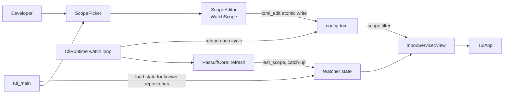

# Design: passuff-watch-scope

## Scope and constraints

Add an explicit all/selected watch scope, a terminal repository picker, hidden
out-of-scope records, silent catch-up on reselect, and configuration reload for
a running watcher. Notifications, stack grouping, and the state history bound
are unchanged.

## Technology decisions

| Decision | Choice | Rationale |
|---|---|---|
| Config shape | `WatchMode` (`all`/`selected`) plus the existing repository list | Represents all, selected, and empty-selected=none without overloading an empty list. |
| Legacy resolution | The file uses `mode: Option<WatchMode>`; absent mode resolves to `selected` when the list is non-empty and `all` when it is empty | A legacy allowlist keeps its meaning; only an explicit selected mode with an empty list means none. |
| Config writer | `toml_edit` as a direct `passuff-cli` dependency (already in `Cargo.lock` through `proc-macro-crate`) | Surgical edit preserves comments and unrelated configuration. |
| Picker state | Separate `ScopePicker` in `passuff-cli::scope` over the `WatchScope` contract | Keeps the inbox renderer focused; the picker is a screen with its own keys. |
| E2E action surface | Scripted `--scope-select/-deselect/-mode/-add` and `--picker` flags on `passuff-tui` | Deterministic real-process actions without a PTY; the interactive picker uses the same contract. |
| Reload | `CliRuntime` reloads the config before each watch cycle from its configured path | Applies the TUI write without a restart; a failed reload keeps the previous config. |
| Catch-up | Compare the current scope with `WatcherState.last_scope`; newly selected repositories with retained pull requests run one silent catch-up cycle | The scope edit writes no state; the pre-existing mark-read/watcher save race remains R-024. |
| State | Add `last_scope` to `WatcherState` with `#[serde(default)]`; version stays 2 | Old state loads with `None`; the first cycle records no catch-up. |

## Architecture impact

### Contracts and Components

| Contract | Consumer use case | Consumers | Implementing component today | Split trigger |
|---|---|---|---|---|
| `WatchScope` (`select`, `deselect`, `set_mode`, `add`; each returns `Result<ScopeSnapshot, ScopeError>`) | change-watch-scope | `ScopePicker`, scripted `passuff-tui` flags, interactive loop | `ScopeEditor` in `passuff-cli::scope` | A second configuration format, remote scope store, or per-account scope. |
| `InboxService` | review-activity-inbox, inspect-watch-status | `TuiApp`, `InboxCli` | `Inbox` in `passuff-core::inbox` | A second read model with different consistency rules. |
| `ConfigLoader` | change-watch-scope, watch-pull-requests | `ScopeEditor`, `CliRuntime`, `passuff-tui` | `passuff-config` | A second configuration source. |



### Data model

```rust
pub enum WatchMode { All, Selected }

pub struct WatchConfig {
    pub mode: WatchMode,
    pub repositories: Vec<String>,
}

pub struct WatchScopeState {
    pub mode: WatchMode,
    pub repositories: Vec<String>,
}

pub struct WatcherState {
    // ...
    #[serde(default)]
    pub last_scope: Option<WatchScopeState>,
}

pub struct InboxView {
    // ...
    pub scope_label: String,
}

pub struct ScopeSnapshot {
    pub mode: WatchMode,
    pub repositories: Vec<String>,
}
```

- The file schema uses `FileWatchConfig { mode: Option<WatchMode>, repositories }`.
  `resolve()` returns `mode` when present; otherwise `Selected` for a non-empty
  list and `All` for an empty list. This preserves every legacy file.
- `WatchConfig::allows_repository` is true in `All` mode or when the selected
  list contains the repository (case-insensitive).
- `WatchConfig::label()` returns `all authored pull requests`, `watching
  nothing`, or the joined selected repositories; `InboxView.scope_label`
  carries it so the TUI and status render the same label. `InboxView.scope`
  stays as the structured repository list; `TuiApp::render` and
  `TranscriptRenderer` switch their display line to `scope_label`.
- `ScopeEditor` reads the config through `ConfigLoader`, updates
  `[watch].mode` and `[watch].repositories` with `toml_edit`, writes a temp file
  in the same directory, and renames. The caller loads the watcher state through
  the existing store and passes the known repositories to the picker; the editor
  does not write state. `ScopePicker` is an internal helper of the TUI adapter,
  not a contract. `ScopeError` carries `{ message, exit }`; a write error exits
  2.
- `ScopeEditor` actions: `select`, `deselect`, `set_mode`, `add`. `add`
  validates `owner/name`; a malformed entry returns `ScopeError { message:
  "must be owner/repo", exit: 2 }`. A write failure returns `ScopeError {
  message: "cannot write configuration: <detail>", exit: 2 }` and leaves the
  previous file intact.
- On `select`, the editor does not write a catch-up marker; the watcher derives
  catch-up from `last_scope` and the retained pull requests.

### Observation, hide, catch-up, and reload

- `cycle.rs` stops pruning out-of-scope watched pull requests; they remain in
  state. Observation still skips out-of-scope pull requests before
  classification.
- `Inbox::view_from_state` filters watched pull requests and activity by
  `config.watch.allows_repository`, then computes `unread` from the filtered
  records. Status uses the same view.
- Before observation, the core computes the newly selected repositories by
  comparing `allows_repository` for the previous `last_scope` and the current
  scope. A repository selected while the previous scope excluded it, and that
  has a retained watched pull request, is catch-up for this cycle. `last_scope`
  `None` (first cycle) produces no catch-up; previous `All` to current `Selected`
  produces none because every repository was already allowed.
- A catch-up repository records its classified events as activity records but
  adds no notification to the report. After the cycle, `last_scope` is replaced
  with the current scope only when the report has no account failures; a failed
  cycle keeps the previous value so the marker survives.
- `CliRuntime` gains an optional `config_path` and a `run_watch_cycle(path)`
  method that reloads the path, rebuilds the core, and runs exactly one cycle.
  `run_check` loads once. `run_watch_with` uses the same reload before every
  cycle after the first; a reload error keeps the previous config and appends
  one transcript line per distinct error (not once per poll). The test harness
  holds the runtime and calls `run_watch_cycle` for both cycles, so the first
  call cannot mask the reload.
- A unit test drives two cycles with a temporary config path and asserts the
  second cycle uses the new scope.

### Terminal picker and scripted flags

- `ScopePicker` renders the mode, known repositories (`[x]`/`[ ]`), a manual
  entry buffer, and an error line. Keys: `j`/`k` move, `i` enters insert mode (printable characters and backspace
  edit the buffer, `esc` leaves insert mode, `enter` adds), `space` toggles in
  selected mode and selects the highlighted repository in all mode, `m` switches
  all/selected, `esc`/`q` closes. In all mode every known repository shows `[x]`.
- `passuff-tui` adds `--scope-select`, `--scope-deselect`, `--scope-mode`,
  `--scope-add`, and `--picker`. Actions apply through `ScopeEditor` before the
  view loads; `--picker` renders the picker screen, otherwise the inbox.
  Errors print to stderr and exit 2.
- The interactive loop opens the picker on `p`; toggling calls the editor and
  reloads the inbox view. The picker uses the same editor and messages.
- The picker and inbox snapshots are both 100x30.

## Decisions

- **Decides D1 (seed config-mode question):** explicit `WatchMode` plus the
  existing list; legacy absent mode resolves by list presence; explicit selected
  empty means none. Realize in `passuff-config`, `ScopeEditor`, and ADR-0006.
- **Decides D2 (seed reload question):** reload the config each watch cycle,
  keeping the previous config on error; realize in `CliRuntime` and the reload
  unit test.
- **Decides D3 (seed picker-E2E question):** scripted scope flags plus
  `--picker` on `passuff-tui` for E2E; the interactive picker uses the same
  `ScopeEditor`.

## Use-case traceability

| Rule or guarantee | Technical decision | Evidence |
|---|---|---|
| R1 all/selected; empty selected none | `WatchMode`, `label()`, `allows_repository` | `The last deselection observes nothing`; config unit tests |
| R2 deselect hides and retains | Read-model filter; no cycle prune; unread from filtered records | `Developer toggles a repository in the watch scope`; `A deselected repository stops observation`; `Deselecting hides status and activity` |
| R3 select restores; catch-up pending | `last_scope` comparison and retained pull requests | `Reselecting catches up silently` (a check while deselected sets the previous scope) |
| Extension 4a no retained records | First observation records a baseline; no catch-up | `Selecting a repository with no records records a baseline` |
| R4 catch-up silent | Cycle suppression, activity records still appended | `Reselecting catches up silently` |
| R5 global scope | One `WatchConfig` | `Two accounts share the global scope` |
| R6 known plus manual | Known index from scope + state PRs; `add` | `Adding a repository by owner/name`; toggle e2e |
| R7 all/selected retention | `set_mode` keeps the list; switching restores it (possibly empty) | `Developer switches the watch scope mode`; `Switching to selected with no retained set observes nothing` |
| R8 format validation | `owner/name` check; no GitHub call | `An invalid repository entry is rejected` |
| R9 atomic write and next cycle | `toml_edit` temp+rename; runtime reload | Unit test `runtime_reloads_scope_between_cycles`; `The watcher reloads the scope without a restart`; `A reload failure keeps the previous scope`; `A scope write failure keeps the previous scope` |
| R10 legacy semantics | File-mode resolution | Config unit tests; ADR-0006 |
| R11 select from all switches to selected | `ScopeEditor::select` sets mode selected with that repository | `Developer toggles a repository in the watch scope` |
| Persona outcome | Picker for `multi-account-developer` | Visual review of the picker and inbox snapshots |

## Testing strategy

- Runner: existing `./scripts/verify.sh`; strict `.fail_on_skipped()`.
- Delta: `GIVN_FEATURES=$PWD/givn/changes/passuff-watch-scope/specs ./scripts/verify.sh`.
- E2E: `GIVN_FEATURES=$PWD/givn/changes/passuff-watch-scope/specs ./scripts/verify.sh --e2e`.
- Single scenario: `GIVN_SCENARIO="Developer toggles a repository in the watch scope" GIVN_FEATURES=$PWD/givn/changes/passuff-watch-scope/specs ./scripts/verify.sh`.
- Step file: `crates/passuff-cli/tests/steps/watch_scope.rs`, one file for the
  `watch-scope` capability; register in `tests/features_runner.rs`.
- New step bodies start as `unimplemented!("<phrase>")`.
- Unit tests: config mode/migration/labels, legacy absent-mode shapes, and
  duplicate case-insensitive entries; `ScopeEditor` atomic write;
  `ScopeEditor` select/deselect/mode/add/write failure; `InboxService` filtering
  and unread; catch-up comparison; `catch_up_survives_account_failure`;
  runtime reload; picker snapshots (all and selected).
- Reload harness: `World` gains a held `CliRuntime` and config path. Both cycles
  use `CliRuntime::run_watch_cycle(path)`, which always reloads the file and
  rebuilds the core; the first call cannot mask the second. The step
  `a watcher is running with a configuration path` writes the config and runs
  the first cycle; `the watcher runs another cycle` calls the same method again.
  The reload scenario adds a comment on the newly selected repository between
  the cycles; the second cycle records it as activity. The `Then the activity
  ... is unread` step reads the watcher-produced state, so a config read cannot
  satisfy it.
- Eager baseline: `the watcher has already observed` writes the baseline state
  immediately, before any scope restriction or comment step. The comment step
  then updates the fixture; a later check classifies against that baseline. The
  reselect scenario runs a check while deselected so `last_scope` excludes the
  repository before it is selected again.
- Config sync: `World::sync_scope_from_file` reloads `config_text` from the
  config path after a scope action, so the regular steps that build the config
  from `World` see the editor's write. The e2e config helper is
  `World::e2e_config_text` reading `e2e_config_dir/config.toml`; the state
  helper is `World::e2e_state_json` reading `e2e_state_path`.
- Strict-mode proof: an undefined-step probe records a nonzero failure.

## Visual Design Contract

- Interface: terminal
- Viewports: 100x30
- Design system: none; text rules above
- Screens covered: watch-scope picker, inbox with current scope
- Approval: the operator approved the 100x30 terminal layout in the archived
  `passuff-tui` design on 2026-11-02; this change adds a picker screen in the
  same style, authorized by the 2026-11-03 instruction to work through the
  change.
- Rendered references: the 100x30 picker and inbox snapshots; the implemented
  renderer's transcript is authoritative. Picker target (selected mode; the
  all-mode transcript shows every known row as `[x]` with the mode line `all`):

```text
┌ passuff — Watch scope ───────────────────────────────────────────────────────────────────────────┐
│Mode: selected   (m switches all/selected)                                                        │
│                                                                                                  │
│[x] acme/api                                                                                      │
│[ ] acme/web                                                                                      │
│                                                                                                  │
│Add: acme/                                                                                        │
│                                                                                                  │
│j/k move   space toggle   m mode   enter add   esc close                                          │
│                                                                                                  │
│                                                                                                  │
│                                                                                                  │
│                                                                                                  │
│                                                                                                  │
│                                                                                                  │
│                                                                                                  │
│                                                                                                  │
│                                                                                                  │
│                                                                                                  │
│                                                                                                  │
│                                                                                                  │
│                                                                                                  │
│                                                                                                  │
│                                                                                                  │
│                                                                                                  │
│                                                                                                  │
│                                                                                                  │
│                                                                                                  │
│                                                                                                  │
└──────────────────────────────────────────────────────────────────────────────────────────────────┘
```
- Capture mechanism: `@e2e` transcripts for both screens and an Alacritty
  screenshot under
  `givn/changes/passuff-watch-scope/evidence/visual/developer-toggles-a-repository-in-the-watch-scope/`;
  the mode scenario commits its transcript under
  `.../developer-switches-the-watch-scope-mode/` and shows the all-mode picker.
- Motion: none.
- Accessibility: keyboard navigation, `[x]`/`[ ]` text selection, mode text,
  error text; no color-only meaning.

## E2E smoke test infrastructure

- E2E runner: delta scope command above with `GIVN_RESULT_SCOPE=e2e`. The e2e
  state helper reads `e2e_state_path`, not the regular `state_path`; the design
  names `World::e2e_state_json`.
- Step file: `crates/passuff-cli/tests/steps/watch_scope.rs`; the TUI spawn
  helper is in `tests/support/e2e.rs`.
- Local infrastructure: the existing wiremock GitHub server; the scripted TUI
  binary uses the e2e config/state temp paths. No live GitHub call.
- Strict-mode proof: the existing `.fail_on_skipped()` proof covers the scope.

## Interaction Coverage Matrix

| Inventory entry | @e2e scenario title | Real interface | Driving mechanism |
|---|---|---|---|
| toggle a repository in the watch scope; manual entry is a variant | Developer toggles a repository in the watch scope | CLI / terminal | Spawn `CARGO_BIN_EXE_passuff-tui --snapshot --picker --scope-select/-scope-deselect/-scope-add`; assert config, state, stdout, exit 0. |
| switch the watch scope mode | Developer switches the watch scope mode | CLI / terminal | Spawn `... --snapshot --picker --scope-mode all/selected`; assert config and stdout, exit 0. |

## Coverage process boundaries

| Process | Started by | Instrumented artifact | Profile output | Merge step | Non-zero production probe |
|---|---|---|---|---|---|
| `passuff-tui` scope action | `./measure-coverage.sh` (e2e scope) | `target/llvm-cov-target/debug/passuff-tui` | `e2e-child-%p-%m.profraw` | `cargo llvm-cov report`; `scripts/json_to_cobertura.py` | `scope.rs` editor and picker render |

## External boundary cases

- Invalid `owner/name`: rejected, previous scope unchanged.
- Config file missing/unparseable on reload: previous config kept; watcher continues.
- Config write failure: previous scope, error reported.
- Legacy config with no mode and non-empty list: selected; empty list: all;
  explicit selected empty: none.
- Deselect last selected: none, no broadening.
- Reselect with no retained records: baseline, no catch-up notification.
- Reselect with retained records: activity unread, no notification/sound.
- Account failure during catch-up: `last_scope` not advanced; the marker survives.
  This has no separate user-visible event; it is covered by the unit test
  `catch_up_survives_account_failure`, not a Gherkin scenario, because the
  eventual catch-up is the observable outcome already asserted by
  `Reselecting catches up silently`.
- Duplicate repository entries: case-insensitive dedupe/validation.
- Two processes writing config: atomic rename; last writer wins; no partial file.

## Local runnability

- Watcher: `cargo run -p passuff-cli -- --config <path> --state <path>` (continuous watch is the no-subcommand path).
- Picker: `cargo run -p passuff-cli --bin passuff-tui -- --config <path> --state <path>`; press `p`.
- Scripted snapshot: add `--snapshot --picker --scope-select <repo>`.
- Tests use the wiremock GitHub twin; no live third-party call.

## Risks

- `toml_edit` becomes a direct dependency; it is already in the lockfile.
- Reloading the whole config each cycle can change credentials/notification
  settings too; the use case promises only the scope, but the broader reload is
  the simplest deterministic behavior.
- The picker screen is 100x30; long repository lists clip rather than scroll.
- Scripted flags are a test/observer surface; they use the same editor as the
  interactive picker.
- The scope edit adds no state writer; it cannot race the watcher. The TUI's
  existing mark-read actions still save the whole state and retain their
  pre-existing lost-update window, recorded as R-024 and deferred to a separate
  change by the operator's instruction to proceed.
