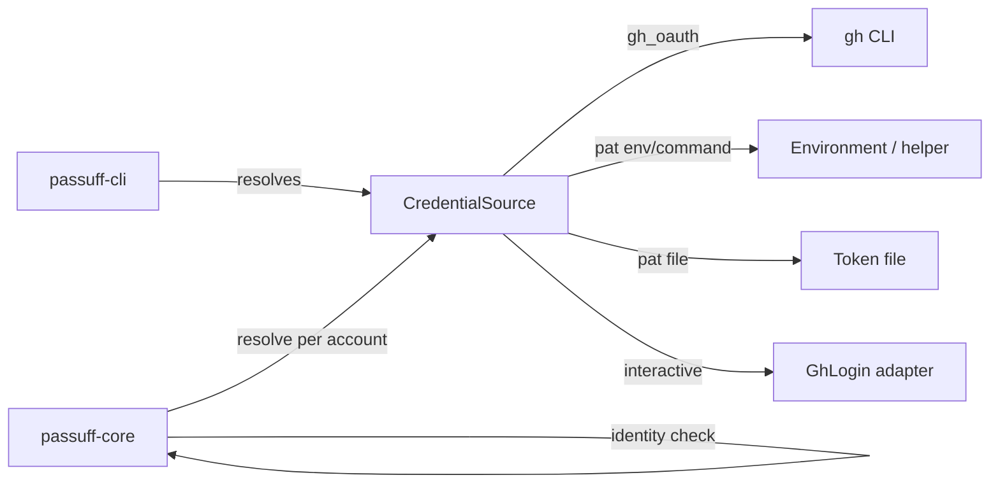
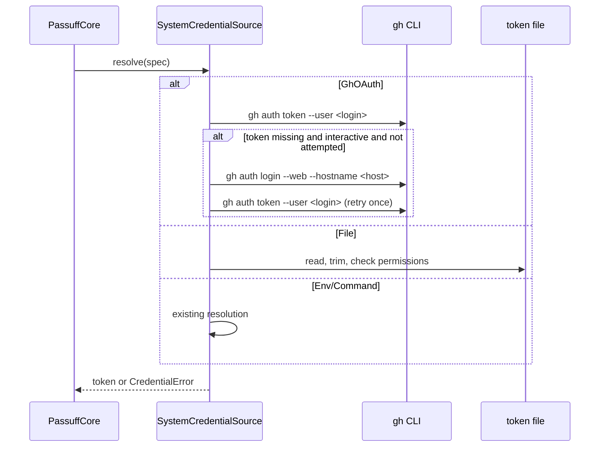

# Design: passuff-auth-modes

## Scope and constraints

This change replaces the implicit credential source with an explicit per-account
credential mode and adds an interactive recovery path for gh-managed
sessions. It keeps the UI-agnostic core: credential acquisition stays behind
`CredentialSource`, and the browser login stays in a CLI-side adapter.

Constraints:

- macOS and Linux only; Unix permission bits are available.
- Tokens never appear in configuration, state, or transcripts.
- `check` and non-interactive runs never start a browser.
- The existing configuration form (`token_env` / `token_command` without
  `auth`) remains valid.
- The gh CLI is an optional runtime dependency for `gh_oauth` only; PAT
  accounts never invoke it.
- A credential is validated against the expected login before any pull request
  is processed for that account.

## Technology decisions

| Decision | Choice | Rationale |
|---|---|---|
| OAuth ownership | Delegate to the operator's gh CLI (`gh auth token --user`, `gh auth login --web`) | A passuff-owned OAuth app needs a registered application and a client ID; gh already owns the consent screen, the token store, and refresh. The future TUI will need its own device flow and is out of scope. |
| gh invocation | `tokio::process::Command` with explicit arguments, inherited stdio for login | No shell interpolation of a login from configuration; the login process must show its own prompts and open the browser. |
| TTY detection | `std::io::IsTerminal` on stdin and stdout | No new dependency; both ends must be interactive for a browser prompt to make sense. |
| Token file permissions | `mode & 0o077 == 0` on Unix, plus owner-read (`0o400`) | Accepts `0600` and `0400`; rejects any group/other access. |
| Tilde expansion | `~` and `~/...` expand from `HOME`; relative paths are rejected | Avoids depending on the process working directory; no shell expansion of environment variables. |
| Login retry | Once per account per process, tracked in the credential source | Prevents browser-tab loops in the watch cycle. |
| Watch cycle seam | `WatchControl` port with `Interrupt` and a test-only `StopAfter` | Lets scenarios run one or two cycles without spawning a signal handler; production default stays `Interrupt`. |

Versions: Rust stable via `rust-toolchain.toml`; cucumber-rs from the existing
`Cargo.lock`; no new runtime dependency. gh is resolved from `PATH` at runtime;
no version pin, because supported gh versions are those that provide
`gh auth token --user` (2.40+) and `gh auth login --web`.

## Architecture impact

### Component view



No new component boundary is introduced. `CredentialSource` remains the port;
the gh and file sources are adapters inside the existing `passuff-core`
credential module. The core's credential sources start token processes
(`gh auth token` and helper commands); the interactive browser login stays behind
the `GhLogin` port, whose process adapter is constructed by the CLI composition
root.

### Contracts and Components

| Contract | Consumer use case | Consumers | Implementing component today | Split trigger |
|---|---|---|---|---|
| `CredentialSource` (resolve one account's token) | watch-pull-requests | `PassuffCore` | `passuff-core` credential module: a resolver over four source adapters (`EnvironmentCredential`, `CommandCredential`, `FileCredential`, `GhOAuthCredential`) | A second credential backend with different lifecycle semantics (for example an embedded OAuth device flow with its own token cache) would split out a new adapter. |
| `GhLogin` (start an interactive browser login) | watch-pull-requests | `SystemCredentialSource` | `passuff-cli` composition root (system adapter), with a recording fake in tests | A TUI needs a non-terminal login surface; that becomes a separate `GhLogin` implementation, not a new core contract. |
| `WatchControl` (stop a watch loop) | watch-pull-requests | `CliRuntime` | `passuff-cli` runtime | A second watch lifecycle (for example a TUI publish loop) may replace the control with its own scheduler. |

## Data model

### Configuration

Existing fields stay. New account fields:

| Field | Type | Rule |
|---|---|---|
| `auth` | `gh_oauth` \| `github_pat` | Optional. Absent means `github_pat` with a legacy source. |
| `github_user` | login string | Required for `gh_oauth`; optional for `github_pat`. Trimmed, non-empty, no whitespace. |
| `token_env` | string | PAT only; exactly one PAT source. |
| `token_command` | string | PAT only; exactly one PAT source. |
| `token_file` | path | PAT only; exactly one PAT source; absolute or `~`-prefixed; must be a regular file; Unix mode must satisfy `0o077 == 0` and include owner read. |
| `token` | — | An explicit rejected field: `account '<label>' must not contain a literal token`. |

Validation matrix:

| `auth` | `github_user` | PAT sources | Result |
|---|---|---|---|
| `gh_oauth` | present | none | valid |
| `gh_oauth` | missing/empty | none | configuration error |
| `gh_oauth` | any | any | configuration error |
| `github_pat` | optional | exactly one | valid |
| `github_pat` | optional | zero or more than one | configuration error |
| absent | optional | exactly one | valid; treated as `github_pat` |
| absent | any | zero or more than one | configuration error |
| unknown value | any | any | configuration error |

Validation messages are part of the contract: `account '<label>' requires
github_user when auth is gh_oauth`, `account '<label>' must not set a personal
access token source when auth is gh_oauth`, `account '<label>' must not contain
a literal token`, `account '<label>' must select exactly one credential source`,
`account '<label>' has unknown auth mode '<value>'`, and
`token_file is not private: <path>`. The transcript wraps them as
`passuff: configuration error: <message>`.

`token_file` permission checks run in `ConfigLoader::load` after parsing: a
present but insecure file is a configuration error (exit 2). A missing file is
not a load error; it becomes an account failure when the account is resolved
(exit 1 in `check`). The resolver repeats the permission check to close the
load-to-use window; a change between load and use is an account failure.

The file path is expanded at load: `~/x` becomes `$HOME/x`; a relative path is
a configuration error. Environment variables inside the path are not expanded;
a helper command remains the way to use `$XDG_CONFIG_HOME`.

### Domain types

```rust
pub enum CredentialSpec {
    Env { variable: String },
    Command { command: String },
    File { path: PathBuf },
    GhOAuth { login: String },
}

pub struct AccountConfig {
    pub credential: CredentialSpec,
    pub graphql_url: Url,
    pub expected_login: Option<String>,
}
```

`expected_login` is `Some` for every `GhOAuth` account (equal to its login) and
for a PAT account that declares `github_user`. `CredentialSpec::File` carries
the expanded path.

`AccountFailureKind` gains `Identity`; the failure detail is
`credential belongs to @<actual>, expected @<expected>`. Credential failures
now carry the resolver's message instead of the fixed
`credential unavailable`, so a missing token file is named in the transcript.

### Persisted state

No schema change. The state remains keyed by the configured account label and
the declared version is unchanged. Changing an account's mode does not reset
its baseline; changing its label creates a new account entry (existing
behavior).

## Decisions

- Decides D1: support environment, helper command, and a permission-checked
  token file; reject a literal token. Realized in `AccountToml` validation,
  `CredentialSpec`, and the README configuration example.
- Decides D2: `github_user` is required for `gh_oauth` and optional for
  `github_pat`; when present, it is validated against `viewer.login`. Realized
  in configuration validation and `PassuffCore::refresh`. Existing
  environment/command configurations stay valid; a wrong token is detected as
  soon as the operator declares the login, without forcing every archived
  configuration to add the field.

## Runtime flow

### Credential resolution



Rules:

- `gh auth token` uses explicit argv, no shell, 10-second timeout, output
  trimmed. A non-zero exit, empty output, or timeout is a credential failure.
- The interactive login runs only when all hold: the spec is `GhOAuth`, the
  source was built with `interactive = true`, and the login for that account
  has not been attempted in this process. The attempt is recorded before the
  process starts, so a failed login never repeats.
- The login command is
  `gh auth login --web --hostname <host>` with inherited stdin/stdout/stderr
  and a 300-second timeout. `<host>` is `github.com` when the account's
  `graphql_url` host is `api.github.com`; otherwise it is the URL host.
- After a successful login the source retries `gh auth token` once. A failure
  after login is a credential failure, not another login.
- A missing `gh` binary or an unsupported command is a credential failure with
  a message naming gh; it never falls back to a PAT.
- File resolution reads the expanded path, requires a regular file, re-checks
  `0o077 == 0`, trims the content, and rejects an empty token.
- `gh auth token` receives `--hostname <host>` as well as `--user <login>`, so a
  GitHub Enterprise account reads the right host's session.
- `check` and every non-interactive run construct the source with
  `interactive = false`; no login adapter is injected.

### Identity validation

After `GitHubGateway::observe` returns, `PassuffCore::refresh` compares
`observation.login` with `expected_login` when the account declares one. The
comparison is ASCII case-insensitive, matching GitHub login semantics. On a
mismatch it records an `AccountFailure` with kind `Identity`, skips every pull
request and the observed login from that account, and continues with the other
accounts. The configured login set is therefore built only from accepted
observations plus persisted logins; a mismatched credential cannot suppress
another account's activity by joining the own-action filter.

A gh OAuth mismatch is normally unreachable because `gh auth token --user`
returns only that login's stored token; a token from another login is a
credential failure. The identity check still applies to gh accounts, and the
mismatch scenario uses a personal access token whose token belongs to another
login, which is the reachable form of the same rule.

The mismatch scenario runs in two phases. First, the `work` account uses a
token for its expected login `octo-work` and records a baseline for
`acme/work#7`; the `personal` account records a baseline for `acme/api#42`.
Then the test rotates the `work` credential to a token belonging to
`octo-other`, changes the authored owner of `acme/work#7` to `octo-other`, and
adds new comments on both pull requests. The final check asserts:

- the account failure names both logins;
- `personal` notifies for the comment from `octo-other`, which fails if
  `octo-other` contaminated the configured login set and suppressed it as an own
  action;
- `work` produces no notification for the known `acme/work#7`, which fails if
  the identity check is skipped and the known pull request is processed.

This makes both R36 clauses non-vacuous: the pull request is known (not a
first-observation baseline) and the login-set exclusion is observable.

### Watch loop and test seam

`CliRuntime::run_watch` accepts a `WatchControl`:

```rust
pub trait WatchControl: Send + Sync {
    fn should_continue(&self) -> bool;
}
```

`Interrupt` returns true until SIGINT; `StopAfter(n)` is used by tests and
returns true for the first `n` cycles. Main uses `Interrupt`. The loop still
prints `passuff: watching` after the first account-successful cycle.

The loop accumulates every line it prints in a `Vec<String>`. `run_watch`
returns that accumulated transcript in `RunOutcome`, and `main` prints
`RunOutcome.transcript` only for `check`; printing it again after the watch loop
would duplicate the last cycle. Tests therefore assert the watch transcript
through `RunOutcome.transcript` without a second output path.

## CLI contract

No new flags. `passuff` (watch) computes interactivity from
`stdin().is_terminal() && stdout().is_terminal()`; `passuff check` always
passes `interactive = false`. `--config`, `--state`, `--verbose`, `--help`,
and `--version` are unchanged.

Transcript additions:

- `passuff: account <label> failed: credential belongs to @<actual>, expected @<expected>`
- `passuff: account <label> failed: token file is missing: <path>`
- `passuff: account <label> failed: token file is readable by other users` is
  not a runtime line; insecure permissions are a configuration error:
  `passuff: configuration error: token_file is not private: <path>`.
- `passuff: configuration error: account '<label>' must not set a personal
  access token source when auth is gh_oauth` (and analogous validation text).
- `passuff: account <label> failed: gh auth login failed`.

The gh login process writes its own prompts to the inherited terminal; passuff
does not duplicate them in the transcript.

## Testing strategy

### Runner and strict mode

- `verify.command`: `./scripts/verify.sh` (executes the delta and permanent
  `.feature` files through cucumber-rs; `GIVN_RESULT_SCOPE` selects the scope).
- `verify.e2e_command`: `./scripts/verify.sh --e2e` with
  `GIVN_RESULT_SCOPE=e2e`.
- Strict mode: `.fail_on_skipped()` on the cucumber builder, proven by the
  undefined-step probe recorded in `tasks.md`.
- Strict stub pattern: every new step body starts as `unimplemented!()`; an
  empty body is never used.
- Single scenario: the runner reads `GIVN_SCENARIO` and filters by exact
  scenario title:
  `GIVN_SCENARIO="A gh OAuth account uses the existing gh session" GIVN_FEATURES=givn/changes/passuff-auth-modes/specs ./scripts/verify.sh`.

### Step definitions

| Step definition file | Capability | Permanent merge target |
|---|---|---|
| `crates/passuff-cli/tests/steps/pr_activity_notification.rs` | `pr-activity-notification` | same file (permanent capability step file) |
| `crates/passuff-cli/tests/steps/pr_activity_notification_e2e.rs` | `pr-activity-notification` (`@e2e`) | same file |

New phrases are added to the existing capability file. No delta step copy is
created.

### Test infrastructure

- Fake gh executable: a shell script in a temporary directory prepended to
  `PATH`. It records every invocation in a log, serves
  `gh auth token --user <login>` from a per-login file, and either succeeds or
  fails `gh auth login` based on a marker. The source and core run in process;
  the real `SystemCredentialSource` executes the fake through `PATH`.
- Recording login adapter: an in-process `GhLogin` implementation records each
  `(login, host)` attempt. It is used for the one-attempt and isolation
  scenarios, because gh's `auth login` command carries no login argument and a
  shell script cannot attribute an attempt to an account.
- Token files: `tempfile::TempDir` with modes `600`, `400`, `640`, `604`, and
  `660`; the test sets `HOME` so `~/work.token` resolves inside the temp
  directory.
- Fake gateway mapping: each token maps to a login and a pull-request set, so a
  token for `octo-other` observes `octo-other`'s pull requests while the
  account expects `octo-work`. A rotation step changes an account's resolved
  login and the authored owner of its known pull request, keeping the baseline
  valid for the key.
- Watch cycles: `StopAfter` control and the existing fake gateway; the
  accumulated transcript is asserted through `RunOutcome`. The helper resolves
  any pending baseline before starting the loop, so a comment added after the
  Given is new activity rather than part of the baseline.
- E2E: the existing wiremock GitHub, private D-Bus fake, and fake `paplay`
  remain; no new `@e2e` scenario is added because the consumer actions are
  unchanged and the login variant is covered at the credential boundary.

### External boundary cases

| Boundary | Adversarial cases |
|---|---|
| gh token | missing binary, non-zero exit, empty output, timeout, wrong login token |
| gh login | non-interactive, already attempted, failure, timeout, success without a token |
| Token file | missing, empty, relative path, group-readable (`640`), other-readable (`604`), group-writable (`660`), owner-read (`400`) and owner-only (`600`) accepted, `~` expansion, HOME unset |
| Configuration | unknown `auth`, gh without login, gh plus PAT source, two PAT sources, literal `token` |
| Identity | mismatch on PAT, case-insensitive match accepted, correct login |

High-risk rules needing discrimination: identity mismatch and login-set
exclusion (R36), browser-login gating (R34), one-attempt rule (R38), permission
rejection (R35), tilde expansion (R35), legacy environment and command
compatibility (R37).

## Interaction coverage

Inventory entries in `givn/specs/watch-pull-requests/usecase.md` remain the
four consumer actions. The auth change alters the precondition of "start
continuous watching" and "run one observation pass"; it introduces no new
consumer action. The missing-session login is a variant of starting the
watcher and is covered by regular scenarios; it is not promoted to a second
`@e2e` scenario for the same action.

| Inventory entry | @e2e scenario | Auth change |
|---|---|---|
| start continuous watching | Developer starts watching and is notified of a new comment | unchanged e2e; the interactive login variant is regular |
| run one observation pass | Developer runs a single check and sees the current activity | unchanged e2e; check never logs in |
| show usage | Developer asks for usage | unchanged |
| show version | Developer asks for the version | unchanged |

## Visual Design Contract

- Interface: terminal
- Viewports: not applicable; transcripts are captured at 100x30
- Design system: none; text rules from the archived change plus the additions
  in the CLI contract above

Persona: `multi-account-developer` (confirmed).

Text rules added: the identity-mismatch line names both logins; the missing
token-file line names the path; configuration errors name the offending
account. No token or token-file content is ever printed. Color carries no
meaning.

Screens covered: continuous watch with an interactive gh login, one-shot check
with a failed credential, and configuration rejection.

Rendered reference: the transcript samples in the CLI contract.

Capture mechanism: the new auth scenarios are regular, so no new `@e2e`
transcript is produced; the four archived transcripts remain the evidence for
the unchanged consumer actions. Intermediate captures, if any, go to
`reports/visual/`.

Motion: none.

## Use-case traceability

| Rule / guarantee | Technical decision | Test evidence |
|---|---|---|
| R32 | Config validation matrix; unknown `auth` and `token` rejected | invalid-credential outline |
| R33 | `CredentialSpec::GhOAuth` runs `gh auth token --user` | gh OAuth session scenario |
| R34 | `interactive` flag from TTY + watch; login adapter injected only then | interactive watch, check, non-interactive watch scenarios |
| R35 | `File` source; `0o077 == 0`; absolute/tilde path; missing file account failure | token-file scenarios |
| R36 | `expected_login` comparison in `PassuffCore::refresh` | identity-mismatch scenario |
| R37 | Legacy no-`auth` parsing maps to PAT | legacy environment scenario |
| R38 | Attempt set in the credential source; login failure is an account failure | one-attempt scenario |
| Minimal guarantee | Auth failure never observes an account; identity mismatch skips its pull requests | identity-mismatch scenario |
| Error isolation | Existing per-account loop; credential and identity failures become `AccountFailure` | existing failed-account scenario plus new ones |
| Exit codes | Config errors 2, credential/identity failures 1 | new scenarios |

## Risks and mitigations

- gh login changes the host's git protocol preference. Mitigation: do not pass
  `--git-protocol`; the operator answers gh's prompt, and the README records
  the side effect.
- gh login needs a browser or a reachable device-code page. Mitigation: a
  failed or timed-out login is an account failure, and the watcher continues
  with other accounts.
- Keyring locked in a headless context. Mitigation: no interactive fallback;
  the account failure names gh.
- Token file changed between load and use. Mitigation: re-check permissions at
  resolution; the stricter check wins.
- gh version without `--user`. Mitigation: the failure is a credential failure
  naming gh; the README states the minimum.
- A second account cannot be selected by `gh auth login`; the browser session
  decides. Mitigation: `github_user` is validated after resolution and a
  mismatch is reported with both logins.

## Arc42 and ADR impact

- Chapters 03 (context), 04 (strategy), 05 (building blocks), 06 (runtime), 08
  (cross-cutting), 09 (decisions), 10 (quality), and 11 (risks) are affected.
- ADR-0004: delegate GitHub OAuth to the gh CLI instead of owning an OAuth
  application. Alternatives: a passuff OAuth app with device flow; PAT-only.
  The decision fixes the external authentication dependency and the consent
  surface. The future TUI's embedded flow is explicitly deferred.
- Cheaper home rejected: `design.md` could describe the gh invocation, but the
  choice fixes a runtime dependency and a consent boundary across future
  changes (including the TUI login plan), so it qualifies as an ADR.
