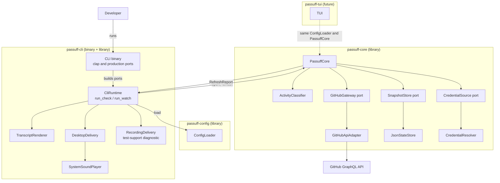
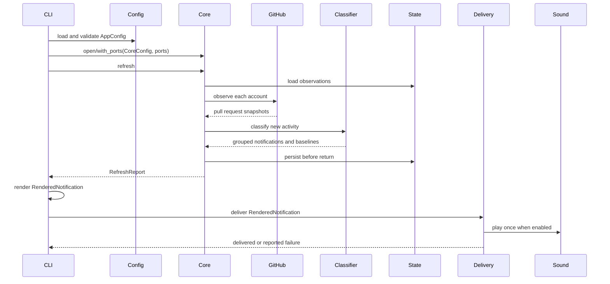

# Design: passuff-pr-watch

## Scope and constraints

passuff is a local watcher with a UI-agnostic core library and a command-line
adapter. The core observes GitHub pull requests authored by one or more
configured accounts, classifies eligible activity, and returns grouped
notifications. The CLI is the first adapter: it parses configuration, prints the
transcript, delivers desktop notifications with sound, handles signals, and maps
exit codes. A future TUI is a second adapter over the same core.

The product supports macOS and Linux. It has no server, no inbound network
surface, and no GitHub mutation path. The change is greenfield: it establishes
the Cargo workspace, the shared configuration library, the core library surface,
the CLI adapter, and the test runner. The activity inbox and TUI are follow-up
changes.

The project is licensed GPL-3.0-or-later, matching givn and watn. Dependencies
must be GPLv3-compatible. `notify-rust` (MIT OR Apache-2.0) and `user-notify`
(LGPL-3.0-or-later) are both compatible; the license does not decide the crate.
The implementation adds the LICENSE file and sets the workspace crate license
fields.

## Technology decisions

Versions were checked on crates.io on 2026-11-02. The installed Rust toolchain
is 1.98.1.

| Concern | Choice | Version / source | Rationale |
|---|---|---|---|
| Language | Rust, stable toolchain | 1.98.1 installed; tasks pin `stable` in `rust-toolchain.toml` and record the resolved version | Existing project preference; one distributable CLI binary; the core stays library-only. |
| Workspace | `passuff-config`, `passuff-core`, `passuff-cli` | Cargo workspace | Shared config, UI-agnostic core, CLI adapter; a future `passuff-tui` member reuses config and core. |
| Async runtime | `tokio` | 1.54.1 (crates.io, 2026-11-02) | Timers, signals, process spawning, HTTP. |
| CLI | `clap` (derive) | 4.6.7 (crates.io, 2026-11-02) | Stable help/version/error handling. |
| HTTP | `reqwest` with `rustls` and `json` | 0.13.5 (crates.io, 2026-11-02) | No OpenSSL system dependency; HTTPS everywhere. |
| Serialization | `serde`, `serde_json`, `toml` | serde 1.0.229, serde_json 1.0.154, toml 1.1.8 (crates.io, 2026-11-02) | Typed config and state. |
| Async traits | `async-trait` | 0.1.92 (crates.io, 2026-11-02) | Object-safe asynchronous ports. |
| Desktop notification | `notify-rust` | 4.18.2 (crates.io, 2026-10-07) | XDG D-Bus on Linux and macOS notifications in one adapter. |
| Linux E2E bus | `zbus` plus system `dbus-daemon` | zbus 6.2.1 (crates.io, 2026-11-02); `dbus-daemon` resolved from the distribution at setup | Dev-only mock `org.freedesktop.Notifications` service on a private session bus. |
| Logging | `tracing`, `tracing-subscriber` | 0.1.44, 0.3.23 (crates.io, 2026-11-02) | Structured stderr logs. |
| Errors | `thiserror` | 2.0.21 (crates.io, 2026-11-02) | Typed error boundaries. |
| Paths | `directories` | 6.0.0 (crates.io, 2026-11-02) | XDG and macOS Application Support paths. |
| Gherkin runner | `cucumber` | 0.23.0 (crates.io, 2026-11-02) | Native Rust Cucumber runner with strict mode. |
| HTTP test twin | `wiremock` (dev) | 0.6.5 (crates.io, 2026-11-02) | Local deterministic GraphQL twin. |
| Temp paths (dev) | `tempfile` | 3.27.0 (crates.io, 2026-11-02) | Isolated config, state, transcripts. |
| Coverage | `cargo-llvm-cov` | 0.9.1 installed; `llvm-tools` installed | Cobertura output for both scopes. |
| License | GPL-3.0-or-later | SPDX identifier | Matches givn and watn; all selected dependencies are GPLv3-compatible. |
| Future TUI | `ratatui`, `crossterm` | Observed in the sibling watn project on 2026-11-02; non-binding, not dependencies of this change | The TUI change confirms its own versions and design contract. |

Only `passuff-config`, `passuff-core`, and `passuff-cli` are workspace members
in this change. `passuff-tui` is a future member.

No version is pinned from memory. The implementation records the resolved
`Cargo.lock` and the exact toolchain version in the setup task.

## Architecture impact

### Component view



Test doubles (`FakeGateway`, `FakeGitHub`, `FakeNotificationService`,
`RecordingSoundPlayer`) are not production components and are not in this
diagram. They are described under Testing.

### Contracts and Components

| Contract | Consumer use case | Consumers | Implementing component today | Split trigger |
|---|---|---|---|---|
| PassuffCore | watch-pull-requests / pr-activity-notification | `passuff-cli`, future `passuff-tui`, Gherkin test harness | `PassuffCore` | A second UI needs the same contract; the core would otherwise grow UI-specific methods. |
| CliRun | run one check or continuous watch with injected ports for the regular Gherkin harness | Gherkin test harness | `CliRuntime` in `passuff-cli/src/lib.rs` | A second embedding of the CLI loop. |
| Configuration | load and validate configuration | `passuff-cli`, future `passuff-tui` | `ConfigLoader` in `passuff-config` | A different configuration format or remote configuration. |
| GitHubGateway | observe authored pull requests | `PassuffCore` | `GitHubApiAdapter` | A second forge or a materially different GitHub Enterprise authentication path. |
| SnapshotStore | load and persist observations | `PassuffCore` | `JsonStateStore` | Concurrent watchers, or state size needs indexed queries. |
| CredentialSource | resolve one account credential | `PassuffCore` | `CredentialResolver` (environment and command adapters) | A keychain or secret-service source. |
| NotificationDelivery | deliver one rendered notification | `CliRuntime` | `DesktopDelivery`; `RecordingDelivery` is a `test-support` diagnostic adapter | A second delivery channel, or platform delivery needs an independent component. |
| SoundPlayer | play the notification sound once | `DesktopDelivery` | `SystemSoundPlayer`; `RecordingSoundPlayer` is a `test-support` double | A bundled audio engine replaces process invocation, or a second platform backend needs isolation. |
| TranscriptRenderer | render notifications, account failures, baselines, empty cycles, and delivery errors as terminal text | `passuff-cli`, Gherkin test harness | `TranscriptRenderer` | A second text format, or the TUI needs a different renderer. |

`PassuffCore` is the UI-agnostic contract. It returns a `RefreshReport`
(notifications, account failures, and baselines recorded) and owns no terminal,
notification, sound, or CLI dependency. `ActivityClassifier` is an internal
helper. `passuff-config` owns the TOML schema and validation; it has no UI or
terminal dependency. `passuff-cli` owns argument parsing, transcript rendering,
delivery, sound, signals, and exit codes; its `CliRuntime` is also the regular
Gherkin harness's entry point. A test double is not a production component; the
production contract has one implementing component.

### Modules

- Workspace root `Cargo.toml` — members `crates/passuff-config`,
  `crates/passuff-core`, and `crates/passuff-cli`.
- `crates/passuff-config/src/lib.rs` — `AppConfig`, `CoreConfig`,
  `NotificationsConfig`, `ConfigLoader`, `ConfigError`.
- `crates/passuff-core/src/lib.rs` — `PassuffCore`, `RefreshReport`,
  `AccountFailure`, `CoreError`, and re-exported domain types.
- `crates/passuff-core/src/domain.rs` — `Account`, `AuthoredPullRequest`,
  `WatchedPullRequest`, `Baseline`, `PullRequestKey`, `ActivityEvent`,
  `Notification`, `CiResult`, `LoginSet`.
- `crates/passuff-core/src/classifier.rs` — pure classification of new activity.
- `crates/passuff-core/src/github.rs` — `GitHubGateway` port and
  `GitHubApiAdapter`.
- `crates/passuff-core/src/state.rs` — `SnapshotStore` port, `JsonStateStore`,
  atomic writes, corruption recovery.
- `crates/passuff-core/src/credential.rs` — `CredentialSource` port,
  `CredentialResolver`, environment and command adapters.
- `crates/passuff-core/src/cycle.rs` — one check cycle, account isolation,
  grouping, persistence ordering.
- `crates/passuff-cli/src/main.rs` — thin process entry; builds production ports and calls `CliRuntime`.
- `crates/passuff-cli/src/lib.rs` — `CliRuntime`, `CliPorts`, `RunOutcome`, `run_check`, `run_watch`, and the CLI exit-code mapping.
- `crates/passuff-cli/src/cli.rs` — clap definitions, help/version behavior.
- `crates/passuff-cli/src/transcript.rs` — `TranscriptRenderer`.
- `crates/passuff-cli/src/delivery.rs` — `NotificationDelivery`,
  `DesktopDelivery`, `RecordingDelivery`.
- `crates/passuff-cli/src/sound.rs` — `SoundPlayer`, `SystemSoundPlayer`,
  `RecordingSoundPlayer`.
- `crates/passuff-cli/tests/features_runner.rs` — Gherkin entry point and Givn
  result contract.
- `crates/passuff-cli/tests/steps/` and `crates/passuff-cli/tests/support/` —
  step definitions and twins.
- `crates/passuff-cli/assets/notification.wav` — bundled CC0 chime, 0.35 s,
  44.1 kHz mono 16-bit.
- `crates/passuff-tui/src/main.rs` — future TUI member; not present in this
  change.

### Future UI adapters

This section is non-binding direction for a follow-up change; it does not add
dependencies or behaviour here. `passuff-tui` will depend on `passuff-config`
and `passuff-core`, not on `passuff-cli`. It will call the same
`PassuffCore::refresh` report and the inbox change's query methods, and render
them in its own event loop.

The TUI change will record its own Visual Design Contract and confirm its
terminal crate versions. The intended visual language follows the sibling watn
project: bordered frame, filter tabs, header counts and focus, a `Controls`
footer, keyboard-first navigation, and centered confirmation dialogs.

## Data model

### Configuration

`passuff-config` deserializes the TOML document into `FileConfig`, validates it,
and returns `AppConfig`:

```rust
pub struct AppConfig {
    pub poll_interval_secs: u64,
    pub core: CoreConfig,
    pub notifications: NotificationsConfig,
}

pub struct CoreConfig {
    pub accounts: BTreeMap<String, AccountConfig>,
    pub events: EventToggles,
}

pub struct AccountConfig {
    pub credential: CredentialSpec,
    pub graphql_url: Url,
}

pub enum CredentialSpec {
    Env { variable: String },
    Command { command: String },
}

pub struct EventToggles {
    pub comments: bool,
    pub reviews: bool,
    pub ci_failure: bool,
    pub ci_recovery: bool,
    pub state_changes: bool,
    pub bot_comments: bool,
}

pub struct NotificationsConfig {
    pub desktop: bool,
    pub sound: bool,
    pub sound_file: SoundFile,
    pub urgency: Urgency,
}

pub enum SoundFile {
    Default,
    Path(PathBuf),
}

pub enum Urgency {
    Low,
    Normal,
    Critical,
}
```

The TOML shape:

```toml
poll_interval_secs = 60

[notifications]
desktop = true
sound = true
sound_file = "default"
urgency = "normal"

[events]
comments = true
reviews = true
ci_failure = true
ci_recovery = true
state_changes = true
bot_comments = false

[accounts.personal]
token_env = "PASSUFF_PERSONAL_TOKEN"
# graphql_url = "https://api.github.com/graphql"

[accounts.work]
token_command = "gh auth token --user work"
```

`FileConfig` is the deserialization shape: top-level `poll_interval_secs`,
`[events]`, `[accounts.*]`, and `[notifications]`. Each account is deserialized
through `AccountToml` with `token_env` and `token_command`, then converted to
`AccountConfig.credential: CredentialSpec`.

Rules:

- `accounts` is required and non-empty. Each TOML key is the account label.
- `token_env` and `token_command` are mutually exclusive; exactly one is
  required. Both forms become a `CredentialSpec`.
- `passuff-config` validates the schema. It never executes a credential
  command. `PassuffCore` resolves the credential at observation time through
  the `CredentialSource` port. A command runs through `/bin/sh -c`, has a 10 s
  timeout, and its stdout is trimmed; a nonzero exit, empty output, or timeout
  is an account failure. Stderr and the token are redacted from every report,
  log, and transcript.
- `graphql_url` defaults to `https://api.github.com/graphql`. Plain HTTP is
  accepted only for `127.0.0.1` and `localhost`; every other address must be
  HTTPS.
- `poll_interval_secs` defaults to 60. Values below 1 are invalid. Values below
  30 log a warning because of GitHub rate limits. This is a CLI scheduling
  setting; it is not passed to `PassuffCore`.
- Unknown TOML keys are rejected with the offending path.
- `sound_file` is `default` or an existing readable file path.
- `SoundFile` and `Urgency` are config-local types. `passuff-config` does not
  depend on `notify-rust`; `DesktopDelivery` maps `Urgency` to the crate's
  urgency.
- The CLI passes `AppConfig.core` to `PassuffCore::open` and uses
  `AppConfig.notifications` for delivery.
- The config path defaults to the platform config directory
  (`~/.config/passuff/config.toml` on Linux,
  `~/Library/Application Support/passuff/config.toml` on macOS) and can be
  overridden with `--config`.

### Persisted state

`WatcherState` is versioned JSON written to the platform state directory
(`~/.local/state/passuff/state.json` on Linux,
`~/Library/Application Support/passuff/state.json` on macOS) or `--state`.

```json
{
  "version": 1,
  "accounts": {
    "personal": {
      "login": "octo-personal",
      "last_check_at": "2026-11-02T12:00:00Z",
      "pull_requests": {
        "acme/api#42": {
          "node_id": "PR_kw...",
          "author": "octo-personal",
          "repository": "acme/api",
          "number": 42,
          "title": "Split the migration",
          "url": "https://github.com/acme/api/pull/42",
          "created_at": "2026-11-01T09:00:00Z",
          "updated_at": "2026-11-02T11:59:00Z",
          "baseline": {
            "recorded_at": "2026-11-01T09:01:00Z",
            "seen_comment_ids": ["IC_1"],
            "seen_review_ids": ["PRR_1"],
            "seen_review_comment_ids": ["PRRC_1"],
            "head_oid": "abc123",
            "ci_state": "SUCCESS",
            "state": "OPEN"
          },
          "current": {
            "seen_comment_ids": ["IC_1", "IC_2"],
            "seen_review_ids": ["PRR_1"],
            "seen_review_comment_ids": ["PRRC_1"],
            "head_oid": "abc123",
            "ci_state": "SUCCESS",
            "ci_failed": false,
            "state": "OPEN",
            "state_reported": false
          }
        }
      }
    }
  }
}
```

- A `WatchedPullRequest` is the persisted observation record for one authored
  pull request. Its immutable `Baseline` is the first recorded snapshot; its
  `CurrentObservation` is compared with each new snapshot.
- `last_check_at` is written at the end of a successful account cycle. The
  short-lived and reopen rules use it as the previous observation boundary.
- Known closed or merged pull requests remain tracked for 30 days so a reopen
  can be observed. Older closed records are pruned after a successful cycle.
- The state is written to a temporary file in the same directory, flushed, and
  renamed over the target. Unix mode is 0600.
- A missing file is an empty state. A corrupt file is renamed to
  `state.json.corrupt.<unix-ts>` and an empty state is used; the watcher reports
  `Fresh baseline recorded`.
- A state version other than `1` is treated as corrupt.
- Seen ID sets hold the IDs present in the current observation window. The
  window is the last 100 conversation comments, last 100 reviews, and last 100
  review comments per pull request. The bound is a documented limit: a burst
  larger than the window between two checks can omit an event.
- Tokens are never written to state.

### Domain types

- `Account { label, login }` — a configured account with its resolved login.
- `AuthoredPullRequest` — the observed snapshot of a pull request whose author
  is in the configured login set. It carries key, title, URL, createdAt,
  updatedAt, state, merged flag, head OID, CI result, comments, reviews, review
  comments, and the ignored metadata fields: draft, assignees, labels,
  milestone, and base branch. The metadata fields are fetched so the
  non-notified-change rule is testable; the classifier never reads them.
- `WatchedPullRequest { key, title, url, author, created_at, updated_at,
  baseline, current }`.
- `Baseline { recorded_at, seen_comment_ids, seen_review_ids,
  seen_review_comment_ids, head_oid, ci_state, state }`.
- `CurrentObservation { seen_comment_ids, seen_review_ids,
  seen_review_comment_ids, head_oid, ci_state, ci_failed, state,
  state_reported }`.
- `PullRequestKey { repository, number }`, displayed as `repository#number`.
- `ActivityEvent` variants: `Comment { author, body_excerpt }`,
  `ReviewComment { author, body_excerpt }`, `Review { author, state }`,
  `CiFailure { failed_checks }`, `CiRecovery`, `StateChange { state }`.
- `Notification { key, events }`. The core returns data; the CLI renders the
  title, body, and transcript through `RenderedNotification`.
- `RenderedNotification { title, body, transcript, sound }` is a CLI type. The
  title is `passuff: <key>`; the body and transcript carry the event lines.
- `RefreshReport { notifications, account_failures, baselines_recorded }`.
- `AccountFailure { label, kind, detail: Option<String> }` where `kind` is
  `Authentication`, `RateLimited { reset_at }`, `Timeout`, `Transport`,
  `MalformedResponse`, or `Credential`. `detail` is a redacted, display-safe
  explanation; it never contains a token or command stderr.
- `CoreError { State(StateError) }`. Configuration errors are
  `passuff-config::ConfigError`. Account failures are report data, not
  `CoreError` values. Classification is infallible.
- `StateError` variants: `Read { path, message }`,
  `Write { path, message }`, and `Quarantine { path, message }`. A corrupt or
  unknown-version file is quarantined and replaced, not returned as a
  `CoreError`; only a failure to quarantine is `StateError::Quarantine`.
- `CiResult { state, failed_checks }` where state is `SUCCESS`, `FAILURE`,
  `ERROR`, `PENDING`, or `NONE`.
- `LoginSet` is a case-insensitive set of GitHub logins.

The public core surface is:

```rust
pub struct PassuffCore { /* ... */ }

impl PassuffCore {
    pub async fn open(config: CoreConfig, state_path: PathBuf) -> Result<Self, CoreError>;
    pub async fn with_gateway(
        config: CoreConfig,
        state_path: PathBuf,
        gateway: Arc<dyn GitHubGateway>,
    ) -> Result<Self, CoreError>;
    pub async fn with_ports(
        config: CoreConfig,
        gateway: Arc<dyn GitHubGateway>,
        store: Arc<dyn SnapshotStore>,
        credentials: Arc<dyn CredentialSource>,
    ) -> Result<Self, CoreError>;
    pub async fn refresh(&mut self) -> Result<RefreshReport, CoreError>;
}
```

`open` wires the production `GitHubApiAdapter`, `JsonStateStore`, and
`CredentialResolver`. `with_gateway` uses the real store and credentials.
`with_ports` is the complete test seam used by the regular Gherkin harness and
the state-failure scenario. No `accounts()` accessor is exposed until a second
consumer needs it. Future inbox methods (`pull_requests`, `activity`,
`mark_read`) are added by the follow-up change; they are not part of this
contract yet.

### GraphQL observation

One query per account per cycle. The query requests the viewer login and the
100 most recently updated authored pull requests across all states. Each pull
request node includes repository, number, title, URL, state, merged flag,
createdAt, updatedAt, draft flag, assignees, labels, milestone, base branch,
author login, the last 100 conversation comments, the last 100 reviews, the
last 100 review comments across the last 50 review threads, and the latest
commit OID with its `statusCheckRollup` state and check contexts.

Known open, closed, and merged pull requests that fall outside the 100 most
recently updated are fetched by node ID in batches of 100. Known closed or
merged records are tracked for 30 days so a reopen is observed. A node is
considered authored only when its author login matches the account's resolved
login.

Pagination is applied when `pageInfo.hasNextPage` is true. The query is bound
to one account; accounts run concurrently but each token remains under its own
rate limit.

### Classification

`ActivityClassifier::classify(previous: Option<&WatchedPullRequest>, current: &AuthoredPullRequest, toggles: &EventToggles) -> Classification` is the pure entry point. `Classification { events, baseline }` carries the grouped events and the optional fresh baseline. `PassuffCore::refresh` and `CliRuntime::run_check` use this entry point; the regular harness calls the runtime.

For each observed authored pull request:

1. If no `WatchedPullRequest` exists, record a baseline for that pull request
   and emit no events. This applies to the first observation of every pull
   request, including one first seen after the account's first cycle.
2. Exception for a short-lived pull request: if no observation exists, the
   account has already completed at least one cycle, `createdAt` is after the
   account's `last_check_at`, and the pull request is merged or closed, emit a
   state change and record `current.state_reported = true`. A long-lived
   closed pull request created before `last_check_at` is baselined silently.
3. Comments, reviews, and review comments with IDs outside the recorded sets
   are new. Filter out authors in the configured login set. Filter out bot
   authors unless `events.bot_comments` is true.
4. When the head OID changes, reset `ci_failed` to false. If the new commit's
   CI state is `FAILURE` or `ERROR`, set `ci_failed` to true and emit
   `CiFailure`; `PENDING` and `SUCCESS` emit nothing because there was no prior
   failure on that commit.
5. On the same head OID: a transition to `FAILURE` or `ERROR` sets `ci_failed`
   and emits `CiFailure` only when `ci_failed` was false. A transition to
   `SUCCESS` when `ci_failed` is true clears the flag and emits `CiRecovery`.
   `PENDING` preserves the flag, so `FAILURE -> PENDING -> SUCCESS` still emits
   recovery, and a repeated failure does not re-notify.
6. A transition from `OPEN` to `MERGED` or `CLOSED` emits a state change once,
   regardless of which actor performed it. A reopen records `OPEN` and resets
   `state_reported` without emitting; a later merge or close notifies again.
   Known closed or merged records are retained for 30 days so this transition
   can be observed.
7. Event family toggles suppress conversation and review comments (`comments`),
   submitted reviews (`reviews`), CI failure (`ci_failure`), CI recovery
   (`ci_recovery`), or state changes (`state_changes`) before grouping. The
   `bot_comments` toggle is a separate filter.
8. Events are grouped by pull request. One notification per pull request per
   cycle.

Label, draft, assignee, milestone, and base-branch changes are fetched but
never read by the classifier. They cannot produce an event.

Precedence is fixed: configured login set first, then bot filter, then event
toggle. A bot account that is also a configured account is an own action and
stays silent. Own actions are comments and reviews; a merge or close is a
state change and notifies regardless of actor.

### Notification content

The core returns `Notification { key, events }`. The CLI's
`TranscriptRenderer` produces a `RenderedNotification { title, body, transcript,
sound }`:

```text
title:      passuff: acme/api#42
body:       New comment from @alice
            CI failing: build, test
transcript: passuff: acme/api#42
              New comment from @alice
              CI failing: build, test
```

Event lines:

- `New comment from @<login>`
- `Review comment from @<login>`
- `Review <state> by @<login>` where state is `approved`, `changes requested`,
  or `commented`
- `CI failing: <checks>` or `CI failing` when no check names are available
- `CI recovered`
- `Merged`
- `Closed`

A notification with no events is not created. `RefreshReport.baselines_recorded`
carries the keys for which a fresh baseline was recorded; the renderer emits
`passuff: Fresh baseline recorded for <key>` for each key. The transcript also
renders `passuff: watching` after the first successful baseline cycle,
`passuff: no notifications` for an empty cycle, and the error lines defined in
the Visual Design Contract.

## Runtime flow



The core persists state before returning the report. The CLI delivers after.
A crash after the return but before delivery can lose a notification; it cannot
replay one. The no-replay guarantee (R15) takes precedence over retrying a
failed delivery. Delivery failures are reported in the transcript and log. The
core never depends on a delivery adapter, so a future TUI can consume the same
`RefreshReport` from its own event loop.

## CLI contract

```text
passuff [OPTIONS] [COMMAND]

Commands:
  check   Run one observation pass and print notifications
  help    Print help

Options:
  --config <PATH>   Configuration file
  --state <PATH>    Persisted observation file
  --verbose         Verbose stderr logging
  -h, --help
  -V, --version
```

- No subcommand starts continuous watching immediately, then waits
  `poll_interval_secs` between cycles.
- `check` runs exactly one cycle and exits.
- The default config and state paths are platform directories; `--config` and
  `--state` override them.
- `--help` and `--version` do not read configuration.
- SIGINT and SIGTERM stop continuous watching cleanly after the current cycle;
  state is already persisted per cycle. Exit status is 0.
- The CLI maps `passuff-config::ConfigError` to exit 2. It maps account failures
  in `RefreshReport` to exit 1 in `check` mode; notifications from healthy
  accounts are still delivered. It maps `CoreError::State` to exit 3. In
  continuous mode, account failures are logged and retried next cycle; the
  process does not exit.
- The binary is provided by `passuff-cli`. The crate also exposes a library
  entry point in `src/lib.rs`:

  ```rust
  pub struct CliPorts {
      pub gateway: Arc<dyn GitHubGateway>,
      pub store: Arc<dyn SnapshotStore>,
      pub credentials: Arc<dyn CredentialSource>,
      pub delivery: Arc<dyn NotificationDelivery>,
  }

  pub struct RunOutcome {
      pub exit: ExitCode,
      pub report: Option<RefreshReport>,
      pub transcript: String,
  }

  pub struct CliRuntime {
      pub ports: CliPorts,
  }

  impl CliRuntime {
      pub async fn run_check(&self, config: Result<AppConfig, ConfigError>) -> RunOutcome;
      pub async fn run_watch(&self, config: Result<AppConfig, ConfigError>) -> RunOutcome;
  }
  ```

  `main.rs` parses arguments, builds the production ports (including the
  `JsonStateStore` from the `--state` path), and calls `CliRuntime`. A
  configuration load error is passed as `Err(ConfigError)` so the
  invalid-configuration scenario can observe exit 2. The regular Gherkin
  harness calls the same runtime with test ports and asserts `RunOutcome.exit`,
  `RunOutcome.report`, and `RunOutcome.transcript`. A `DesktopDelivery` owns its
  `SoundPlayer`; the delivery port is the only delivery dependency in
  `CliPorts`.
- Continuous mode prints `passuff: watching` only after the first successful
  baseline cycle. The E2E start scenario waits for that line, so a comment
  posted after readiness is always a new event.
- The core has no exit-code, signal, or transcript behavior.

## Notification delivery

Everything in this section belongs to `passuff-cli`. The core returns
`Notification` data and has no delivery dependency. The CLI's
`TranscriptRenderer` turns a `Notification` into a
`RenderedNotification { title, body, transcript, sound }`; the
`NotificationDelivery` port receives that rendered value, so the desktop and
recording adapters share the same title and body.

### Linux

`DesktopDelivery` calls `notify-rust` with `appname("passuff")`, the rendered
title and body, and the configured urgency. `notify-rust` uses the session D-Bus
`org.freedesktop.Notifications`. If no daemon is reachable, the delivery
adapter reports the error; the transcript still shows the notification.

### macOS

`DesktopDelivery` uses `notify-rust`'s macOS backend. The application identifier
is set to `dev.passuff.app` before the first notification. A minimal
`Passuff.app` bundle generated by the packaging task supplies
`CFBundleIdentifier = dev.passuff.app`, `CFBundleName = passuff`, and
`LSUIElement = true`. The bundle is the supported path for stable notification
attribution. Running the bare binary remains functional, but macOS may attribute
notifications to the terminal. That limitation is documented in the README.

### Sound

The sound strategy is one bundled WAV played by a system player, not an audio
library:

- macOS: `afplay <path>`.
- Linux: first available of `paplay`, `pw-play`, `aplay`; `canberra-gtk-play`
  is a final fallback.
- `SoundPlayer::play` returns `SoundOutcome::{Played, Disabled, Unavailable,
  Failed}`. If no player exists, `DesktopDelivery` sets the XDG `sound-name`
  hint to `message-new-instant` and reports `Unavailable`; the desktop
  notification is still delivered.
- If sound is disabled in `NotificationsConfig`, the player is not called and
  the outcome is `Disabled`.
- The player runs asynchronously with a short timeout. `Failed` is logged and
  does not affect the transcript or the state.

The WAV is embedded with `include_bytes!`, written once to the platform cache
directory, and reused. It is a generated 0.35 s chime with no third-party
licensing. The sound toggle is a CLI setting; the core does not know whether
sound is enabled. `RecordingSoundPlayer` (test-support) records the path and
outcome so the configured-sound scenario can assert the configured file.

### Diagnostic delivery

`RecordingDelivery` and `RecordingSoundPlayer` are gated behind the
`test-support` feature. When `PASSUFF_NOTIFICATION_SINK` names a file in a
`test-support` build, `DesktopDelivery` is replaced by `RecordingDelivery`,
which appends one JSON line per notification:

```json
{"pr":"acme/api#42","title":"passuff: acme/api#42","body":"New comment from @alice","sound":true}
```

`RecordingDelivery` is the digital twin of the desktop surface for macOS E2E and
diagnostics. It is not part of a default release build. On Linux E2E, the real
`DesktopDelivery` and `notify-rust` run against a private D-Bus fake described
under Testing. The `test-support` feature is enabled by the
`features_runner` test target.

## State and reliability

- One check cycle is per-account isolated. A failure to resolve an account
  credential, resolve a login, authenticate, fetch, or parse marks that account
  failed; the remaining accounts continue.
- A missing runtime credential value (unset environment variable, empty or
  failed command, timeout) is an `AccountFailureKind::Credential`. A
  configuration with no credential source at all is a `ConfigError` and exits
  2 (R19). The command runs through `/bin/sh -c` with a 10 s timeout; stderr and
  the token are redacted from the report.
- HTTP 401/403 marks the account failed with an authentication message.
- HTTP 429 or a GraphQL rate-limit error reports the reset time and skips the
  account for the cycle.
- A request timeout (30 s connect, 60 s total) marks the account failed for the
  cycle.
- GraphQL `errors` with usable `data` are logged; `data` is used. Without
  usable `data`, the account fails.
- Malformed JSON marks the account failed; state for that account is unchanged.
- A state write failure makes `PassuffCore::refresh` return
  `CoreError::State(StateError::Write { path, message })` before it returns a
  report. The CLI maps that to exit 3 in `check` mode; continuous mode retries
  next cycle.
- A state read failure due to corruption renames the file and starts empty.
- A token resolving to a different login than the cached login discards that
  account's observations and records a fresh baseline.
- `last_check_at` is written at the end of a successful account cycle. Known
  closed or merged pull requests are retained for 30 days and pruned after a
  successful cycle.
- Account failures are returned in `RefreshReport.account_failures`; the core
  never decides the process exit status. `CoreError` has only the `State`
  variant; classification is infallible and GitHub failures are account
  failures.
- Delivery and sound failures are CLI concerns. They are reported in the
  transcript and log and do not alter core state.

## Testing strategy

### Gherkin runner

`crates/passuff-cli/tests/features_runner.rs` is the single Gherkin entry point.
`crates/passuff-cli/Cargo.toml` declares:

```toml
[features]
test-support = []

[[bin]]
name = "passuff"
path = "src/main.rs"

[[test]]
name = "features_runner"
path = "tests/features_runner.rs"
harness = false
required-features = ["test-support"]
```

The test binary reads `GIVN_FEATURES` (a feature file or directory),
`GIVN_RESULT_SCOPE` (`change`, `regular`, or `e2e`), and `GIVN_RESULT_FILE`. It:

- runs the given features through `cucumber`;
- filters `@e2e` in or out according to the scope;
- counts scenarios with a `CountingWriter` that observes scenario-finished
  events;
- writes the four-count JSON atomically to `GIVN_RESULT_FILE`; it does not
  depend on the `givn` binary for the result;
- exits nonzero if any scenario fails, any step is skipped, or any step is
  undefined.

`verify.command` becomes `./scripts/verify.sh`. The script runs the workspace
unit tests first, then `cargo test -p passuff-cli --features test-support --test
features_runner`. `verify.e2e_command` becomes `./scripts/verify.sh --e2e`; it
runs only the E2E feature scope. The feature runner selects only `@e2e`
scenarios in that scope and only non-`@e2e` scenarios in `regular`. In `change`,
it runs all delta scenarios, including `@e2e`.

The runner is also usable for one scenario:

```text
GIVN_FEATURES=givn/changes/passuff-pr-watch/specs/watch-pull-requests/pr-activity-notification.feature \
cargo test -p passuff-cli --features test-support --test features_runner -- --name "Developer asks for usage"
```

The setup task sets `verify.command`, `verify.e2e_command`, and the `run` block
in `givn/commands.yaml`; the repository's current sentinel values are replaced
only during implementation. The setup task also creates `./scripts/verify.sh`,
`./measure-coverage.sh`, and `./merge-coverages.sh` at the paths already named
in `givn/commands.yaml`.

### Strict mode

`World::cucumber().fail_on_skipped()` is the strict-mode switch in
cucumber-rs 0.23. It turns skipped or undefined steps into failures. The RED
pattern is:

- every new step body starts with `unimplemented!("RED: <scenario>")`;
- production stubs return an error or `todo!()` rather than a silent value;
- no step body is empty.

The setup task proves strictness with a temporary feature containing an
undefined step or a step that calls `unimplemented!()`. The runner must exit
nonzero and the result file must report `failed > 0` (or `skipped > 0` if the
step is skipped and `fail_on_skipped` is active). The fixture is removed after
the proof, and the command and output are recorded in the task evidence. The
same task builds `cargo build -p passuff-cli --bin passuff` and runs
`passuff --version` before declaring the runner GREEN.

### Step definitions

| Step definition file | Feature | Permanent merge target |
|---|---|---|
| `crates/passuff-cli/tests/steps/pr_activity_notification.rs` | pr-activity-notification.feature (regular scenarios) | `crates/passuff-cli/tests/steps/pr_activity_notification.rs` |
| `crates/passuff-cli/tests/steps/pr_activity_notification_e2e.rs` | pr-activity-notification.feature (`@e2e` scenarios) | `crates/passuff-cli/tests/steps/pr_activity_notification_e2e.rs` |

Both files are included by `crates/passuff-cli/tests/features_runner.rs`. The
regular file calls `CliRuntime::run_check` with `CliPorts` built from
`FakeGateway`, a real `JsonStateStore` (or a failing store for the state-failure
scenario), and a `NotificationDelivery` chosen per scenario: `RecordingDelivery`
for transcript-only rules, or `DesktopDelivery` with `RecordingSoundPlayer` for
sound rules. It asserts `RunOutcome.exit`, `RunOutcome.report`, and
`RunOutcome.transcript`. `PassuffCore::with_ports` consumes the injected store
and credentials. The E2E file spawns the real `passuff` binary and drives the
real CLI surface.

### E2E infrastructure

- Real interface: the `passuff` CLI from `passuff-cli`, spawned as a child
  process with `env!("CARGO_BIN_EXE_passuff")` (available in the CLI crate's
  integration test).
- Fake GitHub: `wiremock 0.6.5` on `127.0.0.1`, configured by the test harness.
  It matches the bearer token to an account fixture and returns GraphQL
  envelopes. It records requests for identity and window assertions.
- Config and state: per-scenario `tempfile` directories, written by the step
  definitions. The child receives `--config` and `--state`.
- Tokens: per-account environment variables with test values. No real token is
  read.
- Linux desktop twin: each E2E scenario gets its own private bus started with
  `dbus-daemon --session --nofork --print-address=1 --print-pid=1` and a minimal
  config file with no service activation. The fake service connects with
  `ConnectionBuilder::address(&private_address)`, never `Connection::session`,
  and registers a `zbus` `FakeNotificationService` implementing
  `org.freedesktop.Notifications` (`Notify`, `GetCapabilities`,
  `GetServerInformation`, `CloseNotification`). The harness waits for the
  `RequestName` success before starting the child. The service runs on a
  dedicated thread/runtime and records title, body, and hints to a JSONL file.
  The address is passed only to the child's `DBUS_SESSION_BUS_ADDRESS`; the test
  process's global environment is not changed. An RAII guard stops the bus and
  drains the log after the scenario. The real `DesktopDelivery` and
  `notify-rust` path is used; no `PASSUFF_NOTIFICATION_SINK` is set.
- macOS desktop twin: the E2E binary is built with the `test-support` feature;
  `PASSUFF_NOTIFICATION_SINK` points at a temp JSON-lines file consumed by
  `RecordingDelivery`. The real macOS surface is covered by the manual smoke
  test.
- Sound player: a temp directory prepended to `PATH` contains a fake `paplay`
  shell script that appends one line to a log. On macOS the same fixture
  provides `afplay`. The test harness asserts a single line for one grouped
  notification and zero lines when sound is disabled.
- Continuous watching: the child is started with a 1-second interval. The step
  waits for the `passuff: watching` readiness line, which is emitted after the
  first successful baseline cycle; only then does it update the fake GitHub
  fixture, wait for the notification, send `kill -INT`, and assert exit 0.
- Transcript evidence: every `@e2e` scenario writes its full stdout/stderr to
  `givn/changes/passuff-pr-watch/evidence/visual/<scenario-slug>/transcript.txt`.
  On Linux, the fake notification service log is an additional artifact under
  the same directory. The slug is the title lowercased with non-alphanumerics
  replaced by `-`.
- `dbus-daemon` is a test prerequisite. The setup task installs or verifies it
  and records the distribution-specific command. The E2E scope fails with a
  clear message when the private bus cannot start; the regular scope still
  runs.
- The E2E step harness uses the CLI's `TranscriptRenderer` to build the expected
title, body, and transcript for its assertions. This also gives the E2E test
process a real production probe for coverage.

### Regular scenarios

Regular scenarios call `CliRuntime::run_check` with `CliPorts` built from
`FakeGateway`, a real or failing `SnapshotStore`, and the delivery chosen for
the scenario: `RecordingDelivery` or `DesktopDelivery` with
`RecordingSoundPlayer`. They assert `RunOutcome.exit`, `RunOutcome.report`, and
`RunOutcome.transcript`. They cover the classification rules, event family
and bot toggles, non-notified change types, baseline rules, short-lived and
reopen rules, own merge, pending-state recovery, cross-channel toggles, dedupe,
account isolation, exit codes, and state recovery. Each check clears the
previous transcript buffer, so a later assertion cannot match an earlier check. The E2E scenarios cover the four real CLI interactions. The
regular scenarios do not duplicate the E2E assertions: they assert the specific
rule variants that the four E2E smoke scenarios cannot each cover.

## Visual Design Contract

- Interface: terminal
- Viewports: not applicable; the transcript is captured at 100 columns by 30
  rows
- Design system: none; terminal text rules are defined here

This contract covers the `passuff-cli` adapter only. The future TUI records its
own terminal contract; the core has no visual contract.

Persona disposition:

| Persona | Confirmed | Relevance | Evidence |
|---|---|---|---|
| `multi-account-developer` | yes | The CLI transcript and desktop notification are the operator's surface. | `proposal.md` Use-Case Context; `usecase.md` Personas. |

Text rules:

- Every user-facing transcript line starts with `passuff:` or is an indented
  event line under a `passuff:` header.
- Notification headers use `passuff: <repository>#<number>`.
- Event lines are:
  `New comment from @<login>`, `Review comment from @<login>`,
  `Review <state> by @<login>`, `CI failing: <checks>` (or `CI failing`),
  `CI recovered`, `Merged`, and `Closed`.
- No internal identifiers, enum names, or state names appear in visible text.
- Account failures render as
  `passuff: account <label> failed: <detail>`.
- A fresh baseline renders as
  `passuff: Fresh baseline recorded for <repository>#<number>` per key.
- No changes render as `passuff: no notifications`.
- Continuous mode renders `passuff: watching` after the first successful
  baseline cycle.
- Delivery failures render as `passuff: desktop notification failed: <detail>`.
- Sound failures render as `passuff: sound unavailable: <detail>`.
- Configuration errors render as `passuff: configuration error: <detail>`.
- State errors render as `passuff: state error: <detail>`.
- `--help` lists `check`, `--config`, `--state`, and `--verbose`. `--version`
  prints `passuff <semver>`.
- No meaning is carried by color alone. Plain text is the baseline. No ANSI
  sequence is required for comprehension.
- The desktop notification title is `passuff: <repository>#<number>` and its
  body mirrors the transcript event lines. The Linux E2E fake service and the
  macOS recording delivery capture the same title and body.

Accessibility: plain text, stable `passuff:` labels, no color-only meaning, and
no mouse requirement. Exit status conveys failure independently of the
transcript.

Interface classification: this is not a Web UI. The product renders no HTML,
CSS, or JavaScript in a browser. The desktop notification is an operating-system
surface, covered by the transcript contract, the Linux D-Bus twin, and the
manual macOS smoke.

Screens covered: continuous watch, one-shot check, help, version.

Rendered reference: the transcript samples in `Notification content` are the
reference views.

Capture mechanism and evidence path: each `@e2e` scenario commits a transcript
at `givn/changes/passuff-pr-watch/evidence/visual/<scenario-slug>/transcript.txt`.
Intermediate captures go to `reports/visual/` and are not review evidence.

Motion: none.

## Interaction Coverage Matrix

| Inventory entry | @e2e scenario title | Real interface | Driving mechanism |
|---|---|---|---|
| pr-activity-notification / start continuous watching | Developer starts watching and is notified of a new comment | CLI | Spawn `passuff` with temp config/state, fake GitHub, Linux private D-Bus fake, fake `paplay`; wait for readiness, update the fixture, assert the transcript and `Notify` call, send SIGINT. |
| pr-activity-notification / run one observation pass | Developer runs a single check and sees the current activity | CLI | Spawn `passuff check` with the same twins; assert the transcript, `Notify` call, sound log, and exit 0. |
| pr-activity-notification / show usage | Developer asks for usage | CLI | Spawn `passuff --help`; assert the command list and exit 0. |
| pr-activity-notification / show version | Developer asks for the version | CLI | Spawn `passuff --version`; assert `passuff <semver>` and exit 0. |

## Use-case traceability

| Use-case guarantee or rule | Technical decision | Evidence |
|---|---|---|
| Minimal guarantee | Authored-only observation; author login must match the account login. | E2E start; regular other-PR scenario. |
| Success guarantee | One grouped notification per pull request per cycle; no own comments or reviews, pushes, other PRs, or historical replay. | E2E start; regular grouping, cross-account, and baseline scenarios. |
| Capability `pr-activity-notification` | `PassuffCore` produces the report; `passuff-cli` renders and delivers. | Interaction Coverage Matrix. |
| Persona `multi-account-developer` | Confirmed; the CLI transcript and desktop notification are the operator's surface. | Proposal Use-Case Context; use-case Personas. |
| R1, R2 | Configured login set; authored-only filter. | Regular other-PR scenario. |
| R3, R4, R5 | Comment, review-comment, and review classification. | E2E start (comment); regular review-comment and review-outline scenarios. |
| R6, R7 | CI transition classification, including `FAILURE` and `ERROR`. | Regular CI failure outline and recovery scenario. |
| R8 | State transition classification, regardless of actor. | Regular merged/closed and short-lived scenarios; a developer's own merge still notifies. |
| R9 | Comments and reviews by configured logins stay silent. | Regular cross-account and own-review scenarios. |
| R10, R11 | Commit pushes and non-authored PRs stay silent. | Regular commit and other-PR scenarios. |
| R12 | Bot comments are filtered unless enabled. | Regular bot outline. |
| R13, R20 | Group by PR, one notification, one sound, independent desktop/sound toggles. | E2E start; regular grouping, sound-toggle, and desktop-toggle scenarios. |
| R14, R26 | First observation of every PR, including a later first sighting, records a baseline without events, except R27. | Regular baseline and first-seen-later scenarios. |
| R15 | Seen ID sets plus core state-before-return; the CLI delivers at most once. | Regular restart scenario; `PassuffCore` contract test. |
| R16, R27 | Known PR merged/closed while stopped, and a PR created after `last_check_at` and merged/closed between checks, are reported. | Regular merged/closed-while-stopped and short-lived outline. |
| R17 | Per-account failure isolation. | Regular failed-account scenario. |
| R18 | Corrupt state rename and fresh baseline. | Regular corrupt-state scenario. |
| R19, R29, R30, R31 | Config errors exit 2; credential failures are account failures and exit 1 in `check`; core state failures exit 3; successful checks exit 0. | Regular invalid-config, failed-account, and state-failure scenarios; CLI unit tests. |
| R21, R22 | `check` one pass; default continuous mode with SIGINT. | E2E check and start scenarios. |
| R23 | Event family toggles suppress the selected family; `comments` covers conversation and review comments, `reviews` covers submissions. | Regular event-family outline. |
| R24 | The configured sound is used; sound can be disabled independently. | Regular configured-sound and sound-toggle scenarios. |
| R25 | Label, draft, assignee, milestone, and base-branch changes stay silent. | Regular non-notified-change outline. |
| R28 | Reopen resets the state-report flag without a notification; a later close notifies; known closed/merged records are retained for 30 days. | Regular reopen scenarios. |

## Decisions

The proposal has no open question IDs. These are design decisions; the
design-review questions and operator decisions are recorded in
`design-review.md`.

- Decides D1: Observe authored pull requests through one GraphQL query per
  account per cycle, with a targeted node query for known open, closed, and
  merged pull requests outside the recent window within the 30-day tracking
  window. Realized in `GitHubApiAdapter`.
- Decides D2: Persist observations in a versioned JSON file with atomic
  replacement and corrupt-file quarantine. Realized in `JsonStateStore`.
- Decides D3: Resolve credentials from a `CredentialSpec` environment variable
  or command; never store tokens in config or state. Commands run through
  `/bin/sh -c` with a 10 s timeout; stderr and tokens are redacted. Realized in
  `CredentialResolver`.
- Decides D4: The CLI delivers through the platform desktop notification
  surface; `RecordingDelivery` is a `test-support` diagnostic adapter for macOS
  E2E and diagnostics. Realized in `passuff-cli` (`DesktopDelivery`,
  `RecordingDelivery`).
- Decides D5: Play one bundled WAV through a platform player; return a typed
  `SoundOutcome` and fall back to the XDG sound hint; no audio library. Realized
  in `passuff-cli` (`SystemSoundPlayer`, `DesktopDelivery`).
- Decides D6: Group per pull request per cycle; `PassuffCore` persists before
  returning and the CLI delivers at most once. Realized in
  `PassuffCore::refresh` and the CLI delivery adapter.
- Decides D7: Use a custom cucumber-rs runner that honors the Givn runner
  contract and proves strict mode. Realized in
  `crates/passuff-cli/tests/features_runner.rs`.
- Decides D8: Make the core a UI-agnostic library and the CLI its first adapter;
  a future TUI consumes the same core. Realized in the workspace and the
  `PassuffCore` contract. See
  [ADR-0003](../../../docs/arc42/adr/ADR-0003-library-first-core.md).
- Decides D9: Linux E2E uses a per-scenario private D-Bus session and a mock
  `org.freedesktop.Notifications` service so the real `DesktopDelivery` and
  `notify-rust` path is exercised. The fake connects by explicit address, owns
  the name before the child starts, and is cleaned up by an RAII guard. Realized
  in `FakeNotificationService` and the E2E harness.
- Decides D10: Baseline the first observation of every pull request, including a
  first sighting after the account's first cycle. Use `createdAt` for the
  short-lived rule, a `ci_failed` flag for recovery across pending states, and
  30-day retention for known closed/merged pull requests. Realized in
  `ActivityClassifier` and `JsonStateStore`.
- Decides D11: Expose `CliRuntime`/`run_check`/`run_watch` from
  `passuff-cli/src/lib.rs` so the regular Gherkin harness can assert exit codes
  and delivery toggles without spawning. Realized in the CLI library target.

## External boundary cases

| Boundary | Adversarial cases | Evidence |
|---|---|---|
| GitHub GraphQL | 401/403, 429 with reset time, timeout, malformed JSON, GraphQL errors with and without data, duplicate nodes, unknown author, empty result, pagination. | `GitHubApiAdapter` integration tests with `wiremock`; regular scenarios for identity and filters. |
| Configuration | Missing file, malformed TOML, unknown key, missing token source, invalid interval, HTTP remote URL, missing sound file. | `passuff-config` unit tests; regular invalid-config scenario. |
| Credential resolution | Missing environment variable, empty command output, command nonzero exit, command timeout, command stderr and token never appear in reports or logs. | `CredentialResolver` unit tests; security grep test; redaction test on `AccountFailure.detail`. |
| State | Missing file, corrupt JSON, wrong version, permission denied, interrupted write, corrupt quarantine failure, injected failing store, 30-day retention boundary (29 days retained, 30 days pruned). | `JsonStateStore` unit tests; `PassuffCore::with_ports` state-failure scenario; regular corrupt-state and reopen scenarios. |
| Notification delivery | No D-Bus daemon, notification service returns an error, recording file unwritable, private bus absent, fake service not ready. | `DesktopDelivery` unit tests; Linux E2E fake service with RequestName readiness; macOS recording delivery; manual macOS smoke. |
| Sound playback | No player on PATH, player exits nonzero, missing custom file, command timeout, sound disabled. | `SystemSoundPlayer` unit tests for `SoundOutcome`; E2E fake player and sound-disabled scenarios; manual platform smoke. |
| Core API | A second consumer needs data or errors the core does not expose; cancellation; non-Send state; core API churn; `test-support` feature divergence. | `PassuffCore` contract tests; `cargo tree -p passuff-core` contains no UI crates; the default release build excludes `RecordingDelivery`; the follow-up inbox and TUI consume the core. |
| CLI | Unknown flag, missing value, `--help`, `--version`, SIGINT during a cycle, SIGINT while idle, exit codes 0/1/2/3. | E2E help/version/start; `CliRuntime` unit tests; regular exit-code scenarios. |
| Replay and identity | Same comment ID twice, restart, token resolves to a different login, cross-account author. | Regular restart and cross-account scenarios; `PassuffCore` unit tests. |

Sensitivity checks: the classifier tests must distinguish a new ID from a seen
ID, an own author from another author, a bot from a human, a CI failure from a
success, a merge from a close, and a first observation from a later
observation. These are the plausible wrong implementations the tests must fail.

## Local runnability and digital twins

- Local run command: `cargo run -p passuff-cli -- --config ./passuff.toml`.
  The product is a CLI; it starts the watcher in the foreground.
  The setup task sets `run.product_type: cli` and the same command in
  `givn/commands.yaml`.
- Local test command: `./scripts/verify.sh` with `GIVN_RESULT_SCOPE=change`
  for the delta; the coverage scripts run the regular and E2E scopes
  separately. The direct runner command is
  `cargo test -p passuff-cli --features test-support --test features_runner`.
- No docker-compose is required. The product has no server, database, queue, or
  container dependency. The regular core twin is `FakeGateway`; the E2E GitHub
  twin is `wiremock` bound to `127.0.0.1`; the Linux desktop twin is a
  per-scenario private `dbus-daemon` plus `FakeNotificationService`; the macOS
  desktop twin is `RecordingDelivery` under `test-support`; the audio player
  twin is a fake `paplay`/`afplay` on `PATH`.
- `dbus-daemon` is installed or verified by the setup task. The E2E harness
  uses a minimal bus config with no service activation, an explicit connection
  address, and an RAII cleanup guard.
- The production GitHub endpoint is configurable; tests never contact
  `api.github.com`. No scenario depends on a live third-party service.
- Anticipated interface obstacle: macOS notification identity. The named fix is
  the `Passuff.app` bundle with `CFBundleIdentifier = dev.passuff.app` and the
  `set_application` call. The E2E suite on macOS uses `RecordingDelivery`; the
  manual macOS smoke test uses the real bundle and is recorded before archive.

## Coverage process boundaries

The coverage gate is enabled. The measured population is
`crates/passuff-config/src/**`, `crates/passuff-core/src/**`, and
`crates/passuff-cli/src/**`. Excluded: `crates/*/tests/**`,
`crates/passuff-cli/assets/**`, generated fixtures, and `target/**`. This
population is declared before the first run and is not changed after seeing the
result.

| Process | Started by | Instrumented artifact | Profile output | Merge step | Non-zero production probe |
|---|---|---|---|---|---|
| Unit tests | `./measure-coverage.sh` with `cargo llvm-cov -p passuff-config -p passuff-core -p passuff-cli --features test-support --lib --no-report` | workspace unit-test binaries | `target/coverage/regular-unit-%p-%m.profraw` | merge into the non-E2E report before `cargo llvm-cov report --cobertura --output-path coverage/non-e2e-cobertura.xml` | `JsonStateStore::load`, `CredentialResolver::resolve` |
| Regular cucumber runner | `./measure-coverage.sh` with `GIVN_RESULT_SCOPE=regular` | `target/llvm-cov-target/debug/deps/features_runner-*` plus the `passuff-config` and `passuff-core` path dependencies | `target/coverage/regular-%p-%m.profraw` | merge into the non-E2E report before `cargo llvm-cov report --cobertura --output-path coverage/non-e2e-cobertura.xml` | `ActivityClassifier::classify` |
| E2E cucumber runner | `./measure-coverage.sh` with `GIVN_RESULT_SCOPE=e2e` | `target/llvm-cov-target/debug/deps/features_runner-*` plus the `passuff-config` and `passuff-core` path dependencies | `target/coverage/e2e-%p-%m.profraw` | merge E2E profiles, then `cargo llvm-cov report --cobertura --output-path coverage/e2e-cobertura.xml` | `TranscriptRenderer::render_notification` |
| Spawned `passuff` binary | E2E step definitions | `target/llvm-cov-target/debug/passuff` built with `cargo llvm-cov -p passuff-cli --features test-support --no-report --bin passuff` | `target/coverage/e2e-bin-%p-%m.profraw` (the harness derives this from the test process's `LLVM_PROFILE_FILE`) | merge with the E2E runner profiles before the E2E report | `main`, `CliRuntime::run_check`, `PassuffCore::refresh`, `DesktopDelivery::deliver`, `SystemSoundPlayer::play` |

The coverage scripts target the workspace packages and do not pass `--no-deps`,
so the path dependencies are instrumented. The unit-test and regular profiles
are merged into the non-E2E report; the E2E runner and child profiles are
merged into the E2E report. The E2E harness sets the child's
`LLVM_PROFILE_FILE` explicitly; it does not rely on inheritance. The scripts
point `GIVN_FEATURES` at `givn/changes/passuff-pr-watch/specs` while the change
is active and at `givn/specs` after archive. The setup task verifies a non-zero
core probe in each report before trusting the gate. The setup task creates the
three scripts before the first instrumented run.

`measure-coverage.sh` runs both scopes separately with distinct
`LLVM_PROFILE_FILE` prefixes and produces distinct Cobertura files.
`merge-coverages.sh` combines the two Cobertura reports into
`coverage/cobertura-coverage.xml` with a small Python merger and writes the
summary used by the README badges. Neither script copies one report to the
other.

## Risks and follow-ups

- macOS notification identity depends on the app bundle. The bare binary is
  usable but notifications may be attributed to the terminal. The packaging
  task and manual smoke test are required.
- Linux E2E depends on `dbus-daemon` and a mock notification service. The setup
  task verifies the package; the E2E scope fails with a clear message if the
  private bus cannot start. macOS E2E uses `RecordingDelivery`.
- The GraphQL observation window is bounded at 100 comments, 100 reviews, and
  100 review comments. A burst larger than the window between two checks can
  omit an event. The default 60-second interval makes this unlikely; the limit
  is documented.
- At-most-once delivery means a crash after the core returns but before the CLI
  delivers can lose a notification. This is the chosen trade-off for the
  no-replay guarantee.
- Linux sound playback depends on a system player. The XDG hint fallback may be
  ignored by some daemons; the transcript and desktop notification still
  deliver.
- GitHub may change the GraphQL schema. The adapter rejects malformed or
  incompatible responses per account and surfaces the failure.
- The core is consumed only by the CLI in this change. The first TUI may need
  query methods and error types the core does not expose yet. The inbox change
  adds the read/query API; the TUI remains a follow-up, and
  `cargo tree -p passuff-core` keeps terminal dependencies out of the core.
- CI recovery across a `PENDING` state depends on the persisted `ci_failed`
  flag. The regular recovery scenarios cover `FAILURE -> SUCCESS` and
  `FAILURE -> PENDING -> SUCCESS`; a regression would be a missed recovery.
- Tracking known closed or merged pull requests for 30 days increases state and
  query cost. The node query is bounded in batches and pruned after a
  successful cycle.
- The `test-support` feature could diverge from the default release build. The
  setup task builds the default binary and asserts that `RecordingDelivery`
  and `PASSUFF_NOTIFICATION_SINK` are absent from it.

## Out of scope

The activity inbox (history, read state, configurable watch scope) and the TUI
are follow-up changes. This change only establishes the shared config library,
the core library, and the CLI adapter. No webhook receiver, no hosted service,
no GitHub mutations, no delivery channel other than the local desktop surface,
no Windows target, no GUI, no TUI, and no per-repository filters.
