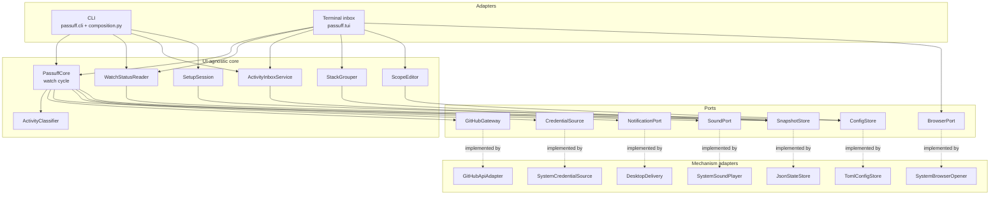
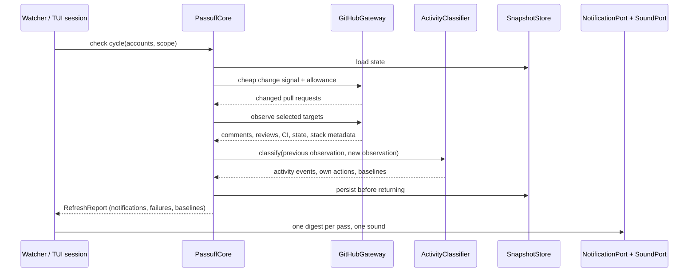

# Design: python-rebuild

## Objective and constraints

Rebuild every specified behavior of passuff from the permanent corpus, and close
the executable-specification gaps the independent design review found. The
change has no user-visible behavior delta. The seven permanent feature files
remain the behavioral contract; a bounded delta adds scenarios for behavior
already specified in the use-case rules and the reference.

Acceptance is the 185 permanent scenarios plus the delta: 167 permanent
non-E2E, 18 permanent E2E, and every delta scenario. A scenario that is
undefined, pending, or skipped fails acceptance.

Constraints from `docs/arc42/02-architecture-constraints.md`:

- Python 3, one distributable CLI package; macOS and Linux only.
- UI-agnostic core; the CLI and the terminal inbox are adapters.
- GitHub GraphQL over HTTPS; one typed query per account per cycle; no scraping.
- Desktop notification through the platform surface; sound through a system
  player; no audio library.
- Local configuration and state files; no database or hosted service.
- The Gherkin corpus under `givn/specs/` is the executable specification.
- Separate non-E2E and E2E Cobertura reports gate archive.

## Technology decisions

No version is recorded from memory. Every third-party version is resolved at
implementation setup from the package index, as stated below.

| Area | Decision | Version resolution | Rationale |
|---|---|---|---|
| Python | CPython 3, `requires-python = ">=3.11"` | Latest stable 3.x at setup; the 3.11 floor is required for stdlib `tomllib` | Constraint: Python 3; TOML reading without a dependency. `tomli` with a 3.10 floor is the rejected alternative (one more dependency for no operator need). |
| Gherkin runner | `behave` | Latest stable on PyPI at setup | Gherkin-native; tag, `--name`, and `--stage` filtering; undefined steps fail the run |
| HTTP client | `httpx` (synchronous client) | Latest stable on PyPI at setup | One GraphQL endpoint with explicit timeouts; no async event loop |
| TOML reader | stdlib `tomllib` | Python 3.11+ | Read-only parsing |
| TOML writer | `tomlkit` | Latest stable on PyPI at setup | Preserves comments and unrelated known configuration on a scope write |
| Terminal UI | stdlib `curses` plus a pure text frame renderer | Python standard library | Deterministic `--snapshot` frames; no third-party TUI dependency; macOS and Linux |
| Linux D-Bus client | `jeepney` | Latest stable on PyPI at setup | Synchronous, pure Python; the same library serves the test twin |
| Packaging | PEP 621 `pyproject.toml`, console scripts `passuff` and `passuff-tui` | n/a | One distributable package; `python -m passuff` stays valid |
| Coverage | `coverage.py` | Latest stable on PyPI at setup | Subprocess instrumentation, parallel data files, Cobertura XML |
| Test HTTP twin | stdlib `http.server.ThreadingHTTPServer` | Python standard library | Deterministic GitHub boundary on loopback; no container runtime |

Rejected alternatives and operator decisions are recorded in `## Decisions` and
`design-review.md`.

## Architecture impact

The logical architecture is unchanged; the implementation language is replaced.
The building blocks keep the names used by arc42 chapter 5, now realized as
Python modules. `RecordingDelivery` is a test double and lives under `tests/`.

### Module layout

```text
pyproject.toml
behave.ini
.coveragerc
passuff/
  __init__.py
  __main__.py            # python -m passuff
  cli.py                 # argument parsing, command dispatch, exit codes
  composition.py         # composition root: names implementations
  config.py              # ConfigStore, TomlConfigStore, AccountConfig,
                         #   WatchConfig, NotificationsConfig, validation
  credentials.py         # CredentialSource, CredentialMode, GhSession,
                         #   PersonalAccessToken, TokenFile, SystemCredentialSource
  github.py              # GitHubGateway, GitHubApiAdapter, PullRequestStack
  classify.py            # ActivityClassifier
  core.py                # PassuffCore: probe, select, observe, persist, report
  state.py               # SnapshotStore, JsonStateStore, ActivityRecord,
                         #   WatcherState, v1 -> v2 migration
  status.py              # WatchStatusReader (WatchStatus)
  inbox.py               # ActivityInboxService (ActivityInbox)
  stacking.py            # StackGrouper (StackedInbox)
  scope.py               # ScopeEditor
  setup.py               # SetupSession
  render.py              # transcript and digest rendering
  notify.py              # DesktopDelivery (NotificationPort)
  sound.py               # SystemSoundPlayer (SoundPort)
  browser.py             # SystemBrowserOpener (BrowserPort)
  tui/
    __init__.py
    __main__.py          # python -m passuff.tui
    app.py               # curses loop and key dispatch
    frame.py             # pure frame renderer used by curses and --snapshot
    session.py           # ObservationSession (live probe/reconcile schedule)
givn/
  environment.py         # regular behave hooks; imports tests.support.harness
  e2e_environment.py     # E2E behave hooks (--stage e2e)
  steps/                 # regular bindings, one file per capability
    common.py            # shared phrase bindings imported by both trees
  e2e_steps/             # E2E bindings, one file per capability
tests/
  __init__.py
  support/
    __init__.py
    harness.py           # per-scenario twins, subprocess driver
    world.py             # per-scenario temp XDG dirs, config/state fixtures
    recording_delivery.py# RecordingDelivery test double (macOS only)
    fake_github.py       # GraphQL twin on 127.0.0.1, query counters, faults
    fake_notifications.py# org.freedesktop.Notifications service for the twin bus
    bin/                 # fake gh, paplay, xdg-open, osascript, afplay
    pty_driver.py        # interactive TUI smoke driver
  strictness/            # undefined/pending/skipped fixtures for the proof task
scripts/
  verify.sh              # runner entry point (see Verification)
  behave_counts.py       # JSON status parser and dedupe -> givn test-result
  measure-coverage.sh
  merge-coverages.sh
  check_steps.py         # AST audit: no no-op step bodies
docs/design/design-system.md  # durable terminal style index (links T25)
```

### Component diagram



The terminal inbox is the product's external terminal interface, realized by
`TuiApp`; it is not a callable contract between components. The contracts are
the consumer-facing surfaces below.

### Contracts and Components

| Contract | Consumer use case | Consumers | Implementing component today | Split trigger |
|---|---|---|---|---|
| `WatchCycle` | watch-pull-requests | `CLI` watcher and check; `ObservationSession` | `passuff.core.PassuffCore` | A second observation source or a hosted watcher |
| `ClassifyActivity` | watch-pull-requests | `PassuffCore` | `passuff.classify.ActivityClassifier` | Event-family policy diverges per account |
| `WatchStatus` | inspect-watch-status | `CLI` status | `passuff.status.WatchStatusReader` | A second status consumer with a different shape |
| `ActivityInbox` | review-activity-inbox | `CLI` inbox/read; `TuiApp` | `passuff.inbox.ActivityInboxService` | Activity views diverge per surface |
| `StackedInbox` | review-pull-request-stacks | `TuiApp` | `passuff.stacking.StackGrouper` | A second stack presentation |
| `WatchScopeEditing` | change-watch-scope | `CLI` scope flags; scope picker | `passuff.scope.ScopeEditor` | A second configuration store or format |
| `InitialSetup` | set-up-passuff | `CLI` setup; TUI first run | `passuff.setup.SetupSession` | A non-interactive provisioning path |
| `ConfigStore` | all six | `CLI`, `ScopeEditor`, `SetupSession` | `passuff.config.TomlConfigStore` | A second configuration format |
| `GitHubGateway` | watch-pull-requests | `PassuffCore` | `passuff.github.GitHubApiAdapter` | A second data source such as webhooks |
| `SnapshotStore` | watch-pull-requests, review-activity-inbox | `PassuffCore`, `ActivityInboxService`, `WatchStatusReader`, `StackGrouper` | `passuff.state.JsonStateStore` | An alternative durable store |
| `CredentialSource` | watch-pull-requests | `PassuffCore` | `passuff.credentials.SystemCredentialSource` | A new authentication mode |
| `NotificationPort` | watch-pull-requests | `CLI` watcher/check and `ObservationSession`; `notify-test` | `passuff.notify.DesktopDelivery` | A second delivery channel |
| `SoundPort` | watch-pull-requests | `CLI` watcher/check and `ObservationSession` | `passuff.sound.SystemSoundPlayer` | An audio-library backend |
| `BrowserPort` | review-activity-inbox | `TuiApp` | `passuff.browser.SystemBrowserOpener` | A second UI |
| `ObservationSchedule` | review-activity-inbox | `TuiApp` | `passuff.tui.session.ObservationSession` | A second live view |

`SetupSession` validates the configuration shape and token-file permissions; it
does not resolve credentials, so it is not a `CredentialSource` consumer.

## Data model

### Configuration

`config.toml` keeps the schema, defaults, and validation rules owned by
`docs/reference.md` and use-case rules R32-R38. No key is added or removed.
`TomlConfigStore` reads with `tomllib` and writes with `tomlkit`; unknown keys
are rejected with exit 2, matching the architecture's typed-decoding
constraint, and a scope write preserves comments and unrelated known
configuration. The specified rejections (literal `token`, relative token file,
non-owner-only mode, plain HTTP outside loopback, duplicate scope entries)
raise a configuration error with exit 2. A setup run writes a new configuration
and does not claim to preserve unrelated configuration.

### Watch state, version 2

One JSON file. The domain terms are the glossary's; the persisted shape is:

| Field | Content |
|---|---|
| `version` | `2` |
| `accounts.<label>` | Resolved login, last successful observation, probe fingerprint and acceptance time |
| `pull_requests.<owner/repo#number>` | Key, title, description, creator, assignees, involvement relations, state, CI result, stack number/size/position/base, baseline and last observation (comments, reviews, review comments, head commit, CI), state-change report flag, terminal and retirement timestamps |
| `activity[]` | `a<n>` id, pull request key, event kind, actor, bounded summary, comment or review body (UTF-8, at most 4 KiB per record), occurrence time, fetch time, `read` |
| `last_scope` | Previous watch scope for catch-up |
| `next_activity_id` | Next free activity id |

The activity history is capped at the 500 most recent records. Load order:
parse; on parse failure or unknown version, quarantine to
`<state>.corrupt-<UTC timestamp>` and continue with an empty state; on version
1, rewrite additively to version 2, preserve watched pull requests and seen
ids, add empty history, and recompute `next_activity_id` (ADR-0005). A
permission or I/O failure that prevents load, write, or quarantine is a state
error with exit 3. Writes use a temporary file in the same directory, `fsync`,
then `os.replace`. No lock is added; the specification says running the watcher
and the inbox together is redundant, not prevented.

### UI preferences

`ui.json` next to the state file: `sort`, `sort_direction`, `filter`,
`unread_only`, `show_ignored`, `desktop`, `sound`. Written only when the save
prompt is confirmed on exit.

## Observation flow



The probe selects changed, new, transitioned, short-lived, and
discovery-search pull requests; the reconciliation pass observes every watched
open pull request. Classification follows the use-case rules; the design does
not restate them. The core persists before returning the report, so delivery is
at-most-once and a restart never replays (quality goal "No replay").

## Packaging

`pyproject.toml` defines the console scripts `passuff` and `passuff-tui`;
`python -m passuff` and `python -m passuff.tui` remain valid. Linux installs
one command; the Python 3.11 floor is the documented prerequisite. The macOS
`Passuff.app` bundle is deferred to a separate packaging change (operator
decision, `design-review.md` Q10); arc42 chapter 7 and chapter 11 carry the
dated deferral note and the unbuilt-bundle debt.

## Verification

### Runner contract

`givn/commands.yaml` sets:

```yaml
verify:
  command: "./scripts/verify.sh"
  e2e_command: "./scripts/verify.sh --e2e"
coverage:
  measure_command: "./scripts/measure-coverage.sh"
  merge_command: "./scripts/merge-coverages.sh"
  non_e2e_path: "coverage/non-e2e-cobertura.xml"
  e2e_path: "coverage/e2e-cobertura.xml"
  output_path: "coverage/cobertura-coverage.xml"
```

`scripts/verify.sh` implements the givn runner contract:

1. Read `GIVN_FEATURES`, `GIVN_RESULT_SCOPE`, and `GIVN_RESULT_FILE`.
2. Remove any existing `GIVN_RESULT_FILE`.
3. Select features: normalize `GIVN_FEATURES` by splitting on whitespace,
   newlines, and `:`; keep existing `.feature` paths. Delta features live under
   `givn/changes/<id>/specs/`; permanent features under `givn/specs/`. An empty
   run set is skipped; the remaining run set still executes and reports its
   counts.
4. Select runs by scope:
   - `change`: one run over every delta feature with no tag filter, and one
     run over every permanent feature with `not @e2e`.
   - `regular`: one run over every permanent feature with `not @e2e`.
   - `e2e`: one run over every permanent feature with `@e2e`, and one run over
     delta features with `@e2e` using `--stage e2e`.
5. Run `behave` once per run set with the JSON formatter; the E2E run uses
   `--stage e2e` so `givn/e2e_steps/` and `givn/e2e_environment.py` are loaded
   instead of the regular tree. Merge the JSON outputs in
   `scripts/behave_counts.py` before reporting counts.
6. The change and E2E scopes may execute the same delta `@e2e` scenario; that
   is the givn scope contract. A delta `@givn.modified` scenario is the stronger
   assertion; its permanent counterpart remains until archive replaces it.
7. Parse scenario statuses with `scripts/behave_counts.py`; count `undefined`
   as failed; call `givn test-result --total ... --passed ... --failed ...
   --skipped ...`.
8. Exit 0 only when `total > 0`, `failed = 0`, and `skipped = 0`. Any other
   outcome exits non-zero, including a behave crash with a written result of
   `total=0, failed=1`.

The permanent-corpus union is deliberate: a non-delta change would otherwise
run zero scenarios and report GREEN. The cost is that every change runs the
permanent non-E2E suite; 167 scenarios are local and deterministic.

### Strictness

- Undefined steps fail `behave`; the runner additionally treats any `undefined`
  status as failed.
- Every step body starts as `raise NotImplementedError("<phrase>")`; a defined
  step with a bare `pass` would otherwise report passed.
- `scripts/check_steps.py` parses every module under `givn/steps/` and
  `givn/e2e_steps/` with `ast` and fails when a step body is only `pass`, `...`,
  a constant, a docstring, or a `return` with no effect.
- A skipped scenario fails the runner. `@wip` does not skip a scenario in
  behave; givn's `check tasks` WIP protection prevents shipping it, and the
  runner's skipped count is the second guard.
- The tasks setup task proves strictness with `tests/strictness/`: an undefined
  step fails behave; a `pass`-only body, a docstring-only body, and a skipped
  scenario each fail either behave or `check_steps.py`; the fixtures are
  removed after the proof.

### Commands

| Purpose | Command |
|---|---|
| Full regular suite | `./scripts/verify.sh` |
| Full E2E suite | `./scripts/verify.sh --e2e` (`GIVN_RESULT_SCOPE=e2e`) |
| One named regular scenario | `./scripts/verify.sh --name "Developer asks for usage"` |
| One named E2E scenario | `./scripts/verify.sh --name "Developer opens the inbox TUI" --e2e` |
| Single regular scenario, raw behave | `behave -n "Developer asks for usage" givn/specs` |
| Single E2E scenario, raw behave | `behave --stage e2e -n "Developer opens the inbox TUI" givn/specs` |
| Coverage measurement | `./scripts/measure-coverage.sh` |
| Coverage merge | `./scripts/merge-coverages.sh` |

## Step Definitions

The rebuild writes the delta phrases directly into the permanent
per-capability files, because those files are created by this change. No delta
step copy is kept; the archive integrity hook resolves every delta phrase in
the permanent target below.

| Capability | Regular step file | E2E step file | Permanent merge target |
|---|---|---|---|
| `pr-activity-notification` | `givn/steps/pr_activity_notification_steps.py` | none | same file |
| `watch-status` | `givn/steps/watch_status_steps.py` | none | same file |
| `activity-inbox` | `givn/steps/activity_inbox_steps.py` | `givn/e2e_steps/activity_inbox_e2e.py` | both files |
| `inbox-navigation` | `givn/steps/inbox_navigation_steps.py` | `givn/e2e_steps/inbox_navigation_e2e.py` | both files |
| `stacked-inbox` | `givn/steps/stacked_inbox_steps.py` | none | same file |
| `watch-scope` | `givn/steps/watch_scope_steps.py` | `givn/e2e_steps/watch_scope_e2e.py` | both files |
| `initial-setup` | `givn/steps/initial_setup_steps.py` | `givn/e2e_steps/initial_setup_e2e.py` | both files |

`givn/steps/common.py` holds the shared phrase bindings imported by both trees,
so no phrase is bound twice in one run. `givn/steps/` and `givn/e2e_steps/` are
chosen because `behave` discovers the steps directory by walking up from the
feature file; `givn/specs/steps/` would pollute the corpus (`givn spec tree`
reports a phantom use case and `givn lint` adds a finding). The E2E scope uses
`--stage e2e`, which loads `givn/e2e_steps/` and `givn/e2e_environment.py`
instead of the regular tree.

## Use-case traceability

| Use case / capability | Guarantees, rules, and events | Technical decision | E2E evidence |
|---|---|---|---|
| watch-pull-requests / `pr-activity-notification` | Notification eligibility, grouping, baselines, no replay, account failure, exit codes, credentials (R1-R46) | `PassuffCore`, `ActivityClassifier`, `GitHubApiAdapter`, `JsonStateStore`, delivery ports | `Developer starts watching and is notified of a new comment`; `Developer runs a single check and sees the current activity`; `The developer tests notifications on the command line`; delta `A GitHub response failure is an account failure` and the delivery-failure outline |
| inspect-watch-status / `watch-status` | Status sections, human labels, unread and total counts, state errors | `WatchStatusReader` over `JsonStateStore` | `Developer sees the watch state` |
| review-activity-inbox / `activity-inbox` | Activity read model, ids, read state, detail with the full body, terminal layout, keys, palette, list-row excerpt, no secrets (R1-R10, T1-T28) | `ActivityInboxService`, `JsonStateStore`, `TuiApp` frame renderer | `Developer lists unread activity`; `Developer marks activity read`; `Developer opens the inbox TUI`; `Developer opens an activity's details` (delta adds the body); `Developer opens the pull request from an activity` |
| review-activity-inbox / `inbox-navigation` | Focus, movement, sort, filter, unread-only, ignored visibility, dialogs, live observation | `TuiApp`, `ObservationSession` | `Developer navigates the inbox panes`; `The inbox shows activity observed while it is open`; delta `The activity list row is bounded to the recorded excerpt`; delta `A missing browser opener is reported and keeps the detail` |
| review-pull-request-stacks / `stacked-inbox` | Stack number, size, position, base, standalone rows, rejected-stack retry | `StackGrouper`, `TuiApp` | `Developer reviews a stacked inbox`; delta `A rejected stack query retries once and shows standalone rows` |
| change-watch-scope / `watch-scope` | Scope mode, known repositories, catch-up, atomic write, focus, all-mode deselect refusal, duplicate rejection | `ScopeEditor`, `TomlConfigStore`, picker in `TuiApp` | `Developer toggles a repository in the watch scope`; `Developer switches the watch scope mode`; `Developer narrows the focus in the watch scope`; delta `Deselecting a repository in all mode is refused`; delta `Duplicate watch scope entries are rejected` |
| set-up-passuff / `initial-setup` | Prompt order, validation, no stored token, TUI first run | `SetupSession`, `TomlConfigStore` | `Developer sets up passuff on first run` |

Persona impact: `multi-account-developer` uses every user-visible capability
(CLI text and terminal UI). The rebuild changes none of the Persona's outcomes;
it restores them.

## Decisions

The proposal records no open `D<n>` questions. Design-local decisions and their
rejected alternatives:

- `Decides V1 (verification scope)`: the runner unions the permanent corpus
  with delta features. Rejected: delta-only verification; it would run zero
  scenarios for a non-delta change and report GREEN. Cost: every change runs
  the permanent non-E2E suite. Realized in `scripts/verify.sh`.
- `Decides V2 (Gherkin runner)`: `behave`. Rejected: `pytest-bdd`; it couples
  Gherkin to pytest fixtures and its undefined-step behavior is a collection
  error rather than a scenario failure. Cost: step modules live in
  `givn/steps/` and `givn/e2e_steps/`. Realized in `behave.ini`,
  `givn/environment.py`, `givn/e2e_environment.py`, and the runner.
- `Decides V3 (terminal UI)`: stdlib `curses` plus a pure frame renderer.
  Rejected: Textual; its rendering pipeline does not expose the deterministic
  plain-text frame that `--snapshot` specifies. Cost: the table, overlays, and
  key dispatch are hand-written. Realized in `passuff/tui/`.
- `Decides V4 (notification fidelity)`: the Linux adapter uses real D-Bus; the
  test twin serves `org.freedesktop.Notifications`. Rejected: a
  recording-only delivery adapter for every assertion; it would not exercise
  the specified platform surface. Cost: the fake service and a private bus.
  `RecordingDelivery` is a macOS-only test double under `tests/support/`.
  Realized in `passuff/notify.py` and `tests/support/fake_notifications.py`.
- `Decides V5 (GitHub twin)`: an in-process GraphQL server on loopback.
  Rejected: a containerized mock; the only external service is GitHub, the
  specification permits loopback HTTP for `graphql_url`, and a local
  single-process twin gives deterministic counters and fault injection.
  Realized in `tests/support/fake_github.py`.

Operator decisions from the independent review (Q1-Q11) are recorded in
`design-review.md`; this design reflects their outcomes.

## Visual Design Contract

- Interface: terminal
- Viewports: 80x24 minimum; 120x40 recommended; `--snapshot` renders 100x30 by
  default and honors `COLUMNS` and `LINES`.
- Design system: `docs/design/design-system.md` — a thin durable index that
  names T25 of `review-activity-inbox` as the normative palette source and
  records the terminal tokens and primitives without copying them.

Screens covered: the transcript, the inbox, pull request detail, activity
detail, help, settings, scope picker, save prompt, and setup prompts. No screen
changes visibly; the rebuild reproduces them. The activity detail now includes
the selected comment or review body, as T14 and the long-comment scenario
already require; the list row keeps the 80-character excerpt (T7).

- Accessibility: keyboard-only operation for every action, text plus symbols
  (never color alone), and no color requirement in the assertions.
- Capture mechanism and evidence path: every `@e2e` scenario writes the final
  command transcript to
  `givn/changes/python-rebuild/evidence/visual/<scenario-slug>/transcript.txt`.
- Motion: none beyond cursor movement and redraw; reduced-motion is not a
  terminal concept.

## E2E smoke test infrastructure

- **E2E runner command**: `./scripts/verify.sh --e2e` with
  `GIVN_RESULT_SCOPE=e2e`; it selects the permanent and delta `@e2e` scenarios.
- **E2E step definitions**: `givn/e2e_steps/`, one file per capability, loaded
  by `behave --stage e2e` through `givn/e2e_environment.py`. Shared phrases are
  imported from `givn/steps/common.py`; no phrase is bound twice in one run.
- **Local infrastructure**: fake GitHub GraphQL on `127.0.0.1:<ephemeral>`;
  private D-Bus session with the fake Notifications service; fake `gh`,
  `paplay`, `xdg-open` on a prepended `PATH`; temp `XDG_CONFIG_HOME` and
  `XDG_STATE_HOME` per scenario; one interactive curses smoke test through a
  pty.
- **Framework**: `behave` (see V2). It drives the real interfaces through
  subprocesses and the documented `--snapshot`, `--keys`, `--scope-mode`,
  `--focus-set`, and `--observe-for` options.
- **Strict-mode proof**: `behave` fails undefined steps; the runner parses the
  JSON statuses and fails on undefined or skipped; `scripts/check_steps.py`
  rejects no-op bodies; the setup task runs the `tests/strictness/` fixtures
  and expects each to fail.

## Interaction Coverage Matrix

| Inventory entry | @e2e scenario | Real interface | Driving mechanism |
|---|---|---|---|
| watch-scope: toggle a repository | Developer toggles a repository in the watch scope | Terminal UI | `--scope-select acme/api` / `--scope-deselect acme/api` for the mutation, then `passuff-tui --picker --snapshot`; assert frame and `config.toml` |
| watch-scope: switch the mode | Developer switches the watch scope mode | Terminal UI | `passuff-tui --scope-mode selected --picker --snapshot`; assert the mode line and file |
| watch-scope: narrow the focus | Developer narrows the focus in the watch scope | Terminal UI | `passuff-tui --focus-set authored --picker --snapshot`; assert focus and counts |
| watch-status: show the watch state | Developer sees the watch state | CLI | subprocess `passuff status`; assert transcript and exit code |
| activity-inbox: list unread | Developer lists unread activity | CLI | subprocess `passuff inbox`; assert transcript |
| activity-inbox: mark read | Developer marks activity read | CLI | subprocess `passuff read <id>`; assert transcript and state file |
| activity-inbox: open the TUI | Developer opens the inbox TUI | Terminal UI | `passuff-tui --observe --snapshot`; assert the frame; a pty smoke starts the interactive loop and quits with `q` |
| activity-inbox: open a detail | Developer opens an activity's details (delta adds the body) | Terminal UI | `passuff-tui --observe --snapshot --keys "enter"`; assert metadata and the comment body |
| activity-inbox: open the pull request | Developer opens the pull request from an activity | Terminal UI + browser | `--snapshot --keys "enter,enter"` with fake `xdg-open`; assert URL log |
| inbox-navigation: navigate panes | Developer navigates the inbox panes | Terminal UI | `passuff-tui --snapshot --keys "tab,j"`; assert focus and selection |
| inbox-navigation: live refresh | The inbox shows activity observed while it is open | Terminal UI | `passuff-tui --observe-for 4000 --snapshot`; fake server injects a comment during the interval |
| stacked-inbox: review a stack | Developer reviews a stacked inbox | Terminal UI | `--snapshot` with fake stack metadata; assert group title, positions, standalone rows |
| initial-setup: first run | Developer sets up passuff on first run | CLI + TUI | subprocess `passuff setup` with stdin answers, then TUI `--snapshot`; assert config and frame |
| pr-activity-notification: start watching | Developer starts watching and is notified of a new comment | CLI | `timeout --signal=INT 10 passuff`; fake server injects a comment after the first probe; fake D-Bus and sound log |
| pr-activity-notification: one check | Developer runs a single check and sees the current activity | CLI | subprocess `passuff check`; assert transcript, D-Bus summary, sound once |
| pr-activity-notification: usage | Developer asks for usage | CLI | subprocess `passuff --help`; assert usage lines |
| pr-activity-notification: version | Developer asks for the version | CLI | subprocess `passuff --version`; assert version line |
| pr-activity-notification: notification test | The developer tests notifications on the command line | CLI | subprocess `passuff notify-test`; assert D-Bus log, sound log, exit code |

Every entry has a non-empty driving mechanism.

## External boundary cases

| Boundary | Adversarial cases | Evidence |
|---|---|---|
| GitHub GraphQL | Wrong login for a credential; malformed or partial response; timeout; non-2xx; `errors` payload; replayed duplicate node; stack preview rejection with one retry | Delta `A GitHub response failure is an account failure`, `A replayed pull request node does not duplicate activity`, `A rejected stack query retries once and shows standalone rows`; permanent account-failure and wrong-login scenarios |
| State file | Corrupt JSON; unknown version; version 1; read/write/quarantine permission failure; duplicate activity ids; 30-day retirement boundary | Delta `An unknown state version is quarantined and replaced`, `A quarantine failure is a state error`, `Duplicate activity ids are repaired on load`, `A reopen within the retention window notifies`, `A reopen after the retention window is not observed`; permanent corrupt-state and version-1 scenarios |
| Configuration | Missing file; invalid TOML; literal token; multiple credential sources; gh account with a token source; relative or directory token file; group-readable file; plain HTTP outside loopback; duplicate scope entries; unknown key; poll interval below one | Delta `An invalid configuration is reported with exit 2`, `A missing configuration is a configuration error`, `Duplicate watch scope entries are rejected`; permanent credential scenarios |
| CLI input | Unknown command or option; missing option value; invalid `--focus-set`; invalid `--keys`; TUI without a terminal; `--scope-deselect` in all mode | Delta `A CLI usage error exits 2`, `Deselecting a repository in all mode is refused`; permanent terminal-required scenario |
| Linux D-Bus | Service absent; `Notify` error | Delta `A delivery surface failure keeps the transcript`; permanent service-unavailable scenario |
| Sound | No player on `PATH`; player non-zero exit | Delta `A delivery surface failure keeps the transcript`; fake bin variants |
| `gh` CLI | Binary missing; non-zero exit; token for the wrong login; interactive login failure | Delta `A missing or failing gh is an account failure`; permanent wrong-login and login-failure scenarios |
| Browser opener | Binary missing; non-zero exit | Delta `A missing browser opener is reported and keeps the detail`; permanent status-line scenario |
| TUI excerpt | List row exceeds 80 characters; detail body is longer than 80 characters | Delta `The activity list row is bounded to the recorded excerpt`; permanent long-comment scenario |

Sensitivity checks: identity (expected login, case-insensitive comparison),
boundaries (30-day retention, minimum intervals, 80-character list-row
excerpt, 4 KiB body bound, 500-record cap), lifetime (terminal retirement and
reopen), and precedence (own action versus state change, bot versus human,
focus versus fetch). A batch that cannot distinguish a plausible wrong
implementation is incomplete.

## Local runnability and digital twins

- **Local run command**: `python -m passuff --help`; a configured run is
  `python -m passuff` after `passuff setup`. The complete test stack is
  `./scripts/verify.sh` (and `--e2e`), which starts the twins per scenario.
- **Isolated network**: the only network service is the GitHub GraphQL twin,
  bound to `127.0.0.1` on an ephemeral port. Every process uses per-scenario
  temp configuration and state directories. No host service, shared port, or
  outbound network is used by the suite.
- **Digital twins**: GitHub GraphQL (`tests/support/fake_github.py`), `gh`
  (`tests/support/bin/gh`), Linux notifications (private D-Bus plus
  `tests/support/fake_notifications.py`), sound players
  (`tests/support/bin/paplay`), browser opener (`tests/support/bin/xdg-open`),
  and macOS `osascript`/`afplay` plus `RecordingDelivery` for platform-adapter
  tests only.
- **Anticipated interface obstacles and fixes**:
  - Curses needs a TTY: frame assertions use the specified `--snapshot`; one
    smoke test uses `tests/support/pty_driver.py` to start the real loop and
    quit with `q`.
  - Live refresh timing: scenarios use the specified `--observe-for` in
    milliseconds (4000 for four seconds) with a 1-second poll interval; the
    fake server injects changes at scripted probe counts, not wall-clock
    sleeps.
  - A continuous watcher assertion uses `timeout --signal=INT 10 passuff`, so
    the step has a bounded stop and the transcript is checked before exit.
  - D-Bus isolation: `scripts/verify.sh` starts a private session bus
    (`dbus-run-session --` when available) and exports
    `DBUS_SESSION_BUS_ADDRESS`; the fake service owns
    `org.freedesktop.Notifications`.
  - Subprocess coverage: `COVERAGE_PROCESS_START` plus `--parallel-mode` for
    every CLI and TUI subprocess; the measure script sets both.
  - The suite must run as a non-root user for permission-failure fixtures;
    `scripts/verify.sh` exits 2 when `id -u` is 0.

## Coverage process boundaries

Measured population: the production package `passuff/`. Excluded: `tests/`,
`givn/`, `scripts/`, generated evidence, and build output. Declared before the
first run; not changed after seeing a result.

| Process | Started by | Instrumented artifact | Profile output | Merge step | Non-zero production probe |
|---|---|---|---|---|---|
| `passuff` CLI subprocesses (regular and E2E) | behave steps via `PASSUFF_CLI="python -m coverage run --parallel-mode -m passuff"` | `passuff/` package | `coverage/{non-e2e,e2e}/.coverage.*` by run scope | `scripts/merge-coverages.sh` combines both data sets | `passuff/cli.py` dispatch and `passuff/core.py` check cycle |
| `passuff-tui` subprocesses (regular snapshots and E2E live loop) | behave steps via `PASSUFF_TUI="python -m coverage run --parallel-mode -m passuff.tui"` | `passuff/tui/` and shared `passuff/` | `coverage/{non-e2e,e2e}/.coverage.*` by run scope | same | `passuff/tui/app.py` render and `passuff/tui/frame.py` |
| behave runner | `scripts/verify.sh` | excluded (test harness) | none | n/a | n/a |

`scripts/measure-coverage.sh` runs the regular and E2E suites as two distinct
instrumentation runs, then writes `GIVN_COVERAGE_NON_E2E_PATH` and
`GIVN_COVERAGE_E2E_PATH` as separate Cobertura reports.
`scripts/merge-coverages.sh` combines the data sets and writes
`GIVN_COVERAGE_OUTPUT_PATH`. The non-E2E report is never copied to the E2E
path.

## Risks

- The fake GraphQL surface must track the adapter's operation shapes; a shape
  mismatch fails loudly in the suite rather than silently passing.
- The private-bus notification twin depends on `dbus-daemon` tooling; the
  README already names D-Bus as a Linux prerequisite.
- The separate E2E step tree requires disciplined phrase ownership; a phrase
  bound in both `givn/steps/` and `givn/e2e_steps/` would make behave report an
  ambiguous step. `givn/steps/common.py` is the only shared home.
- Coverage of subprocesses depends on `coverage.py` in the development
  environment; a missing installation fails the measurement, not the suite.
- The macOS bundle is deferred; macOS notification attribution remains a
  documented, unbuilt deliverable until the packaging change.
