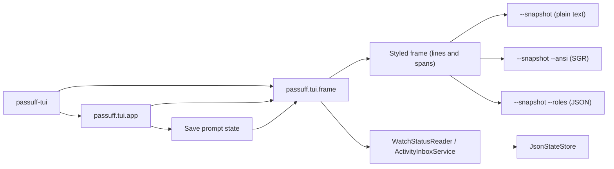

# Design: restore-tui-styling

## Context

The rebuilt terminal inbox is functionally complete but visually flat. The
original passuff main branch and its `passuff.gif` show a titled frame, header
line, watched and activity tables, controls bar, modal overlays, and a
save-on-quit prompt in watn's indexed palette. The durable visual contract is
`docs/design/design-system.md` and terminal-interface rule T25 (the palette and
composition rule) of `review-activity-inbox`.

The operator approved the original main-branch composition and indexed palette
as the target on 2026-11-08 and chose to include the save-on-quit prompt.
Apart from that prompt, the change does not change keys, data, the CLI
transcript, notifications, sound, browser, setup, or network behavior.

Reference evidence committed with this change:

- `givn/changes/restore-tui-styling/evidence/reference/main-inbox.png` — the
  main screen.
- `.../activity-selection.png` — the selected activity row and focus.
- `.../settings-overlay.png` — the settings modal.

The original Rust source is derivation evidence only; the durable contract is
the design system.

## Decisions

Decides D1: **Both a styled transcript and a structured role record.** The
terminal must produce one human-viewable artifact that preserves the palette
and one machine-readable record that scenarios assert. Realized in
`passuff/tui/frame.py` (`render_ansi` and `render_roles`) and
`givn/steps/support.py` (`transcript` strips SGR for the existing text
assertions). The role record is the assertion source; the ANSI transcript is
the human-viewable artifact. A missing role record is a failure, not a
fallback.

Design decision (palette durability): **The exact palette values are durable in the design system.** The
values in `docs/design/design-system.md` are copied from the original theme and
are no longer derived at runtime from the original source. The trigger for a
future change is a theme change; the switch cost is one design-system update
plus the palette assertion; owner: this change.

Operator decision (save prompt, 2026-11-08): **The save-on-quit prompt is in scope.** The operator chose it on
2026-11-08. The prompt restores terminal-interface rule T22 (the settings
persistence rule): `q` opens `Save sort and filter settings?` when the sort,
direction, filters, ignored view, or notification settings changed; `y`
persists and quits; `n` discards and quits; `Esc` cancels the quit. Without a
change, `q` quits without a prompt.

## Architecture Impact

The presentation layer gains a styled frame model and the save-prompt state.
The behavior layers (`passuff.core`, `passuff.inbox`, `passuff.status`,
`passuff.state`) are unchanged.

### Contracts and Components

| Contract | Consumer use case | Consumers | Implementing component today | Split trigger |
|---|---|---|---|---|
| `TerminalPresentation` | `review-activity-inbox`, `review-pull-request-stacks`, `change-watch-scope` | `TuiApp`, `--snapshot` | `passuff.tui.frame` (styled frame model, palette mapping, and picker overlay) | A second terminal frontend or a second theme |

`ScopeEditor` owns the scope edit and `TuiApp` composes it; `TerminalPresentation`
owns only the picker's rendering. The visual step definitions consume the public
`--snapshot` output, not the component, so they are not listed as consumers.

### Modules

- `passuff/tui/frame.py` — add `Role`, `Span`, `StyledLine`, and
  `render_styled(config, state, view) -> list[StyledLine]`. Own the palette
  mapping (`ROLE_STYLES`) so the indexed values exist once. Keep
  `render(...) -> list[str]` as the plain projection used by existing text
  assertions. Add `render_ansi(...)` and `render_roles(...)`. Build the layout
  from the design system: outer frame, header, counts/focus, watched table,
  activity table, controls, the save prompt, and the existing overlays.
- `passuff/tui/app.py` — import the palette mapping from `frame.py`; set up
  curses color pairs, enable default colors, and draw each span with its role
  and `A_BOLD`/`A_DIM`. Add `y`, `n`, and `Esc` handling for the save prompt,
  add `y`/`n` to the `--keys` whitelist, and keep every other key unchanged.
  The loop keeps the existing redraw.
- `givn/steps/support.py` — `transcript()` strips SGR; add helpers for the
  styled snapshot and role queries.
- `givn/steps/activity_inbox_steps.py`,
  `givn/steps/inbox_navigation_steps.py`,
  `givn/steps/stacked_inbox_steps.py`,
  `givn/steps/watch_scope_steps.py` — the concrete visual assertions and the
  save-prompt steps, one capability per file.
- `scripts/verify.sh` — resolve the delta from the active change
  (`givn/changes/*/specs/*/*.feature`) instead of the archived
  `python-rebuild` path, and export the active change id to the harness.
- `tests/support/harness.py` — resolve the active change id from
  `GIVN_CHANGE_ID` (or the active change directory) and write
  `transcript.txt`, `transcript.ansi`, and the role record under
  `givn/changes/<active-id>/evidence/visual/<scenario-slug>/`.
- `docs/design/design-system.md` — the durable palette, composition,
  viewports, accessibility, and capture contract (updated by this design).

### Data model

No persisted schema change. The frame model and the save-prompt state are in
memory. The UI preferences already persist in `ui.json`; the prompt changes
when they are written, not their shape.

### Palette and role model

`Role` names are the contract: `accent`, `accent_bold`, `bright`, `bright_bold`,
`body`, `gold`, `gold_bold`, `green`, `green_bold`, `rule`, `dim`. The exact
indexed values and attributes are recorded in
`docs/design/design-system.md`; `frame.py` is the only code that owns them.
The ANSI renderer maps indexed colors to `38;5;<n>` and attributes to `1`
(bold) and `2` (dim); the curses renderer maps them to color pairs and
attributes. The role record is a JSON array of lines, each an array of
`{"text": ..., "role": ...}` spans.

### Layout

The layout follows the original:

- Outer frame with a dim border and the title `passuff — Inbox`
  (`passuff` uses `bright_bold`, `— Inbox` uses `dim`).
- An account and watch-scope header, then an unread and focus line.
- Watched table: `Pull request` (30), `State` (6), `CI` (12), optional `☰`
  (width of the widest position), optional `☺` (width of the widest people
  label), `Title` (minimum 15). Header `accent_bold` and centered; selected row
  `gold_bold` with `▶`; ignored rows `dim` with `⊘`.
- Activity table: `When` (12), `Event` (minimum 40), `Stack` (10), `Read` (6).
  Header `accent_bold` and centered; selected row `gold_bold` with `▶`.
- Controls bar: `Controls` title `accent`, key hints `accent_bold`, labels
  `dim`.
- Save prompt: a centered dim-bordered block with title `Leave` in `accent`,
  the question in `bright`, the keys `accent_bold`, and labels `dim`.
- Overlays: activity detail, PR detail, help, and settings use accent-bold
  titles; the save prompt uses an accent title; the picker uses the brand
  roles. All use dim borders and the role rules from the design system.

The frame is clipped to the terminal size; the snapshot defaults to 100x30 and
honors `COLUMNS`/`LINES`.

## Test infrastructure and evidence paths

The archived `python-rebuild` change currently owns the only hardcoded paths in
the runner and the harness. This change removes the hardcoding:

- `scripts/verify.sh` builds the delta list from the active change. The change
  scope and the E2E scope both see `restore-tui-styling/specs/`.
- The runner exports the resolved active change id as `GIVN_CHANGE_ID` for
  the harness; if more than one active change exists and the id is unset, it
  fails rather than guessing.
- `tests/support/harness.py` writes evidence under the active change, not the
  archived one.
- The existing `python-rebuild` archive is not read or written.

## Visual Design Contract

- Interface: terminal. No browser or Web UI is rendered, so Playwright and the
  Web viewports do not apply.
- Viewports: 80x24 minimum; 120x40 recommended; snapshot 100x30 by default,
  honoring `COLUMNS` and `LINES`.
- Design system: `docs/design/design-system.md`
- Design tokens: the palette table and role names in the design system.
- Component primitives: outer frame, header line, counts/focus line, watched
  table, activity table, controls bar, modal overlay, settings row, picker row,
  save prompt. States: default, focused, selected, ignored, read, unread,
  enabled, disabled, empty, error.
- Breakpoints: not applicable to a terminal; the two size classes above are
  the viewports.
- Accessibility: keyboard-only; every role is paired with text, a symbol, or
  position; the focused pane is indicated by a green border and title and the
  `Focus:` label; no color is the sole carrier of meaning.
- Screens covered: the main inbox, activity detail, pull request detail, help,
  settings, save prompt, watch-scope picker, ignored row, status line, and the
  80x24 viewport.
- Rendered reference: the three committed reference frames from the original
  recording; after implementation, a new capture of the rebuilt TUI is
  committed under `docs/design/`.
- Capture mechanism and evidence path: every `@e2e` scenario commits
  `transcript.txt`, `transcript.ansi`, and the role record under
  `givn/changes/<active-id>/evidence/visual/<scenario-slug>/`. The visual
  assertions use the role record. The plain transcript remains the text
  contract.
- Motion: none in this change. The original fetching spinner is out of scope;
  the counts line is static.

## Step Definitions

| Capability | Step definition file | Permanent merge target |
|---|---|---|
| shared visual roles | `givn/steps/common.py` | same file |
| `activity-inbox` | `givn/steps/activity_inbox_steps.py` | same file |
| `inbox-navigation` | `givn/steps/inbox_navigation_steps.py` | same file |
| `stacked-inbox` | `givn/steps/stacked_inbox_steps.py` | same file |
| `watch-scope` | `givn/steps/watch_scope_steps.py` | same file |

E2E step files: `givn/e2e_steps/activity_inbox_e2e.py`,
`givn/e2e_steps/inbox_navigation_e2e.py`,
`givn/e2e_steps/stacked_inbox_e2e.py`, and
`givn/e2e_steps/watch_scope_e2e.py`. Each imports its regular capability
module; the visual steps live in the regular files and are bound in both
scopes. Shared phrases stay in `givn/steps/common.py`.

The new concrete phrases. Shared role phrases (`the selected row is gold and bold`, `the watched table headers are cyan-blue and bold`, `the activity table headers are cyan-blue and bold`, `the focused pane title is green and bold`, `the metadata labels are cyan-blue`, `the metadata values are dim`) are bound once in `givn/steps/common.py`; the capability files hold overlay- and state-specific phrases:

- Activity inbox: `the unread count is gold and bold`, `the focus label is dim`,
  `the focused pane name is cyan-blue and bold`, `the outer frame border is
  dim`, `the frame title is bright and bold`, `the frame title suffix is dim`,
  `the account login is cyan-blue`, `the watched table shows the people
  column`, `the activity body is bright gray`, `the controls bar title is
  cyan-blue`, `the key hints are cyan-blue and bold`, `the detail overlay border
  is dim`, `the detail overlay title is cyan-blue and bold`, `the detail
  separator uses the rule color`, `the ignored row is dim`, `the empty state
  text is bright`.
- Inbox navigation: `the focused pane border is green`, `the unfocused pane
  border is dim`, `the unfocused pane title is dim`, `the settings overlay
  border is dim`, `the settings title is cyan-blue and bold`, `the settings
  selected row is gold and bold`, `the enabled settings values are green`, `the
  disabled settings values are dim`, `the pull request detail border is dim`,
  `the pull request detail title is cyan-blue and bold`, `the pull request
  detail heading is green and bold`, `the help heading is cyan-blue and bold`,
  `the help keys are cyan-blue and bold`, `the status line is gold`, `the
  developer opens the inbox TUI at 80x24`, `the save prompt border is dim`, `the
  save prompt title is cyan-blue`, `the save prompt question is bright`, `the
  save prompt keys are cyan-blue and bold`, `the saved sort is "name"`.
- Stacked inbox: `the stack column header is cyan-blue and bold`, `the stack
  positions are bright`.
- Watch scope: `the picker border is dim`, `the picker brand is bright and
  bold`, `the picker title suffix is dim`, `the picker mode is cyan-blue and
  bold`, `the selected repository is gold`.

Each starts as `raise NotImplementedError("<phrase>")` until its batch lands.

## Interaction Coverage Matrix

The inventory lives in the owning use-case documents. The change does not add
or remove an interaction; every touched entry is listed here. The added visual
scenarios are variants of these interactions and do not create new inventory
entries.

| Inventory entry | `@e2e` scenario | Real interface | Driving mechanism | Change |
|---|---|---|---|---|
| activity-inbox: list unread activity | Developer lists unread activity | CLI | subprocess `passuff inbox` | Not changed |
| activity-inbox: mark activity read | Developer marks activity read | CLI | subprocess `passuff read <id>` | Not changed |
| activity-inbox: open the inbox in the terminal UI | Developer opens the inbox TUI | Terminal UI | `--observe --snapshot`; the styled snapshot and role record | Restyled; modified `@e2e` |
| activity-inbox: open an activity's detail | Developer opens an activity's details | Terminal UI | `--snapshot --keys "enter"` | Restyled; modified `@e2e` |
| activity-inbox: open the pull request from an activity | Developer opens the pull request from an activity | Terminal UI + browser | `--snapshot --keys "enter,enter"` + fake opener | Overlay and status line restyled; modified regular scenario |
| inbox-navigation: navigate the watched pull requests and activity | Developer navigates the inbox panes | Terminal UI | `--snapshot --keys "tab,j"` | Restyled; modified `@e2e` |
| inbox-navigation: leave the inbox open while activity arrives | The inbox shows activity observed while it is open | Terminal UI | `--observe-for 4000 --snapshot` | Restyled main frame; behavior unchanged |
| stacked-inbox: review a stack | Developer reviews a stacked inbox | Terminal UI | `--snapshot` with fake stack metadata | Stack column restyled; modified `@e2e` |
| watch-scope: toggle a repository in the watch scope | Developer toggles a repository in the watch scope | Terminal UI | picker snapshot | Picker restyled; added visual scenario |
| watch-scope: switch the watch scope mode | Developer switches the watch scope mode | Terminal UI | `--picker --snapshot` | Picker restyled |
| watch-scope: narrow the focus | Developer narrows the focus in the watch scope | Terminal UI | `--picker --snapshot` | Picker restyled |

## Version freshness

No new version-bearing dependency. The existing Python 3.11 floor and the
already-pinned `behave`, `coverage`, `httpx`, `tomlkit`, and `jeepney`
dependencies are unchanged; no version lookup is needed for this change. The
palette uses indexed terminal colors, not a library version.

## Black-Box-First policy

The change is verified through the rendered terminal frame and the public
snapshot interfaces. No scenario imports `passuff.tui.frame` or asserts a
private function. The visual steps consume `--snapshot`, `--snapshot --ansi`,
and `--snapshot --roles`; the existing CLI subprocess scenarios remain
unchanged.

## Use-case traceability

| Use case / capability | Rule or guarantee | Technical decision | Evidence |
|---|---|---|---|
| review-activity-inbox / `activity-inbox` | T1 (one-screen composition), T7 (excerpt and body bound), T14 (activity detail), T23 (watched columns), T25 (palette and composition), T27 (ignored view) | `TerminalPresentation`, styled frame and overlays | `Developer opens the inbox TUI`; `Developer opens an activity's details`; `An ignored row is dim and marked` |
| review-activity-inbox / `inbox-navigation` | T2 (selection movement), T8 (focus cycling), T9 (row movement), T18 (sort), T19 (filter), T21 (help), T22 (settings save prompt), T24 (pull-request detail), T26 (settings) | focused/unfocused pane roles, help/settings/save prompt overlays, 80x24 frame | `Developer navigates the inbox panes`; `The settings overlay follows the palette`; `The pull request detail shows its metadata`; `The developer opens the key reference`; `A missing browser opener is reported and keeps the detail`; `The 80x24 frame keeps the composition`; `The developer confirms saving settings on quit`; `The developer discards settings on quit`; `The developer cancels the quit from the save prompt` |
| review-pull-request-stacks / `stacked-inbox` | R2 (stack grouping), R3 (position/size and base) | watched table `☰` column and stack cells | `Developer reviews a stacked inbox` |
| change-watch-scope / `watch-scope` | picker mode, focus, selected repositories | picker overlay roles | `The scope picker renders the watn palette` |

Persona `multi-account-developer` (confirmed 2026-11-02): the main inbox,
activity detail, PR detail, help, settings, save prompt, stack, and picker
screens are in scope; the change restores the visual composition the Persona
uses.

## Verification

- Runner: `./scripts/verify.sh` (regular) and `./scripts/verify.sh --e2e`
  (`GIVN_RESULT_SCOPE=e2e`). The change scope is `GIVN_RESULT_SCOPE=change`.
  The runner resolves the active change's delta and evidence path (see the test
  infrastructure section).
- Single scenario: `GIVN_RESULT_SCOPE=change ./scripts/verify.sh --name
  "Developer opens the inbox TUI"`; for the E2E scenario add `--e2e`.
- Strict mode: `behave` fails undefined steps; `scripts/check_steps.py` rejects
  no-op bodies in `givn/steps/` and `givn/e2e_steps/` and runs in every normal
  scope. The new steps start as `raise NotImplementedError`.
- The change delta has sixteen scenario entries: four under `activity-inbox`
  (two modified `@e2e`, the ignored-row scenario, and the empty-state scenario);
  ten under `inbox-navigation` (one modified `@e2e`, the settings, PR detail,
  help, status-line, 80x24, save-y, save-n, save-Esc, and no-change quit
  scenarios); one modified `@e2e` under `stacked-inbox`; one added picker
  scenario under `watch-scope`.
- Coverage: the existing `scripts/measure-coverage.sh` and
  `scripts/merge-coverages.sh`. The styled renderer is covered by the visual
  steps and the regular frame scenarios.

## E2E smoke test infrastructure

- **Runner**: `./scripts/verify.sh --e2e`; identical stack and private D-Bus
  service as the current suite.
- **Step definitions**: `givn/e2e_steps/`, one file per capability, loaded by
  `behave --stage e2e` through `givn/e2e_environment.py`.
- **Local infrastructure**: the existing fake GitHub GraphQL twin, fake `gh`,
  sound, browser, D-Bus Notifications service, and pty driver. No new service.
- **Framework**: `behave`, because the corpus is Gherkin and the real interface
  is a subprocess or a snapshot subprocess.
- **Strict-mode proof**: the existing `./scripts/verify.sh --strictness` and
  `check_steps.py` proof remain valid; the new steps are subject to the same
  audit.
- **Evidence path**: the active change id, never the archived `python-rebuild`
  directory.

## Risks

- The palette values are now durable; a later theme change must update the
  design system and the visual test together.
- The original GIF and Rust source are derivation evidence only. If the design
  system and the original disagree, the design system wins.
- The curses color pairs depend on a 256-color terminal. Below 256 colors,
  the fallback maps accent 81 to cyan, bright 15 to white, body 252 to white,
  gold 214 to yellow, green 114 to green, and rule 240 to the default
  foreground; dim and bold are unchanged. The fallback is terminal-dependent
  and is a hard-to-test gap; the role record and ANSI snapshot are independent
  of the terminal.
- The new layout is size-sensitive; the snapshot at 100x30 and the 80x24
  minimum must be checked.
- The save prompt changes quit behavior. The operator chose it; the design
  limits it to the changed settings and keeps every other key unchanged.
- The active-change runner fix touches shared test infrastructure; a regression
  would affect every change. The design's tasks keep it small and the existing
  regular/E2E scopes verify it.
