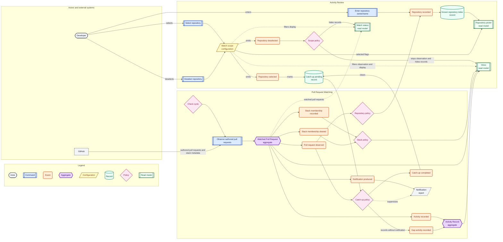

# Event Storming: inbox-scope-and-stacks

## Scope of this canvas

Two chains share one observation cycle:

- **Watch scope editing:** the developer selects or deselects a repository from
  the terminal UI; the inbox hides out-of-scope records; reselecting records
  catch-up activity silently.
- **Stack grouping:** GitHub reports stack membership during observation; the
  inbox groups watched pull requests and their activity by stack.

Decisions applied: Q1 Hide, Q2 metadata only, Q3 global scope, Q4 catch-up
silently, Q5 known plus manual entry.

## Event chain

| # | Event | Emitted by | Trigger: actor → command | Policy reaction | Read model |
|---|---|---|---|---|---|
| 1 | Repository recorded | Repository policy (or the manual-entry command) | GitHub reports an authored pull request, or the developer enters owner/name → Observe authored pull requests / Enter repository owner/name | Add the repository to the picker if it is not known. | Repository picker |
| 2 | Repository selected | Watch scope (configuration) | Developer → Select repository | Mark catch-up pending for the repository; the next cycle observes it. | Repository picker, Inbox |
| 3 | Repository deselected | Watch scope (configuration) | Developer → Deselect repository | Stop observing the repository; hide its records from the inbox and status; keep them in state. | Inbox, Watch status |
| 4 | Pull request observed | Watched Pull Request (aggregate) | Check cycle → Observe authored pull requests | Classify new activity; update the observation and baseline. | Inbox |
| 5 | Stack membership recorded | Watched Pull Request (aggregate) | GitHub reports stack metadata → Observe authored pull requests | Record stack number, position, size, and stack base on the watched pull request; group it in the inbox. | Inbox |
| 6 | Stack membership cleared | Watched Pull Request (aggregate) | GitHub reports no stack → Observe authored pull requests | Clear the recorded stack membership; show the pull request as standalone. | Inbox |
| 7 | Activity recorded | Watched Pull Request (aggregate) | Classification of a new event → Observe authored pull requests | Append one activity record with a stable id and an unread flag. | Inbox |
| 8 | Notification produced | Watched Pull Request (aggregate) | Classification of a new event → Observe authored pull requests | Produce one grouped notification per pull request unless a catch-up cycle suppresses it. | Notification report |
| 9 | Gap activity recorded | Catch-up policy | Catch-up pending + first observation after reselect | Record the events as activity without producing a notification or sound. | Inbox |
| 10 | Catch-up completed | Catch-up policy | First observation after reselect | Clear the catch-up pending marker; normal notification resumes on the next cycle. | Repository picker, Inbox |

## Reverse narrative

**Why can activity be recorded without a notification?**
Because the developer reselected a repository, and catch-up completed only after
the first observation recorded the gap. Before that, the developer selected the
repository, and before that, the repository was deselected and hidden — which
requires a known repository and a watch scope.

**Why does the inbox group rows?**
Because stack membership was recorded during observation, which requires the
GitHub stack metadata and a watched pull request.

**Why is a repository in the picker?**
Because it was recorded from an authored pull request or entered manually, or
because it is already in the watch scope.

## Canvas

## Elements and kinds

| Kind | Elements |
|---|---|
| Actor | Developer |
| External system | GitHub |
| Commands | Select repository, Deselect repository, Enter repository owner/name, Observe authored pull requests |
| Events | Repository recorded, Repository selected, Repository deselected, Pull request observed, Stack membership recorded, Stack membership cleared, Activity recorded, Notification produced, Gap activity recorded, Catch-up completed |
| Aggregates | Watched Pull Request (baseline, seen identities, CI, state, stack membership; at most one notification per event), Activity Record (stable id, observation time, read flag; history bounded to 500) |
| Configuration | Watch scope (global repository allowlist) |
| Records | Known repository index, Catch-up pending |
| Policies | Check cycle, Repository policy, Scope policy, Stack policy, Catch-up policy |
| Read models | Repository picker, Inbox, Watch status |
| Reports | Notification |

No record, configuration, external fact, or report is drawn as an aggregate:

- **Watch scope** is configuration. It receives the select/deselect commands and
  emits the selection events; it is not an aggregate.
- **Known repository index** is a record built from observation and manual entry.
- **Catch-up pending** is a per-repository marker in watcher state.
- **Pull request stack** is a GitHub fact recorded on the Watched Pull Request;
  passuff issues no stack commands, so it is not an aggregate.
- **Notification** is a grouped report, not an aggregate.

## Model consequences for the existing implementation

- `cycle.rs:212` currently prunes watched pull requests outside the watch scope.
  Q1 Hide requires keeping them and filtering the read model instead.
- The observation currently skips out-of-scope pull requests before
  classification. The known repository index needs the repository name from
  those pruned observations without recording the pull request.
- Reselect requires a per-repository catch-up marker and a suppression path in
  the notification policy; the first cycle after reselect records activity but
  produces no notification.
- `WatchedPullRequest` and the GraphQL query need stack number, position, size,
  and stack base; the query currently fetches only `baseRefName`.
- A GraphQL error for the preview-gated stack field must degrade to standalone,
  not fail the account observation.
- The inbox read model needs stack groups and a hidden-repository filter; the
  status read model needs the same filter.

## Open questions

None. Q1–Q5 are closed and the terms are confirmed.

## Phase review (Event Storming)

- Canvas rendered with `mmdc` (Chrome at `/usr/bin/google-chrome`); all ten
  events, four commands, both aggregates, both actors, five policies, two
  records, the configuration, three read models, and the notification report
  appear in the picture.
- Cause and effect are symmetric: select/deselect, stack membership
  recorded/cleared, catch-up pending/completed, activity recorded/notification
  produced with a suppression path.
- No record, configuration, external fact, or report is drawn as an aggregate.
- Every confirmed term records a collision check; known repository and
  catch-up were confirmed before the canvas relied on them.
- Corrected during review: repository-recorded and activity-recorded emission
  now match the canvas paths, and manual entry now reaches the same
  repository-recorded event.
