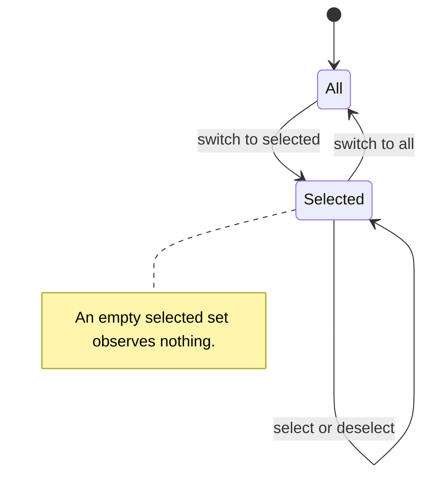

# Use case: change-watch-scope
## Level
!
## Actors
Developer
## Goal
Change which repositories passuff observes.
## Trigger
The developer opens the repository picker from the inbox and changes a repository's selection or the scope mode.
## Preconditions
- At least one account is configured.
- The terminal UI can read the configuration and watcher state.
- The current watch scope mode and selected set are loaded.
## Main flow
1. Developer opens the repository picker; System shows the scope mode, the known repositories with their selected state, and the manual-entry field.
2. Developer changes one repository's selection; System adds or removes it in the selected set and persists the new scope atomically.
3. System updates the read models: a deselected repository's watched pull requests and activity are hidden from the inbox and status; a selected repository's records are restored.
4. If the selected repository has retained records, System marks catch-up pending for the next check cycle.
5. Developer leaves the picker; System shows the updated scope mode and selected repositories.
## Extensions
- 1a: no known repositories → System shows an empty list and the manual-entry field; protects the success guarantee by keeping the picker usable.
- 1b: scope mode is all → the repository list is informational and read-only until the developer switches to selected; switching restores the retained selected set, or starts with all known repositories selected when no set is retained; protects the scope-mode rule.
- 2a: the developer deselects the last selected repository → System keeps selected mode with an empty set; nothing is observed; status says watching nothing; protects the deselect rule.
- 2b: the developer enters an unknown owner/name → System validates the format, records the repository as known, and selects it; protects the known-repository rule.
- 2c: the entered owner/name is malformed → System rejects the entry, keeps the previous scope, and reports the error; protects the minimal guarantee.
- 2d: persistence fails → System keeps the previous mode, selected set, and read-model visibility, and reports the error; protects the minimal guarantee.
- 2e: the developer switches to all repositories → System observes every authored pull request and retains the selected set for a later switch back; protects the scope-mode rule.
- 4a: the selected repository has no retained records → System marks no catch-up; the next observation records a baseline; protects the catch-up rule.
- 4b: a running watcher reaches its next check cycle after the change → System applies the persisted scope without a restart; protects the success guarantee.
## Rules
- R1. The watch scope has a mode: all repositories, or selected repositories. A selected set may be empty, which means no repositories are observed.
- R2. Deselecting a repository hides its watched pull requests and activity from the inbox and status but retains them in watcher state.
- R3. Selecting a repository with retained records restores them and marks catch-up pending for the next check cycle.
- R4. Catch-up records gap activity as unread records without a desktop notification or sound.
- R5. The watch scope is global across configured accounts.
- R6. Known repositories are those seen in an authored pull request or present in the watch scope; manual entry adds one.
- R7. Switching from all to selected restores the retained selected set; if none is retained, it starts with all known repositories selected. The selected set is retained while the mode is all.
- R8. A repository entry is `owner/name`, case-insensitive. The system validates the format and does not contact GitHub to verify existence.
- R9. A scope change is persisted atomically and applies to the next check cycle of a running watcher. A failed write leaves the previous mode, selected set, and visibility.
- R10. A configuration without an explicit scope mode keeps today's meaning: an empty allowlist observes all repositories. An explicit selected mode with an empty set observes none.
## Examples
- The developer switches from all to selected: the picker starts with the known repositories selected; deselected ones disappear from the inbox and status.
- The developer deselects `acme/api`: its rows disappear from the inbox and status; its records remain in state.
- The developer reselects `acme/api`: its rows return; the next check cycle records a week of comments as unread without a notification or sound.
- The developer deselects the last selected repository: the picker shows selected mode with no repositories; status says watching nothing; nothing is observed.
- The developer enters `acme/new`: the format is valid; it becomes known and selected. Entering `acme` is rejected with an error.
- The developer's watcher is running: the next check cycle observes the new scope without a restart.
## Minimal guarantee
On a failed write or an invalid entry, the previous scope mode, selected set, and read-model visibility remain; no partial scope is persisted.
## Success guarantee
The watch scope has the chosen mode and selected set and is persisted; the inbox and status show exactly the in-scope records; a selected repository with retained records has catch-up pending for the next check cycle.
## Personas
- `multi-account-developer`
## Capabilities
- none
## Interactions
| Interaction | Kind |
|---|---|
| Select a repository for observation | changing |
| Deselect a repository from observation | changing |
| Add a repository by owner/name | changing variant of select |
| Switch the scope mode between all and selected | changing |
## Includes
- none
## Extends
- none
## Out of scope
- Per-account watch scope; the scope stays global across accounts.
- A full readable-repository catalog; the picker lists known repositories plus manual entry.
- GitHub Projects boards.
- Creating or modifying repositories on GitHub.
- Changing the delivery of notifications produced by normal check cycles.
## Diagram

