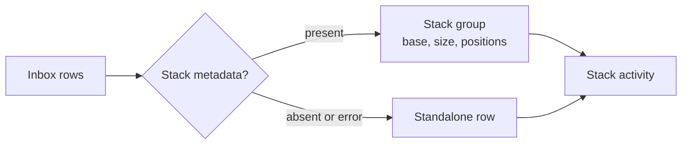

# Use case: review-pull-request-stacks
## Level
!
## Actors
Developer
Supporting: GitHub supplies stack metadata during observation.
## Goal
Review a stack of pull requests as one unit.
## Trigger
The developer opens the inbox and focuses the activity of a stack.
## Preconditions
- Watched pull requests have been observed at least once.
- Stack membership has been recorded for the watched pull requests where GitHub reports it.
- The inbox can read watcher state and the watch scope.
## Main flow
1. Developer opens the inbox; System groups watched pull requests by repository and stack number, ordering each group by stack position.
2. System shows each stack's base and size, its watched members with state and CI, and the stack's aggregated unread count; standalone pull requests keep single rows.
3. Developer focuses a stack; System shows the stack's activity records, including records for watched merged or closed members.
4. Developer marks an activity record read; System updates the record and the stack's unread count.
5. Developer leaves the inbox; System preserves the read state.
## Extensions
- 1a: a watched pull request has no stack metadata → System renders it as a standalone row; protects the metadata-only rule.
- 1b: a stack member is not watched by any configured account → System omits the member, keeps the stack size, and shows the watched positions, which may be non-contiguous; protects the grouping rule.
- 1c: stack metadata arrives for a pull request that was standalone → System moves it into its stack on the next render; protects the grouping rule.
- 1d: stack metadata disappears or a GraphQL stack error occurs → System renders the pull request standalone and does not fail the account observation; protects the minimal guarantee.
- 2a: a stack has no unread activity → System shows it with zero unread; protects the unread-count rule.
- 3a: a stack member is merged or closed → System keeps the member and its activity in the group with the terminal state; protects the grouping rule.
- 3b: the stack base changes after a retarget → System updates the base shown for the group on the next observation; protects the grouping rule.
- 4a: marking read fails → System leaves the record unread and reports the state error; protects the minimal guarantee.
## Rules
- R1. Stack membership comes only from GitHub stack metadata; an absent or null stack means standalone.
- R2. Watched pull requests group by repository and stack number and order by stack position ascending.
- R3. The group shows the stack base and size once; each member shows its position.
- R4. A member not watched by any configured account is omitted; the size still reflects the full stack, so positions may have gaps.
- R5. Activity records group under the stack of their pull request; the group's unread count is the sum of its visible members.
- R6. Standalone pull requests keep the existing inbox presentation and read behaviour.
- R7. A GraphQL stack error or absent field degrades to standalone and never fails the account observation.
- R8. Stack grouping is read-only; passuff never creates, extends, or dissolves a stack.
## Examples
- `acme/api` stack #7 has watched pull requests #41 at position 1 and #42 at position 2, base `main`, size 2: the inbox shows one group with both positions and one unread count.
- Stack #7 has size 3, but only positions 1 and 3 are watched: the group shows positions 1 and 3, notes size 3, and does not invent a row for position 2.
- Pull request #43 has no stack metadata: it appears as a standalone row, not in a one-member stack.
- The repository does not have the stacked-PRs preview: every pull request renders standalone; no account failure.
- A comment arrives on merged member #41: the activity appears under stack #7 with the merged state.
## Minimal guarantee
If stack metadata is absent, malformed, or rejected by GitHub, watched pull requests render as standalone rows; existing inbox content, read state, and unread counts remain correct.
## Success guarantee
The developer sees each stack as one group with its base, size, watched members ordered by position, and the stack's activity; unread counts aggregate per group.
## Personas
- `multi-account-developer`
## Capabilities
- none
## Interactions
| Interaction | Kind |
|---|---|
| Review a stack and its activity | observing |
| Mark an activity record read | changing, shared with the existing inbox goal |
## Includes
- none
## Extends
- `usecase:review-activity-inbox` — when watched pull requests carry stack metadata, group their rows and activity into stack groups.
## Out of scope
- Creating, extending, or dissolving stacks on GitHub.
- Fetching stack metadata directly from the inbox; observation owns the GitHub call.
- Showing stack members that no configured account authored.
- Changing the notification rules for stack members.
## Diagram

