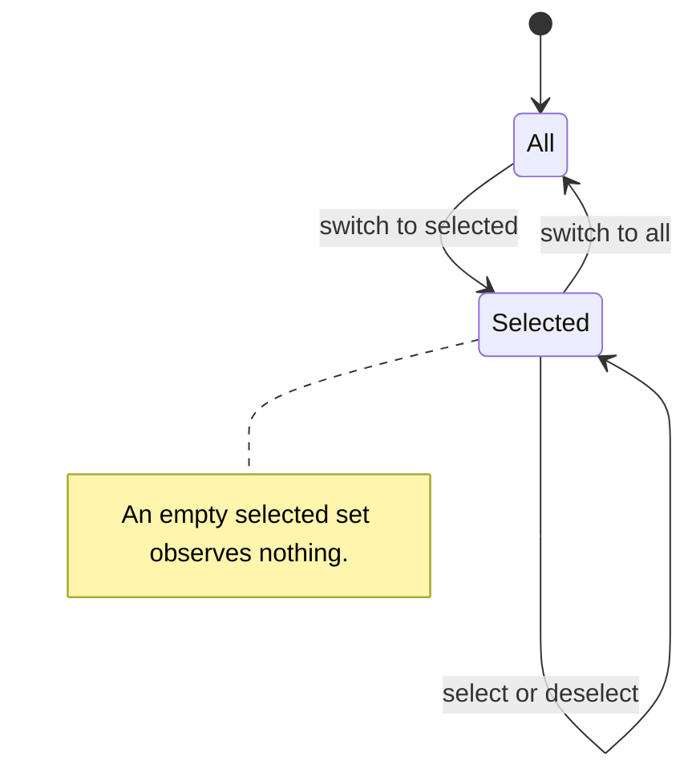

# Use case: change-watch-scope

## Level

!

## Actors

- developer

## Goal

Change which repositories passuff observes.

## Trigger

The developer opens the repository picker in the terminal inbox and changes a selection or the scope mode.

## Preconditions

- A valid configuration exists.
- The terminal UI can read the configuration and watcher state.
- The current scope mode and selected set are loaded.

## Main flow

1. passuff shows the scope mode, the focus relations with their selected state, and the known repositories with their selected state.
2. The developer changes a repository's selection, toggles a focus relation, or switches the scope mode; passuff persists the new scope atomically. Selecting a repository while in all mode switches to selected mode with that repository selected.
3. passuff hides a deselected repository's watched pull requests and activity from the inbox and status, or restores them on selection.
4. If a selected repository has retained records, passuff marks catch-up pending for the next check cycle.
5. A running watcher applies the persisted scope on its next check cycle, and the inbox applies the focus on its next read; the picker shows the updated mode, focus, and selected repositories.

## Extensions

- 1a. No known repositories exist: passuff shows an empty repository list; protects the success guarantee.
- 2a. The developer deselects the last selected repository: selected mode keeps an empty set and observes nothing; status says watching nothing.
- 2b. The focus selection is empty: nothing is shown or notified until a relation is enabled again; fetching is unchanged.
- 2c. Persistence fails: passuff keeps the previous mode, set, focus, and visibility and reports the error.
- 4a. The selected repository has no retained records: no catch-up is marked; the next observation records a baseline.

## Rules

- R1: The watch scope has a mode: all repositories, or selected repositories. A selected set may be empty, meaning no repositories are observed.
- R2: Deselecting a repository hides its watched pull requests and activity from the inbox and status but retains them in watcher state.
- R3: Selecting a repository with retained records restores them and marks catch-up pending for the next check cycle.
- R4: Catch-up records gap activity as unread records without a desktop notification or sound.
- R5: The watch scope is global across configured accounts.
- R6: Known repositories are those seen in an authored or involved pull request or present in the watch scope.
- R7: In all mode the list is informational; switching to selected restores the retained selected set, which may be empty. The selected set is retained while the mode is all.
- R8: A repository entry is `owner/name`, case-insensitive. The format is validated; existence is not checked against GitHub.
- R9: A scope change is persisted atomically and applies to the next check cycle of a running watcher. A failed write leaves the previous mode, set, and visibility.
- R10: A configuration without an explicit scope mode keeps today's meaning: an empty allowlist observes all repositories. An explicit selected mode with an empty set observes none.
- R11: While in all mode, selecting a repository switches to selected mode containing that repository.
- R12: The focus is a set of involvement relations: authored, assigned, review requested from the developer, and review requested from a team the developer belongs to. It defaults to all four.
- R13: The focus never changes observation: every relation is fetched and recorded, and changing the focus neither fetches nor discards. It filters the inbox read model and notification production.
- R14: A watched pull request recorded before this rule has unknown relations and stays visible and notifiable until an observation records them.
- R15: The focus is global across configured accounts, like the repository scope.

## Examples

- The developer switches from all to selected with no retained set: the selected set is empty and the inbox is empty; selecting a repository adds it.
- The developer deselects `acme/api`: its rows disappear from the inbox and status; its records remain in state.
- The developer reselects `acme/api`: its rows return; the next check records a week of comments as unread without a notification or sound.
- The developer deselects the last selected repository: selected mode is empty; status says watching nothing.
- A running watcher's next check cycle observes the new scope without a restart.

## Minimal guarantee

On a failed write, the previous scope mode, selected set, focus, and read-model visibility remain; no partial scope is persisted.

## Success guarantee

The watch scope has the chosen mode, selected set, and focus and is persisted; the inbox and status show exactly the in-scope, in-focus records; a selected repository with retained records has catch-up pending for the next check cycle.

## Personas

- multi-account-developer — a developer with personal and work GitHub accounts who wants to change the watched repositories from the inbox and review catch-up activity.

## Capabilities

- watch-scope

## Interactions

| Capability | Consumer action | E2E scenario |
|---|---|---|
| watch-scope | toggle a repository in the watch scope | Developer toggles a repository in the watch scope |
| watch-scope | switch the watch scope mode | Developer switches the watch scope mode |
| watch-scope | narrow the focus to a subset of involvement relations | Developer narrows the focus in the watch scope |

## Includes

- none

## Extends

- none

## Out of scope

- Per-account watch scope.
- A full readable-repository catalog.
- GitHub Projects boards.
- Changing stack grouping or normal notification delivery.
- Creating or modifying repositories on GitHub.

## Diagram

