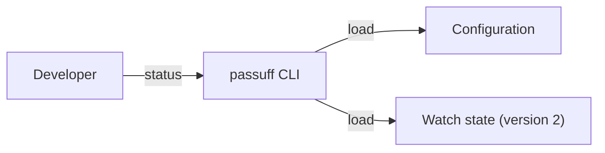

# Use case: inspect-watch-status

## Level

!

## Actors

- developer

## Goal

The developer sees which accounts, watch scope, and pull requests are watched and how much recorded activity is unread.

## Trigger

The developer asks passuff for status.

## Preconditions

- A valid configuration exists.
- A state file may or may not exist; a missing state is an empty watch.

## Main flow

1. passuff loads the configuration and the persisted watch state.
2. The developer sees every configured account, its resolved login, and its last observation time.
3. The developer sees the watch scope.
4. The developer sees every watched pull request with its state and CI result.
5. The developer sees the number of unread activity records and the total retained.

## Extensions

- 1a. The configuration is invalid: passuff reports the configuration error and exits 2.
- 1b. The state cannot be read or migrated: passuff reports the state error and exits 3.
- 1c. No state file exists: passuff shows "not resolved", "never", no watched pull requests, and 0 unread of 0; exit 0.

## Rules

- S1: Status lists every configured account with its resolved login, or "not resolved" when the account has not been observed, and its last observation time, or "never".
- S2: Status states the watch scope: "all authored pull requests", "watching nothing" for an empty selected scope, or the configured repository list.
- S3: Status lists every watched pull request with repository and number, human state (open, merged, closed), CI result (passing, failing, pending, not started), and title.
- S4: Status reports unread and total activity records.
- S5: Status never contacts GitHub and never changes the watch state, except the version-1 to version-2 rewrite.
- S6: Status with no state file shows the empty sections and exits 0.
- S7: A configuration error exits 2; a state read or migration error exits 3; success exits 0.

## Examples

- Two accounts, all repositories, three watched PRs, and two unread records.
- One account, `repositories = ["acme/api"]`, and a PR in `acme/web` absent from status.
- No state: `personal not resolved`, `last check never`, `no watched pull requests`, `0 unread of 0`.

## Minimal guarantee

Status never reports a login or pull request that is not present in the configuration or the persisted state.

## Success guarantee

The developer can see the watched accounts, scope, pull requests, and unread count without contacting GitHub.

## Personas

- multi-account-developer — a developer with personal and work GitHub accounts who wants alerts only for pull requests they authored, on macOS and Linux.

## Capabilities

- watch-status

## Interactions

| Capability | Consumer action | E2E scenario |
|---|---|---|
| watch-status | show the watch state | Developer sees the watch state |

## Includes

- none

## Extends

- none

## Out of scope

- Listing and reading individual activity records (review-activity-inbox).
- The terminal UI (next change).
- Editing configuration.

## Diagram

