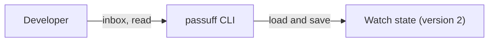

# Use case: review-activity-inbox

## Level

!

## Actors

- developer

## Goal

The developer reviews the activity passuff recorded and marks it read.

## Trigger

The developer lists the inbox or marks activity read.

## Preconditions

- A valid configuration exists.
- A state file may or may not exist; a missing state is an empty inbox.

## Main flow

1. passuff loads the configuration and the persisted watch state.
2. The developer lists unread activity newest first, or all activity.
3. The developer marks one activity or all activity read.

## Extensions

- 1a. The configuration is invalid: passuff reports the configuration error and exits 2.
- 1b. The state cannot be read, migrated, or written: passuff reports the state error and exits 3.
- 3a. The named activity does not exist: passuff reports the unknown id and exits 2.

## Rules

- R1: `inbox` lists unread activity newest first with when the activity happened, the pull request, the event summary, and the read state. An activity with no reported time shows its fetch time marked approximate with a leading `~`; the order follows the shown time.
- R2: `inbox --all` lists unread and read activity newest first.
- R3: `read <id>` marks one activity record read and reports the new unread count; an unknown id is refused with exit 2.
- R4: `read --all` marks every activity record read and reports the number changed.
- R5: Activity is recorded as one record per event, persists across restarts, and is capped at the 500 most recent records.
- R6: Read state persists across restarts and is independent of notification delivery.
- R7: A version-1 state loads with an empty history, preserves its watched pull requests, and is rewritten as version 2.
- R8: A missing state file is an empty inbox and exit 0.
- R9: The inbox, the status unread count, and the watched table show only pull requests whose involvement relations intersect the focus; a relation that is neither recorded nor derivable from the author leaves a pull request visible. Activity outside the focus is retained and appears when the focus widens.
- R9: Recording history never replays a notification.
- T1: The terminal UI shows the unread and total activity counts, configured accounts, watch scope, watched pull requests, and the activity list on one screen.
- T2: `j`/down and `k`/up move the selection and clamp at the list ends; Home and End jump to the first and last row; `q` quits, and Escape or `q` closes the focused dialog.
- T3: `r` marks the selected activity record read and refreshes the view; `a` marks every record read and refreshes.
- T4: An empty inbox shows "no activity yet".
- T5: A configuration error exits 2 and a state error exits 3 before the interface starts; the message names the failure.
- T6: `--snapshot` renders one frame to stdout with the same renderer and data and exits 0 without a terminal.
- T7: The screen contains no token, no more than the recorded 80-character event excerpt, no helper command text, and no enum name.
- T8: `Tab`/`Shift-Tab` cycles focus between the watched pull request pane and the activity pane; the footer names the focused pane.
- T9: `j`/`k` and the arrow keys move the selected row in the focused pane; the watched table scrolls to keep the selection visible, including large stacks; the activity selection clamps.
- T10: The terminal inbox observes the configured accounts while it is open and shows the result without a keypress or another command; it probes GitHub for a change, observes only the selected target pull requests, and preserves the selected pull request and clamps a vanished selection. A configured reconciliation interval also observes every watched open pull request and every open assigned or review-requested pull request, and defaults to one hour.
- T11: A refresh never changes focus or replays a notification.
- T12: The inbox paces observation against the account's remaining API allowance; it never spends the allowance faster than it is replenished.
- T13: A failed observation keeps the last view and is retried without ending the program.
- T14: Enter on the focused activity opens a detail popup with the recorded id, event summary, the occurrence time and the fetch time, read state, the pull request's key, title, state, CI result, and stack position, and the selected comment or review body in full, rendered as Markdown; the metadata values are muted, a rule separates them from the indented body, and `j`/`k`, the arrow keys, `PgUp`/`PgDn`, and `Home`/`End` scroll it.
- T15: Escape or `q` closes the detail popup and returns to the unchanged inbox.
- T16: Enter in the detail popup opens the pull request's URL in the system browser and closes the popup; a launch failure keeps the popup open and reports the failure.
- T17: Enter outside the activity pane, or with no selected activity, changes nothing.
- T18: `s` cycles the watched sort between updated, name, state, and age; `S` reverses the direction; stacks keep their members in position order.
- T19: `f`/`F` filter the activity list to the selected pull request or its stack, and `u` filters it to unread records; `c` clears both filters; the count shows the filtered unread and total plus the unfiltered total.
- T20: `a` marks the visible activity records read; with no filter it marks all records.
- T21: `h`/`H`/`F1` shows the key reference for the focused pane; Escape or `q` closes it.
- T22: `C` resets the sort, direction, activity filters, and ignored view. Sort, direction, filters, ignored view, and notification settings persist across runs when the developer confirms saving on exit.
- T23: The watched table shows a pull request key with its significant end (a leading ellipsis when the column truncates it) and its creator and assignees; when the creator is also an assignee or none is assigned, one login is shown. The `☰` stack column appears only when a visible pull request is stacked, and the `☺` people column is as wide as its longest label.
- T24: Enter on the focused watched pull request opens its metadata dialog; the status, CI, creator, and assignee share two rows with muted values, a rule separates the metadata from the indented description, and the description keeps its line and paragraph breaks (consecutive blank lines collapse to one), renders a Markdown subset (headings green and bold without markers, bullet and numbered lists with hanging indents, task boxes, code fences dimmed without the fences, horizontal rules, inline emphasis and code markers removed, links reduced to their text, HTML comments removed), and scrolls with `j`/`k`, the arrow keys, `PgUp`/`PgDn`, and `Home`/`End`, which jump to its top and bottom; Escape or `q` closes it.
- T25: The terminal interface follows watn's palette: dim borders; cyan-blue labels, key hints, and table headers; bold key hints; gold selected rows and attention text; green focus borders and Markdown headings; muted metadata values; bright-gray description and activity body text.
- T27: An ignored pull request remains in the watched list in both views, prefixed with `⊘` and dimmed, while its activity is hidden in the filtered view and shown in the all view. The footer's `x` control reads `unignore` while the selected row is ignored.
- T26: `,` opens the settings dialog; `j`/`k` or the arrow keys select desktop notifications or sound, `space`/`Enter` toggles the selected surface, and `esc` closes it. The settings persist in `ui.json`, default to on, and apply immediately to the live inbox delivery; Escape or `q` closes the dialog.
- T28: The activity table's `When` column shows when the activity happened as `MM-DD HH:MM`; an activity with no reported time shows its fetch time prefixed with `~`. The detail popup shows `When:` with the same value and adds `Fetched:` beside it when the fetch time differs; an approximate activity reads `When: ~MM-DD HH:MM (fetch time)` instead.

## Examples

- Two unread records are listed newest first; after `read --all`, the inbox reports no unread activity.
- A version-1 state with one watched PR loads with zero records and keeps the PR.
- The 501st record drops the oldest.

## Minimal guarantee

The inbox never shows activity for a pull request that was outside the watch scope when the activity was observed.

## Success guarantee

The developer can review the retained activity and mark it read; the history and read state survive restarts without replaying notifications.

## Personas

- multi-account-developer — a developer with personal and work GitHub accounts who wants alerts only for pull requests they authored, on macOS and Linux.

## Capabilities

- activity-inbox
- inbox-navigation

## Interactions

| Capability | Consumer action | E2E scenario |
|---|---|---|
| activity-inbox | list unread activity | Developer lists unread activity |
| activity-inbox | mark activity read | Developer marks activity read |
| activity-inbox | open the inbox in the terminal UI | Developer opens the inbox TUI |
| activity-inbox | open an activity's detail | Developer opens an activity's details |
| activity-inbox | open the pull request from an activity | Developer opens the pull request from an activity |
| inbox-navigation | navigate the watched pull requests and activity, with automatic refresh | Developer navigates the inbox panes |
| inbox-navigation | leave the inbox open while activity arrives | The inbox shows activity observed while it is open |

## Includes

- none

## Extends

- none

## Out of scope

- The status summary (inspect-watch-status).
- A separately distributed `passuff-tui`; the interface ships as a second binary in the same package as `passuff`.
- Editing configuration or deleting history.

## Diagram

