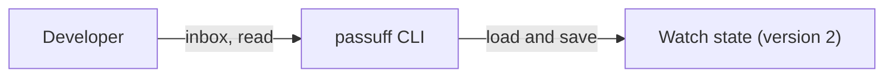

# Use case: review-activity-inbox

## Level

!

## Actors

- developer

## Goal

The developer reviews the activity passuff recorded and marks it read.

## Trigger

The developer lists the inbox or marks activity read.

## Preconditions

- A valid configuration exists.
- A state file may or may not exist; a missing state is an empty inbox.

## Main flow

1. passuff loads the configuration and the persisted watch state.
2. The developer lists unread activity newest first, or all activity.
3. The developer marks one activity or all activity read.

## Extensions

- 1a. The configuration is invalid: passuff reports the configuration error and exits 2.
- 1b. The state cannot be read, migrated, or written: passuff reports the state error and exits 3.
- 3a. The named activity does not exist: passuff reports the unknown id and exits 2.

## Rules

- R1: `inbox` lists unread activity newest first with the observation time, pull request, event summary, and read state.
- R2: `inbox --all` lists unread and read activity newest first.
- R3: `read <id>` marks one activity record read and reports the new unread count; an unknown id is refused with exit 2.
- R4: `read --all` marks every activity record read and reports the number changed.
- R5: Activity is recorded as one record per event, persists across restarts, and is capped at the 500 most recent records.
- R6: Read state persists across restarts and is independent of notification delivery.
- R7: A version-1 state loads with an empty history, preserves its watched pull requests, and is rewritten as version 2.
- R8: A missing state file is an empty inbox and exit 0.
- R9: Recording history never replays a notification.

## Examples

- Two unread records are listed newest first; after `read --all`, the inbox reports no unread activity.
- A version-1 state with one watched PR loads with zero records and keeps the PR.
- The 501st record drops the oldest.

## Minimal guarantee

The inbox never shows activity for a pull request that was outside the watch scope when the activity was observed.

## Success guarantee

The developer can review the retained activity and mark it read; the history and read state survive restarts without replaying notifications.

## Personas

- multi-account-developer — a developer with personal and work GitHub accounts who wants alerts only for pull requests they authored, on macOS and Linux.

## Capabilities

- activity-inbox

## Interactions

| Capability | Consumer action | E2E scenario |
|---|---|---|
| activity-inbox | list unread activity | Developer lists unread activity |
| activity-inbox | mark activity read | Developer marks activity read |

## Includes

- none

## Extends

- none

## Out of scope

- The status summary (inspect-watch-status).
- The terminal UI (next change).
- Editing configuration or deleting history.

## Diagram

