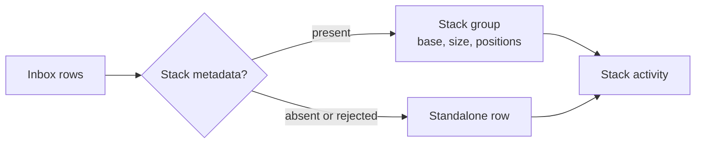

# Use case: review-pull-request-stacks

## Level

!

## Actors

- developer
- Supporting: GitHub supplies stack membership during observation.

## Goal

The developer reviews a stack of pull requests as one unit.

## Trigger

The developer opens the inbox and reviews the activity of a stack.

## Preconditions

- A valid configuration exists.
- Watched pull requests have been observed at least once.
- Stack membership has been recorded for watched pull requests where GitHub reports it.
- The inbox can read watcher state and the watch scope.

## Main flow

1. passuff loads the configuration and the persisted watch state.
2. passuff groups watched pull requests by repository and stack number and orders each group by stack position.
3. passuff orders stack members by position and shows position/size on each member; the stack's base appears in the pull request detail; standalone pull requests keep single rows.
4. The developer marks an activity record read.
5. passuff updates the record and the total unread count.

## Extensions

- 2a. A watched pull request has no stack metadata: passuff renders it as a standalone row; protects R1.
- 2b. A stack member is not watched by any configured account: passuff omits the member, keeps the stack size, and shows the watched positions, which may have gaps; protects R4.
- 2c. Stack metadata arrives for a pull request that was standalone: passuff moves it into its stack on the next render; protects R2.
- 2d. Stack metadata disappears or GitHub rejects the stack field: passuff renders the pull request standalone and does not fail the account observation; protects R7.
- 3b. A stack member is merged or closed: passuff keeps the member and its activity in the group with the terminal state; protects R3.
- 4a. Marking read fails: passuff leaves the record unread and reports the state error; protects the minimal guarantee.

## Rules

- R1: Stack membership comes only from GitHub-reported stack metadata; an absent or null stack means standalone.
- R2: Watched pull requests group by repository and stack number and order by stack position ascending.
- R3: Each stack member shows position/size; the stack's base appears in the pull request detail.
- R4: A member not watched by any configured account is omitted; the size still reflects the full stack, so positions may have gaps.
- R5: Activity records carry the stack label of their pull request; the inbox shows the total unread count.
- R6: Standalone pull requests keep the existing inbox presentation and read behaviour.
- R7: A GitHub rejection of stack metadata degrades to standalone and never fails the account observation.
- R8: Stack grouping is read-only; passuff never creates, extends, or dissolves a stack.
- R9: This use case extends `review-activity-inbox` only when watched pull requests carry stack metadata; otherwise the base inbox behavior applies.

## Examples

- `acme/api` stack 7 has watched pull requests #41 at position 1 and #42 at position 2, base `main`, size 2: the members show `1/2` and `2/2`; the detail shows `base main`.
- Stack 7 has size 3, but only positions 1 and 3 are watched: the rows show `1/3` and `3/3`; no row is invented for position 2.
- Pull request #43 has no stack metadata: it appears as a standalone row, not a one-member stack.
- A repository without the stacked-PRs preview renders every pull request standalone; the account observation still succeeds.
- A comment arrives on merged member #41: the activity appears under stack 7 with the merged state.

## Minimal guarantee

If stack metadata is absent, malformed, or rejected by GitHub, watched pull requests render as standalone rows; existing inbox content, read state, and unread counts remain correct.

## Success guarantee

The developer sees each stack as one group with its base, size, watched members ordered by position, and the stack's activity; the group shows an aggregated unread count.

## Personas

- multi-account-developer — a developer with personal and work GitHub accounts who uses stacked pull requests and wants to review a stack as one unit.

## Capabilities

- stacked-inbox

## Interactions

| Capability | Consumer action | E2E scenario |
|---|---|---|
| stacked-inbox | review a stack and its activity | Developer reviews a stacked inbox |

## Includes

- none

## Extends

- usecase:review-activity-inbox

## Out of scope

- Creating, extending, or dissolving stacks on GitHub.
- Fetching stack metadata directly from the inbox; observation owns the GitHub call.
- Showing stack members that no configured account authored.
- Changing notification rules for stack members.
- Ref-chain inference when GitHub reports no stack.

## Diagram

