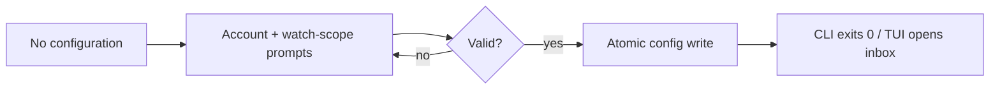

# Use case: set-up-passuff

## Level

!

## Actors

- developer

## Goal

Set up passuff on this machine.

## Trigger

The developer runs `passuff setup`, or starts `passuff-tui` when the configuration file is missing.

## Preconditions

- The configuration file is missing, or the developer confirms replacing it.
- The setup surface can read input and write the configuration path.

## Main flow

1. passuff asks for the configuration path when it is not the default.
2. passuff asks for an account label, credential mode, and expected GitHub login.
3. passuff asks whether to add another account; the developer may repeat step 2.
4. passuff asks for the watch scope: all repositories or a selected set.
5. passuff validates the answers and writes the configuration atomically.
6. `passuff setup` exits 0; `passuff-tui` continues to the inbox.

## Extensions

- 1a. The configuration already exists: passuff asks before replacing it; a negative answer exits 0 without writing.
- 2a. A credential mode or expected login is invalid: passuff reports the problem and asks again.
- 2b. A token file is missing or readable by group/other users: passuff reports the problem and asks again.
- 3a. A selected repository is malformed or duplicated: passuff reports the problem and asks again.
- 5a. The configuration directory cannot be created or the atomic write fails: passuff reports the error and exits 3; no partial configuration remains.
- 6a. `passuff-tui` has no terminal: it prints that `passuff setup` must run and exits 2; it does not prompt.

## Rules

- R1: Setup runs when the configuration is missing, or after an explicit confirmation to replace it.
- R2: An account declares a label, a credential mode, and the expected GitHub login for gh OAuth accounts.
- R3: A token value is never read into or written to the configuration; only an environment variable name, a helper command, or a token-file path is stored.
- R4: A token file must be absolute or `~`-prefixed and not readable or writable by group or other users.
- R5: The watch scope is all repositories or a selected set; a selected set is validated as `owner/name` and deduplicated case-insensitively.
- R6: The configuration is validated before writing and written through a temporary file in the target directory plus rename; parent directories are created.
- R7: `passuff setup` writes the configuration and exits 0 without starting a watcher.
- R8: `passuff-tui` starts the same setup flow when the configuration is missing and the terminal is interactive; a non-interactive run names `passuff setup` and exits 2.
- R9: The created configuration is immediately usable by `passuff check`, `passuff status`, and `passuff-tui`.

## Examples

- A fresh machine runs `passuff setup`, enters `personal`, `gh_oauth`, `octo-personal`, and `all`; `~/.config/passuff/config.toml` is created and the TUI opens.
- A work account uses `token_env` with `WORK_TOKEN`; the configuration stores the variable name, not the token.
- An existing configuration is preserved when the developer answers no to replacement.
- A token file readable by others is rejected and the prompt repeats.
- `passuff-tui --snapshot` without a terminal and without a config prints the `passuff setup` hint and exits 2.

## Minimal guarantee

On invalid input, a failed write, or a negative replacement answer, the previous configuration (if any) is unchanged and no partial file remains.

## Success guarantee

A validated configuration exists at the chosen path, contains no token value, and is immediately usable by the CLI and the terminal UI.

## Personas

- multi-account-developer — a developer setting up passuff for personal and work GitHub accounts.

## Capabilities

- initial-setup

## Interactions

| Capability | Consumer action | E2E scenario |
|---|---|---|
| initial-setup | set up passuff on first run | Developer sets up passuff on first run |

## Includes

- none

## Extends

- none

## Out of scope

- Editing or deleting accounts after setup.
- Migrating an existing configuration to the setup flow.
- Browser onboarding.
- Verifying every credential against GitHub during setup.

## Diagram

