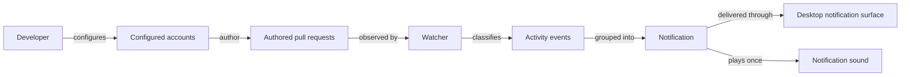

# Use case: watch-pull-requests

## Level

!

## Actors

- developer

## Goal

The developer is notified when something they care about changes on a pull request they authored, across every configured GitHub account, without being disturbed by their own actions, code pushes, or other people's pull requests.

## Trigger

The developer starts the watcher, or runs a single check pass.

## Preconditions

- At least one GitHub account is configured with a credential source; an interactive continuous watch may obtain a gh credential during the flow.
- Each configured account can read the repositories that contain its authored pull requests.

## Main flow

1. The watcher resolves each configured account through its declared credential mode to its GitHub login and forms the configured login set.
2. The watcher observes the pull requests authored by the configured login set that the watch scope allows.
3. On the first observation of an open pull request, the watcher records a baseline and reports no activity. A short-lived closed pull request is handled by R27.
4. On each later observation, the watcher compares the pull request with its recorded observation.
5. The watcher classifies eligible changes into activity events, including the R27 short-lived state change.
6. The watcher groups the activity events for one pull request into one notification.
7. The watcher always prints the terminal transcript. When desktop notification is enabled it also displays a desktop message; when sound is enabled it plays the configured sound once.
8. The watcher records the observed activity so it is not reported again.

## Extensions

- 1a. A runtime credential value is missing or invalid, or the account cannot be reached: the watcher reports the account failure and continues with the remaining accounts. `check` exits 1; continuous mode retries. A configuration with no credential source at all is a configuration error (R19).
- 1b. A gh OAuth session is missing in an interactive continuous watch: the watcher starts gh's browser login once for that account, then retries the account. A failed or abandoned login is an account failure (R38).
- 1c. A credential belongs to a login other than the expected one: the watcher reports the account failure with both logins and does not process that account's observation (R36).
- 2a. No authored pull requests exist: the watcher reports no notifications and completes the pass.
- 4a. The persisted observation is corrupt or has an unknown version: the watcher sets it aside, records a fresh baseline, and continues. A permission or I/O failure that prevents reading, writing, or quarantining exits 3 in `check` mode.
- 5a. A change is an own action, a commit push, or activity on a pull request outside the watched set: the watcher notifies nothing; an own action is still recorded as read.
- 7a. The desktop notification surface is unavailable: the watcher reports the failure, keeps the terminal transcript, and continues.
- 7b. The configured sound cannot be played: the watcher reports the failure and still delivers the desktop notification and transcript.

## Rules

- R1: The configured login set is the union of the GitHub logins discovered for all configured accounts whose credential matched their expected login.
- R2: An authored pull request is a pull request whose author login belongs to the configured login set.
- R3: A conversation comment by a login outside the configured login set produces a notification.
- R4: A review comment by a login outside the configured login set produces a notification.
- R5: A submitted review by a login outside the configured login set produces a notification, whatever the review state.
- R6: A CI result transition to failing or erroneous produces a notification.
- R7: A CI result transition from failing or erroneous to successful produces a notification.
- R8: A transition of an authored pull request to merged or closed produces a notification, regardless of which actor merged or closed it.
- R9: A comment or review by a login in the configured login set produces no notification; it is recorded as read so the activity history stays complete. Own actions are comments and reviews, not state changes.
- R10: A commit or push to the pull request branch produces no notification.
- R11: Activity on a pull request authored by a login outside the configured login set produces no notification.
- R12: A bot-authored comment produces no notification unless bot comments are enabled.
- R13: All new activity for one pull request in one observation pass is grouped into one notification; the sound plays once for that notification.
- R14: The first observation of an authored pull request records a baseline without notifying about existing activity, except the R27 short-lived state change.
- R15: Already notified activity is never notified again, including after a restart.
- R16: A known authored pull request merged or closed while the watcher was stopped is notified on the next observation.
- R17: A failed account is reported and the remaining accounts are still observed.
- R18: A corrupt persisted observation is set aside and replaced with a fresh baseline; the watcher continues.
- R19: Invalid configuration, including a missing credential source, exits with status 2.
- R20: Desktop notification and sound can be disabled independently.
- R21: The one-shot check performs one observation pass, reports every notification it would deliver, and exits.
- R22: The continuous watcher observes at the configured interval until interrupted.
- R23: Each event family (comments, reviews, CI failure, CI recovery, state changes) can be disabled independently; disabling suppresses that family. The comments family covers conversation comments and review comments; the reviews family covers submitted reviews.
- R24: The configured sound is played once per notification when sound is enabled; disabling sound suppresses audio independently of the desktop notification.
- R25: Label, draft, assignee, milestone, and base-branch changes produce no notification.
- R26: A pull request first observed after the account's first cycle records a baseline without notifying about its existing activity, except the R27 short-lived state change.
- R27: A pull request created after the account's last successful observation and merged or closed between observations produces one state-change notification.
- R28: Reopening an authored pull request resets its state-change report flag without a notification; a later merge or close notifies again. Known closed or merged pull requests remain tracked for 30 days so a reopen is observed.
- R29: A missing runtime credential value or an invalid credential is an account failure; `check` exits 1 and continuous mode reports it and retries.
- R30: A state read, write, or quarantine failure that cannot be recovered in `check` exits with status 3. A corrupt or unknown-version state is quarantined and replaced, not treated as an error.
- R31: `check` exits 0 when all accounts were observed, 1 when at least one account failed, 2 for configuration or CLI errors, and 3 for a core state failure.
- R32: An account selects exactly one credential source: a gh OAuth session with an expected login, or a personal access token from exactly one of an environment variable, a helper command, or a token file. Declaring more than one source, a gh OAuth account without an expected login, or a literal token is a configuration error that exits with status 2.
- R33: A gh OAuth account names its expected GitHub login and obtains its token from the operator's gh session for that login.
- R34: A gh OAuth account whose gh session is missing starts gh's browser login once per gh login when the continuous watcher runs interactively. The one-shot check and every non-interactive run never start a browser login and report the account failure instead.
- R35: A personal access token file is used only when group and other users cannot read or write it; a leading `~` names the operator's home directory. A missing token file is an account failure; insecure permissions are a configuration error.
- R36: When an account declares its expected login, a credential belonging to a different login, compared case-insensitively, is an account failure that names both logins, and no pull requests are processed for that account.
- R37: An account configured with only an environment variable or a helper command, with no declared mode, remains a personal access token account.
- R38: A failed or abandoned browser login is reported as an account failure and is attempted at most once per gh login per process; the remaining accounts are still observed.
- R39: When a repository scope excludes a repository, an authored pull request outside it is not observed or notified; already watched pull requests and activity are hidden from the inbox and status but retained in state.
- R40: Activity on an already-merged or already-closed watched pull request does not notify. The transition that made it terminal, a short-lived pull request (R27), and a reopen (R28) are still reported.
- R41: A check cycle observes only the pull requests selected from the change probe and the discovery search; a reconciliation pass observes every watched open pull request and every open assigned or review-requested pull request.
- R42: `notify-test` sends one test notification through the configured desktop and sound surfaces, reports the result of each enabled surface, exits 0 when every enabled surface succeeds, 1 when an enabled surface fails, and 2 for a configuration error or when both surfaces are disabled. On macOS the desktop notification is delivered through Notification Center via `osascript`.
- R43: `--no-desktop` and `--no-sound` suppress the corresponding notification surface for that run without changing the configuration; both `passuff` and `passuff-tui` accept them, and `notify-test` respects them.

## Examples

- A comment by @alice on acme/api#42, authored by the configured personal account, notifies once.
- A comment by the configured work account on the personal account's pull request stays silent.
- A CI failure on acme/api#42 notifies; a later success notifies once as a recovery.
- A pull request created and merged between two checks notifies once as merged.
- A merge of the developer's own pull request notifies once; own comments and reviews stay silent.
- Disabling the comments event family silences new comments but not CI failures.
- A work account without a gh session opens a browser login on start, then watches its pull requests.
- A token file readable by other local users is refused before any observation.
- `passuff notify-test` shows a Notification Center banner and plays the configured sound; disabling both surfaces exits 2.
- `passuff --no-sound check` reports the notification in the terminal without playing the sound; the configuration keeps `sound = true`.

## Minimal guarantee

The watcher never notifies about activity on a pull request that was not authored by a configured account.

## Success guarantee

The developer receives one grouped desktop notification with sound, when both are enabled, for each eligible set of new activity on an authored pull request, and receives no notification for own comments or reviews, code pushes, other people's pull requests, or activity that existed before the baseline.

## Personas

- multi-account-developer — a developer with personal and work GitHub accounts who wants alerts only for pull requests they authored, on macOS and Linux.

## Capabilities

- pr-activity-notification

## Interactions

| Capability | Consumer action | E2E scenario |
|---|---|---|
| pr-activity-notification | start continuous watching | Developer starts watching and is notified of a new comment |
| pr-activity-notification | run one observation pass | Developer runs a single check and sees the current activity |
| pr-activity-notification | show usage | Developer asks for usage |
| pr-activity-notification | show version | Developer asks for the version |

## Includes

- none

## Extends

- none

## Out of scope

- Webhooks, a public endpoint, or a hosted service.
- Notifications for review requests, mentions, or activity on pull requests the developer did not author.
- Notifications for code changes, diffs, or commits.
- Replying to comments, approving, merging, or otherwise changing GitHub state.
- Mobile push, email, Slack, Telegram, or other external delivery channels.
- Windows desktop support.
- A graphical interface, tray icon, or installer.
- A TUI; it is a separate follow-up use case.
- Per-account repository scopes; the first watch scope is one global allowlist.
- Activity history, read state, and status; these are separate use cases.
- Replaying activity that existed before the first observation of an account. The R27 short-lived state change is not a replay; it is a newly created pull request's terminal state.

## Diagram

